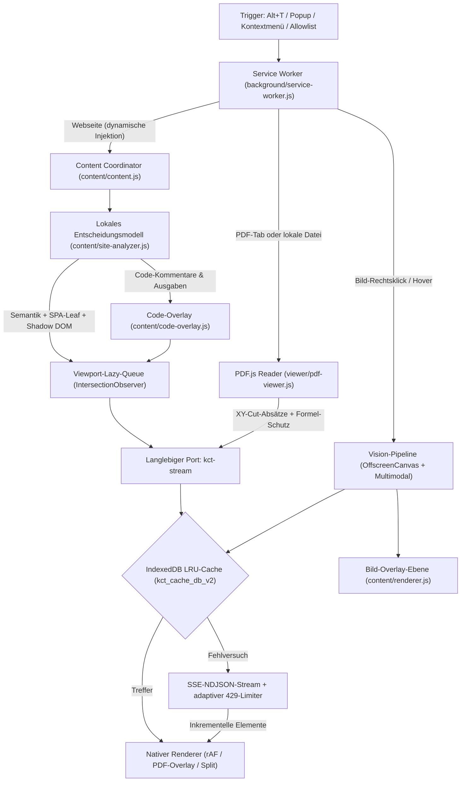

# NativeRead

[English](README.md) · [繁體中文](README.zh-TW.md) · [简体中文](README.zh-CN.md) · [日本語](README.ja.md) · [한국어](README.ko.md) · [Español](README.es.md) · [Français](README.fr.md) · **Deutsch**

**NativeRead (v2.2.0)** ist eine Manifest-V3-Browsererweiterung und mobile PWA, die Webseiten, PDFs, Code-Kommentare und eingebettete Infografiken übersetzt und dabei die ursprüngliche Typografie und das Layout der Seite beibehält. Sie bleibt standardmäßig im Hintergrund, läuft bei Bedarf mit Ihrem eigenen LLM-API-Schlüssel und streamt Übersetzungen Absatz für Absatz, ohne den Lesefluss zu unterbrechen.

---

## 1. Produktübersicht & Schnellstart

### Hauptfunktionen

| Funktion | Funktionsweise | Leseerlebnis |
| --- | --- | --- |
| **Standardmäßig stille Web-Übersetzung** | Keine statischen `content_scripts`; wird bei Bedarf dynamisch über `chrome.scripting` injiziert (`Alt+T`, Popup-Button, Kontextmenü oder seitenweise Allowlist `autoTranslateHosts`). | Null Overhead, keine schwebende UI und keine API-Nutzung auf Seiten, die Sie nicht übersetzen. |
| **Integrierter PDF.js-Reader** | Bündelt lokales Apache-2.0 `PDF.js` (`vendor/pdfjs/`) in `viewer/pdf-viewer.html`; unterstützt Remote-PDFs, Google-Drive-Links und lokales `.pdf`-Drag-and-Drop. | Wechsel zwischen **Overlay**-, **Split**- und **Original**-Modus (`1` / `2` / `3`); Abbildungen, Tabellen und abgesetzte Formeln bleiben erhalten. |
| **Google-Drive-PDF-In-Page-Overlay** | Erkennt `.ndfHFb-c4YZDc-cYSp0e-DARUcf`-Viewer-Ebenen direkt vor Ort, führt Textfelder derselben Spalte zusammen, baut Inhaltsverzeichnis-Führungspunkte neu auf und misst native Glyphenmetriken aus Seitenrastern. | Übersetzt mehrseitige Drive-PDFs direkt in Google Drive, ohne den Tab zu verlassen. |
| **On-Demand-Bild- & Infografik-Overlay** | Strikt auf Abruf per Rechtsklick (**NativeRead Translate Image Text**) oder Hover-Pill (**譯圖**) auf Bildern `>= 200x140` px; scannt niemals automatisch Seitenbilder. | Ersetzt Textblöcke direkt an Ort und Stelle mit abgetasteten Hintergrund-/Vordergrundfarben und bewahrt dabei 3D-Diagramme und Illustrationen. |
| **Code-Kommentare & Notebook-Ausgaben** | Zerstörungsfreier CSS-`attr()`-Tausch für statische `<pre>`-Blöcke (Pygments, Prism, Highlight.js, GitHub `.pl-c`), schreibgeschütztes Overlay für CodeMirror 6 (`.cm-editor`) und Schnellübersetzungs-Buttons für Jupyter-Ausgaben. | Code bleibt editierbar und ausführbar; Overlays blenden sich automatisch aus, wenn Sie einen Editor fokussieren oder in den Originalmodus wechseln. |
| **Mobil & Plattformübergreifend** | Bietet eine eigenständige mobile PWA (`docs/`), ein universelles Userscript (`docs/nativeread.user.js`), ein Android-Erweiterungs-ZIP (`docs/nativeread-android-extension.zip`) und lokale QR-Code-`#nr_sync`-Synchronisation. | Vollständiger Übersetzungs-Workflow auf iOS Safari und Android-Browsern ohne erneutes Eintippen von API-Schlüsseln. |

### Schnellstart (Desktop-Erweiterung)

Erfordert Chromium 119+ (Chrome, Edge, Brave oder kompatible Browser).

1. Repository klonen:
   ```bash
   git clone https://github.com/Chih-Kai-Wang/native-read.git
   ```
2. `chrome://extensions/` (oder `edge://extensions/`) öffnen und den **Entwicklermodus** aktivieren.
3. Auf **Entpackte Erweiterung laden** klicken und das geklonte Verzeichnis `native-read` auswählen.
4. Auf das **NativeRead**-Symbol in der Symbolleiste klicken → **Optionen**, einen Modellanbieter wählen, API-Schlüssel eingeben, auf **Test Connection** klicken und speichern.
5. Übersetzung auf einer beliebigen Webseite oder einem PDF-Tab mit **`Alt+T`**, dem Popup-Button oder dem Rechtsklick-Menü auslösen. Auf `☆` / `★` im Popup oder in der schwebenden Pill klicken, um die aktuelle Domain zur Auto-Translate-Allowlist hinzuzufügen oder daraus zu entfernen.

### Unterstützte Modellanbieter

Konfiguriert in `shared/config.js` (`PROVIDER_PRESETS`). Lokale Endpunkte (`localhost`, `127.0.0.1`, `0.0.0.0`) benötigen keinen API-Schlüssel.

| Provider ID | Protokoll | Standard-Basis-URL | Standardmodell |
| --- | --- | --- | --- |
| `deepseek` | OpenAI | `https://api.deepseek.com/v1` | `deepseek-chat` |
| `openai` | OpenAI | `https://api.openai.com/v1` | `gpt-4o-mini` |
| `gemini` | Gemini Native | `https://generativelanguage.googleapis.com/v1beta` | `gemini-3.5-flash-lite` |
| `qwen` | OpenAI | `https://dashscope.aliyuncs.com/compatible-mode/v1` | `qwen-plus` |
| `siliconflow` | OpenAI | `https://api.siliconflow.cn/v1` | `deepseek-ai/DeepSeek-V3` |
| `moonshot` | OpenAI | `https://api.moonshot.cn/v1` | `moonshot-v1-8k` |
| `zhipu` | OpenAI | `https://open.bigmodel.cn/api/paas/v4` | `glm-4-flash` |
| `openrouter` | OpenAI | `https://openrouter.ai/api/v1` | `google/gemini-2.5-flash` |
| `custom` | OpenAI | `http://localhost:11434/v1` | `qwen2.5:7b` |

- **Zielsprachen**: `zh-TW` (Standard), `zh-CN`, `ja`, `ko`, `es`, `fr`, `de`, `vi`, `pt`, sowie benutzerdefinierte Sprach-Prompts.
- **Denkaufwand (`thinkingEffort`)**: `fastest` (Standard), `balanced` oder `deep`. Ordnet Gemini 3.x/4.x automatisch `thinkingLevel` (`MINIMAL` / `LOW` / `MEDIUM`) zu, Gemini 2.5 Flash `thinkingBudget` (`0` / `512` / `2048`), OpenAI `o1`/`o3`/`o4` `reasoning_effort: "low"` und DashScope `qwen3` `enable_thinking: false` im Modus `fastest`, während `thought`-Teile aus Antworten entfernt werden.

### Mobile & plattformübergreifende Unterstützung

- **Mobile PWA (`https://chih-kai-wang.github.io/native-read/`)**: Installierbar auf dem Home-Bildschirm unter iOS Safari und Android Chrome. Enthält einen mobilen PDF.js-Reader (Overlay / Split / Original), einen Web-URL- & Direct-Paste-Artikelübersetzer, eine Offline-App-Shell (`docs/sw.js`) und lokales IndexedDB-Caching.
- **Universelles Userscript (`https://chih-kai-wang.github.io/native-read/nativeread.user.js`)**: Läuft in iOS Safari (über *Stay* oder *Userscripts*) und Android-Browsern (*Tampermonkey*, *Lemur*, *Kiwi*, *Firefox*). Injiziert ein verschiebbares Shadow-DOM-`NR`-Rand-Tab und fällt auf `GM_xmlhttpRequest` zurück, wenn strenge Seiten-CSPs `fetch` blockieren.
- **Android-Erweiterungs-ZIP (`https://chih-kai-wang.github.io/native-read/nativeread-android-extension.zip`)**: Vollständiges MV3-Paket für Chromium-basierte Android-Browser (*Lemur*, *Kiwi*, *Quetta*, *Edge Android*) mit Touch-Auswahlübersetzung (`touchend` / `selectionchange`).
- **Lokale QR-Code-`#nr_sync`-Synchronisation**: Generieren Sie einen Sync-Link und QR-Code auf der Desktop-Optionsseite; beim Scannen auf dem Mobilgerät werden Anbieter, API-Schlüssel, Modell und Einstellungen in die PWA, das Userscript oder die Android-Erweiterung importiert und das URL-Fragment sofort gelöscht.

---

## 2. Technische Architektur



### 2.1 Lokales Zero-Latency-Entscheidungsmodell

Alle Seitensegmentierungs-, Filter- und Typografieentscheidungen laufen lokal in `content/site-analyzer.js` und `content/renderer.js` ohne zusätzliche LLM-Aufrufe:

- **Erkennung des Hauptinhalts (`findContentRoots`, `scoreReadabilityContainer`)**: Priorisiert eingebettete Jupyter-/Notebook-Zellen (`LESSON_CELL_SELECTOR`), Google-Drive-PDF-Viewer-Seiten (`.ndfHFb-c4YZDc-cYSp0e-DARUcf`) und semantische Container (`article`, `main`, `[role="main"]`, `.markdown-body`, `.prose`, `#mw-content-text`). Container werden nach `textLen + pCount * 40` bewertet, bei `linkRatio > 0.55` herabgestuft, für Artikel-/Dok-Container um `1.25x` aufgewertet und auf engere innere Container verfeinert, wenn diese `>= 65%` des Textes behalten. Oberste `#firstHeading` / `h1`-Überschriften bleiben erhalten.
- **Zwei-Pass-DOM-Scan (`collectUniversalCandidateElements`)**:
  - *Pass 1*: Sammelt semantische Blöcke (`h1–h6, p, li, blockquote, td, th, figcaption, summary, dt, dd`) und überspringt verschachtelte Container, sodass nur Leaf-Prosa-Blöcke erfasst werden.
  - *Pass 2*: Durchläuft `DIV`-, `SPAN`-, `A`-, `LABEL`- und `BUTTON`-Leaf-Kandidaten für moderne SPAs und verwirft Shadow-DOM-Hosts, Elemente mit Block-Kindern oder interaktiven Steuerelementen (`LEAF_FORBIDDEN_DESCENDANT_SELECTOR`), reine Metadaten-Zähler (`PURE_METADATA_REGEX`) sowie Wrapper-`div`/`span`-Knoten, die nur `<a href>`-Links umschließen. Beide Pässe werden in DOM-Dokumentreihenfolge (`compareDocumentPosition`) zusammengeführt.
- **Shadow-DOM-Traversierung (`queryAllDeep`, `ensureShadowModeStyle`)**: Durchläuft offene `shadowRoot`-Bäume bis zur Tiefe 5, überspringt dabei Code-Editoren und UI-Knoten (`SHADOW_SKIP_SELECTOR`) und injiziert `:host-context(html.kct-mode-*)`-Regeln, sodass der Wechsel zwischen Ersetzen / Original / Zweisprachig auch im Shadow DOM funktioniert.
- **Inline-Schutz-Tokens (`extractBlockContent`, `buildTranslatedFragment`)**: Ersetzt Inline-Code (`code, kbd, var`) durch `[[C#]]`, Formeln und Zitate (`.katex, .MathJax, mjx-container, math, .mwe-math-element, sup.reference`) durch `[[M#]]` und kurze/nicht übersetzbare `<a href>`-Links (`<= 28` Zeichen) durch `[[L#]]`. Der Renderer stellt jedes Token wieder her, indem er den ursprünglichen DOM-Knoten (`cloneNode(true)`) in ein `DocumentFragment` klont.
- **Sprachfilterung (`shouldTranslateText`)**: Filtert URLs, E-Mails, Dateipfade, Jupyter-`In[]`/`Out[]`-Prompts, einzelne ASCII-Code-Bezeichner und Text heraus, der bereits in der Zielsprache verfasst ist, indem Unicode-Schriftverhältnisse genutzt werden (für `zh-TW`/`zh-CN` wird Han-Anteil `>= 0.55` mit `< 6` lateinischen Wörtern übersprungen, während japanischer Text mit Kana-Anteil `>= 0.12` weiterhin übersetzt wird).
- **Font-Gene-Pairing (`probeTypography`, `sanitizeFontFamily`, `content/content.css`)**: Klassifiziert jeden Block anhand der berechneten `fontFamily` als `serif`, `sans` oder `mono`, entfernt generische CSS-Sammelfamilien (`serif`, `sans-serif`, `monospace`, `system-ui` usw.), sodass bis zu 5 seitenspezifische lateinische Schriften in `--kct-orig-font` verbleiben, und hängt den passenden Zielsprachen-Stack an (`var(--kct-orig-font), var(--kct-font-serif|sans|mono)`). Dichte, nicht abgeschnittene Prosablöcke mit `lineHeight / fontSize < 1.62` erhalten eine selektive `line-height: 1.72`-Anhebung (`data-kct-lh-lift="1"`).

### 2.2 Duale PDF-Native-Layout-Pipelines

NativeRead unterhält zwei spezialisierte PDF-Pipelines, die darauf zugeschnitten sind, wie PDFs im Browser gerendert werden:

| Phase | Integrierter PDF.js-Reader (`viewer/pdf-viewer.js`) | Google-Drive-In-Page-Overlay (`site-analyzer.js` + `renderer.js`) |
| --- | --- | --- |
| **Text- & Geometriequelle** | `pdfPage.getTextContent()` transformiert in CSS-Viewport-Koordinaten; überspringt gedrehten Text (`\|angle\| > 0.25`). | Prozentual positionierte versteckte `<p>`-Knoten innerhalb von `.ndfHFb-c4YZDc-cYSp0e-DARUcf-Df1ZY-bN97Pc-haAclf`. |
| **Spalten- & Absatzgruppierung** | Baseline-Zeilen-Clustering, geometrische Hoch-/Tiefstellungsabsorption, zusammenhängende Gutter-Spaltentrennung, De-Hyphenierung und rekursive XY-Cut-Lesereihenfolge (Y-Cut → X-Cut → innere X-Tal-Straddler-Trennung). | Gruppenübergreifende Zusammenführung derselben Spalte (`leftDiff <= 3.6%`, `hRatio <= 0.36`), De-Hyphenierung und `nearestBelowTop`-Sicherheitshöhenbegrenzung; absorbierte `<p>`-Knoten über `data-kct-pdf-merged="absorbed"` ausgeblendet. |
| **Formel- & Inhaltsverzeichnis-Behandlung** | Überspringt abgesetzte Gleichungen (`isDisplayedMathBlock`), schützt Inline-Formeln mit `[[M#]]` und normalisiert durchgesickertes LaTeX zu Unicode (`cleanLatexMathInText`). | `detectPdfTocEntries` findet `>= 3` rechtsbündige Inhaltsverzeichniszeilen (innerhalb von `1.2%`), übersetzt nur Titel und baut native Flex-Zeilen mit gepunkteten CSS-Führungslinien (`.kct-pdf-toc-leader`) und tabellarischen Seitenzahlen neu auf. |
| **Typografie & Strichstärke** | Liest PDF-Schriftmetadaten (`isSerif`, `isBold`, `isItalic`, `isMono`, `isMathFont`) aus `styles` und `commonObjs`. | `ensurePdfLayerTypography` misst x-Höhen-Tintenbänder (`0.53` Latein / `0.88` CJK) und Strichverhältnisse (`>= 1.3x` Median = fett) direkt aus Seiten-``-Rastern und clustert nahezu gleiche Größen (`1.08x`-Toleranz) zu einem gemeinsamen Median. |
| **Farb- & Kollisionsschutz** | Einmaliges `ctx.getImageData` pro Seite tastet den Umfangs-Median `bg` + WCAG-Kontrast `fg` ab; `refineMaxHeightWithCanvasInk` scannt unterhalb jedes Absatzes, um Überlappungen mit Abbildungen/Linien zu vermeiden, und erkennt kompakte Diagrammbeschriftungen. | `samplePdfImageColors` tastet Umfangs-Median `bg` und kontrastangepassten `fg` aus jedem Seiten-`` ab (gebunden an `img.currentSrc \|\| img.src`), mit `2px` Box-Shadow-Halo und `:hover`-Erweiterung. |
| **Anzeigemodi** | **Overlay**, **Split** (Canvas + übersetzte Karten), **Original**, plus Klick-zum-Vergleichen-Popover. | **Ersetzen**, **Original** und **Zweisprachig** (kompaktes In-Place-Overlay, das sich beim Hover zu einer zweisprachigen Karte erweitert). |

### 2.3 Multimodale On-Demand-Bild-Overlay-Pipeline

1. **Expliziter Benutzerauslöser**: Wird nur aktiviert, wenn der Benutzer mit der rechten Maustaste auf ein Bild klickt (**NativeRead 翻譯圖片文字**) oder auf die Hover-Pill (**譯圖**) auf Inhaltsbildern `>= 200x140` px klickt (ausgenommen Nav/Header/Footer und Google-Drive-PDF-Seitenraster).
2. **Hintergrundabruf & Herunterskalierung (`background/service-worker.js`)**: `prepareImagePayloadForVision` lädt `http(s):`-Bilder über den Service Worker herunter (vermeidet Seiten-Canvas-CORS-Taint; 16-MB-Limit, 20-s-Timeout, Magic-Byte-MIME-Sniffing) oder akzeptiert `data:`-URLs für lokale/Blob-Bilder. Mithilfe von `createImageBitmap` + `OffscreenCanvas` wird ein `~480px` Alpha-erhaltender Sample-Puffer erstellt und Bilder über `1600px` oder `4 MB` neu kodiert.
3. **Strukturierte Vision-Inferenz & Farb-Sampling**: `callVisionImageLLM` sendet eine einzelne multimodale Anfrage (Gemini `inlineData` oder OpenAI `image_url`, 60-s-Timeout) und gibt `{"blocks":[{"box_2d":[ymin,xmin,ymax,xmax],"text":"...","role":"title|badge|body"}]}` in 0–1000-Koordinaten zurück. `sampleImageBoxColors` berechnet den modalen Umfangs-`bg` und WCAG-geprüften inneren `fg` für jeden Block und speichert das Ergebnis in IndexedDB sowohl nach SHA-256-Digest als auch nach normalisierter URL.
4. **In-Place-Overlay-Rendering (`content/renderer.js`)**: `renderImageVisionOverlay` umschließt das `` mit `.kct-img-overlay-host`, richtet `.kct-img-overlay-layer` an den exakten Bildabmessungen aus, platziert jeden Block mit adaptiver Schriftverkleinerung (`fitVisionOverlayBlock`) und lässt Benutzer bei Bedarf zwischen **原圖 / 顯示譯圖** umschalten.

### 2.4 Streaming, Viewport Lazy Loading, Rate Limiting & LRU-Cache

- **SSE / NDJSON-Streaming & robuster Fallback**: Content-Skripte und der PDF-Viewer verbinden sich über einen langlebigen `kct-stream`-Port. Der Service Worker streamt Gemini- (`:streamGenerateContent?alt=sse`) oder OpenAI- (`stream: true`) NDJSON-Zeilen (`{"i":0,"t":"..."}`), die inkrementell über `createIncrementalJsonScanner` geparst werden. Fehlende Elemente oder unterbrochene Streams fallen auf Batch-JSON (`TRANSLATE_BATCH`) mit rekursiver Bisektion (`translateItemsWithFallback`, bis Tiefe 3) zurück.
- **rAF-Mikro-Batching & Viewport Lazy Loading**: Gestreamte Web-Übersetzungen werden über `renderJobsWithRAF` in Slices von bis zu `15` Elementen pro Animations-Frame geleert (`scheduler.yield()` zwischen Slices, sofern unterstützt). Elemente außerhalb des Bildschirms werden über `IntersectionObserver` (`rootMargin: 600px 0px` für Web; `500px 0px` für PDF.js) zurückgestellt und Viewport-first mit bis zu `3` gleichzeitigen Batch-Workern (`batchSize: 20`, `maxBatchChars: 5500`) eingereiht.
- **Frame-übergreifender adaptiver 429-Rate-Limiter**: `background/service-worker.js` erzwingt ein globales Parallelitätslimit von `3` über Frames hinweg. Bei HTTP `429` parst er `Retry-After` / `retryDelay`, löst ein 90-s-adaptives Pacing-Fenster (Parallelität `1`, `4.3s` Abstand zwischen Anfragen) plus globalen Cooldown aus und trennt tägliche/Null-Kontingent-Erschöpfung (`QUOTA_EXCEEDED`) von temporären RPM-Limits (`RATE_LIMITED`).
- **IndexedDB LRU-Cache (`shared/cache-db.js`)**: Speichert bis zu `20,000` Einträge in `kct_cache_db_v2` (Store `entries`, indiziert nach `ts`), geschlüsselt nach `protocol:model:thinkingEffort:targetLang:customLang:glossaryHash`. Cache-Treffer aktualisieren `ts` entprellt (`60s`-Schwelle, `250ms`-Debounce), sodass bei Überlauf die am längsten nicht genutzten Datensätze entfernt werden.

### 2.5 Projektstruktur

```text
native-read/
├── manifest.json                 # MV3-Manifest, Berechtigungen, Alt+T-Befehl (keine statischen content_scripts)
├── shared/
│   ├── config.js                 # Schema-v5-Einstellungen, Provider-Presets, Thinking-Konfig, URL-/PDF-Helfer
│   └── cache-db.js               # IndexedDB kct_cache_db_v2 LRU-Cache für 20.000 Einträge
├── background/
│   └── service-worker.js         # Dynamischer Injektor, SSE/NDJSON-Streamer, 429-Limiter, Vision-Engine, #nr_sync-Guard
├── content/
│   ├── site-analyzer.js          # Lokales Entscheidungsmodell (Readability, 2-Pass-SPA, Shadow DOM, Drive-PDF-Merge/TOC)
│   ├── code-overlay.js           # Statischer <pre>-Kommentartausch, CodeMirror-6-Overlay, Jupyter-Ausgabeübersetzer
│   ├── renderer.js               # Sicherer DOM-Renderer, Font-Gene-Pairing, Drive-PDF-Rastermetriken, Bild-Overlays
│   ├── content.js                # Viewport-Lazy-Queue, kct-stream-Client, Shadow-DOM-Pill/Auswahl/Bild-UI
│   └── content.css               # Ersetzen/Original/Zweisprachig-Modi, Font-Stacks, Drive-PDF- & Bild-Overlay-Styles
├── viewer/                       # Integrierter PDF.js-Reader (pdf-viewer.html / .css / .js)
├── popup/                        # Erweiterungs-Popup-Steuerung, Allowlist-Umschalter, PDF-Reader-Starter
├── options/                      # Einstellungsseite, Anbieter-/Modellkonfig, Glossar, lokaler QR-Sync, Cache-Steuerung
├── icons/                        # Erweiterungssymbole (16 / 48 / 128 px)
├── scripts/
│   └── build-mobile.js           # Generiert docs/nativeread.user.js, Android-ZIP und kopiert PDF.js/Icons
├── docs/                         # GitHub-Pages-Mobile-PWA (index.html, app.js, app.css, sw.js, generierte Bundles)
├── LICENSE                       # MIT-Lizenz
└── README*.md                    # Mehrsprachige Produkt-, Architektur- und Sicherheitsdokumentation
```

---

## 3. Datenschutz- & Sicherheitsarchitektur

| Bereich | Implementierung |
| --- | --- |
| **Lokale Speicherung** | Erweiterungseinstellungen und API-Schlüssel liegen ausschließlich in `chrome.storage.local` (`kct_settings_v1`); PWA-Einstellungen liegen in `localStorage`; Userscript-Einstellungen liegen in `GM_getValue`/`GM_setValue` (`localStorage`-Fallback). Übersetzungscaches liegen lokal in IndexedDB (`kct_cache_db_v2`) und können jederzeit geleert werden. |
| **Netzwerk-Endpunkte** | Der Datenverkehr von Erweiterung und Userscript geht direkt an Ihren konfigurierten LLM-Endpunkt, wobei API-Schlüssel strikt in HTTP-Headern (`x-goog-api-key` oder `Authorization: Bearer`) platziert und aus Fehlermeldungen entfernt werden (`redactApiKey`). Remote-PDFs und On-Demand-Bilder werden direkt von ihren Quell-URLs durch den Service Worker abgerufen. |
| **`#nr_sync`-Fragment-Behandlung** | Sync-Payloads liegen ausschließlich im URL-`#`-Fragment (niemals `?query`), das Browser nicht in HTTP-Anfragen übertragen. `background/service-worker.js` akzeptiert `#nr_sync` nur vom Erweiterungs-Origin oder `https://chih-kai-wang.github.io/native-read`, lehnt Endpunkt-Mutationen (`baseUrl` / `protocol` / `providerId`) ab, sofern kein expliziter `apiKey` enthalten ist, validiert `http:`/`https:`-Schemas und löscht das Fragment sofort mit `history.replaceState`. |
| **Zero-`innerHTML`-DOM-Sicherheit** | Alle übersetzten Zeichenketten, Popovers und Overlays werden über `document.createTextNode` und `.textContent` geschrieben. Inline-Platzhalter (`[[C#]]`, `[[M#]]`, `[[L#]]`) stellen nur geklonte, bereits vorhandene DOM-Knoten wieder her. |
| **MV3-CSP & PDF.js-Härtung** | PDF.js ist lokal mit `isEvalSupported: false` sowohl in `viewer/pdf-viewer.js` als auch in `docs/app.js` gebündelt. Privilegierte Service-Worker-Aktionen (`ENSURE_AND_COMMAND`, `TEST_CONNECTION`, `OPEN_PDF_VIEWER`, `GET_SW_DEBUG`, `CLEAR_CACHE`) erzwingen `isExtensionSender(sender)`. |
| **UI- & QR-Isolierung** | Schwebende Pills, Auswahl-Popovers, Bild-Hover-Trigger und Userscript-Steuerelemente sind im Shadow DOM (`all: initial`) isoliert. Sync-QR-Codes werden lokal auf der Optionsseite generiert, ohne externe QR-Dienste aufzurufen. |

> **Hinweis zur mobilen PWA (`docs/app.js`)**: Für PDF-URLs gilt bei NativeRead die Richtlinie des ausschließlichen direkten Browser-Abrufs – der frühere `api.allorigins.win`-CORS-Proxy-Fallback wurde zugunsten eines direkten Abrufs mit Timeout und Anleitung zum Herunterladen lokaler Dateien entfernt, sodass private PDF-URLs/-Bytes niemals an ein Drittanbieter-Relay gesendet werden. Im optionalen Tab **Web URL** der PWA nutzt die ursprungsübergreifende Extraktion öffentlicher Artikel (`fetchReadableArticleFromUrl`) derzeit `r.jina.ai` (mit einem `api.allorigins.win`-Fallback); wenn Sie auf Mobilgeräten keinerlei Drittanbieter-Relays wünschen, fügen Sie Artikeltext direkt im Web-Tab ein oder verwenden Sie stattdessen das Userscript bzw. die Android-Erweiterung.

---

## Entwicklung

Mobile Distributionsartefakte erstellen und Syntaxprüfungen für alle JavaScript-Dateien ausführen:

```bash
node scripts/build-mobile.js
for f in shared/*.js background/*.js content/*.js popup/*.js options/*.js viewer/*.js scripts/*.js docs/app.js docs/sw.js docs/nativeread.user.js; do node --check "$f" || exit 1; done
```

`docs/nativeread.user.js`, `docs/nativeread-android-extension.zip`, `docs/vendor/pdfjs/`, `docs/icons/` und `docs/.nojekyll` werden von `scripts/build-mobile.js` generiert – bearbeiten Sie die Quellmodule unter `shared/`, `content/`, `viewer/` sowie `docs/app.js` und führen Sie anschließend das Build-Skript erneut aus.

---

## Lizenz

Veröffentlicht unter der [MIT-Lizenz](LICENSE). Das gebündelte PDF.js (`vendor/pdfjs/` und `docs/vendor/pdfjs/`) steht unter der Apache-2.0-Lizenz (siehe [docs/vendor/pdfjs/LICENSE](docs/vendor/pdfjs/LICENSE)).