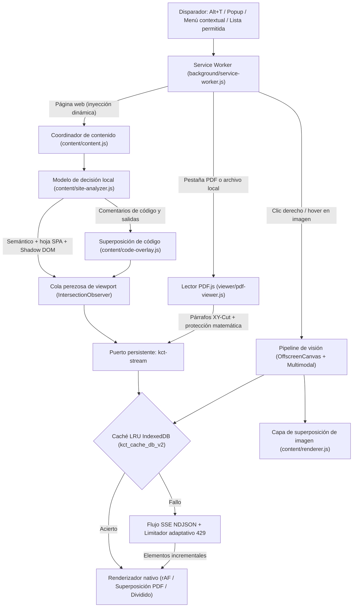

# NativeRead

[English](README.md) · [繁體中文](README.zh-TW.md) · [简体中文](README.zh-CN.md) · [日本語](README.ja.md) · [한국어](README.ko.md) · **Español** · [Français](README.fr.md) · [Deutsch](README.de.md)

**NativeRead (v2.2.0)** es una extensión de navegador Manifest V3 y PWA móvil que traduce páginas web, archivos PDF, comentarios de código e infografías incrustadas conservando la tipografía y el diseño originales de la página. Permanece silenciosa por defecto, se ejecuta bajo demanda con tu propia clave de API de LLM y transmite las traducciones párrafo por párrafo sin interrumpir el ritmo de lectura.

---

## 1. Descripción del producto e inicio rápido

### Capacidades principales

| Característica | Cómo funciona | Experiencia de lectura |
| --- | --- | --- |
| **Traducción web silenciosa por defecto** | Cero `content_scripts` estáticos; se inyecta dinámicamente mediante `chrome.scripting` bajo demanda (`Alt+T`, botón del popup, menú contextual o lista de sitios permitidos `autoTranslateHosts`). | Cero sobrecarga, cero interfaz flotante y cero consumo de API en los sitios que no traduces. |
| **Lector PDF.js integrado** | Incluye `PDF.js` local con licencia Apache-2.0 (`vendor/pdfjs/`) dentro de `viewer/pdf-viewer.html`; admite PDFs remotos, enlaces de Google Drive y arrastrar y soltar archivos `.pdf` locales. | Cambia entre los modos **Superposición**, **Dividido** y **Original** (`1` / `2` / `3`); las figuras, tablas y ecuaciones mostradas permanecen intactas. |
| **Superposición en página para PDFs de Google Drive** | Detecta las capas del visor `.ndfHFb-c4YZDc-cYSp0e-DARUcf` en su sitio, fusiona cuadros de texto de la misma columna, reconstruye los puntos de guía de la tabla de contenidos y mide las métricas nativas de los glifos desde los rásteres de página. | Traduce PDFs multipágina de Drive directamente dentro de Google Drive sin salir de la pestaña. |
| **Superposición bajo demanda de imágenes e infografías** | Estrictamente bajo demanda mediante clic derecho (**NativeRead Translate Image Text**) o píldora flotante (**譯圖**) en imágenes de `>= 200x140` px; nunca escanea automáticamente las imágenes de la página. | Reemplaza los bloques de texto en su lugar usando colores de fondo y primer plano muestreados, conservando diagramas 3D e ilustraciones. |
| **Comentarios de código y salidas de notebooks** | Intercambio no destructivo con CSS `attr()` para bloques `<pre>` estáticos (Pygments, Prism, Highlight.js, `.pl-c` de GitHub), superposición de solo lectura para CodeMirror 6 (`.cm-editor`) y botones de traducción rápida en salidas de Jupyter. | El código sigue siendo editable y ejecutable; las superposiciones se ocultan automáticamente al enfocar un editor o cambiar al modo original. |
| **Móvil y multiplataforma** | Incluye una PWA móvil independiente (`docs/`), un Userscript universal (`docs/nativeread.user.js`), un ZIP de extensión para Android (`docs/nativeread-android-extension.zip`) y sincronización local mediante código QR `#nr_sync`. | Flujo completo de traducción en Safari de iOS y navegadores Android sin volver a escribir las claves de API. |

### Inicio rápido (extensión de escritorio)

Requiere Chromium 119+ (Chrome, Edge, Brave o navegadores compatibles).

1. Clona el repositorio:
   ```bash
   git clone https://github.com/Chih-Kai-Wang/native-read.git
   ```
2. Abre `chrome://extensions/` (o `edge://extensions/`) y activa el **Modo de desarrollador**.
3. Haz clic en **Cargar descomprimida** y selecciona el directorio `native-read` clonado.
4. Haz clic en el icono de **NativeRead** en la barra de herramientas → **Opciones**, elige un proveedor de modelos, introduce tu clave de API, haz clic en **Probar conexión** y guarda.
5. Activa la traducción en cualquier página web o pestaña de PDF con **`Alt+T`**, el botón del popup o el menú contextual. Haz clic en `☆` / `★` en el popup o en la píldora flotante para añadir o quitar el dominio actual de tu lista de traducción automática.

### Proveedores de modelos compatibles

Configurados en `shared/config.js` (`PROVIDER_PRESETS`). Los endpoints locales (`localhost`, `127.0.0.1`, `0.0.0.0`) no requieren clave de API.

| ID de proveedor | Protocolo | URL base predeterminada | Modelo predeterminado |
| --- | --- | --- | --- |
| `deepseek` | OpenAI | `https://api.deepseek.com/v1` | `deepseek-chat` |
| `openai` | OpenAI | `https://api.openai.com/v1` | `gpt-4o-mini` |
| `gemini` | Gemini Native | `https://generativelanguage.googleapis.com/v1beta` | `gemini-3.5-flash-lite` |
| `qwen` | OpenAI | `https://dashscope.aliyuncs.com/compatible-mode/v1` | `qwen-plus` |
| `siliconflow` | OpenAI | `https://api.siliconflow.cn/v1` | `deepseek-ai/DeepSeek-V3` |
| `moonshot` | OpenAI | `https://api.moonshot.cn/v1` | `moonshot-v1-8k` |
| `zhipu` | OpenAI | `https://open.bigmodel.cn/api/paas/v4` | `glm-4-flash` |
| `openrouter` | OpenAI | `https://openrouter.ai/api/v1` | `google/gemini-2.5-flash` |
| `custom` | OpenAI | `http://localhost:11434/v1` | `qwen2.5:7b` |

- **Idiomas de destino**: `zh-TW` (predeterminado), `zh-CN`, `ja`, `ko`, `es`, `fr`, `de`, `vi`, `pt`, además de prompts de idioma personalizados.
- **Esfuerzo de razonamiento (`thinkingEffort`)**: `fastest` (predeterminado), `balanced` o `deep`. Asigna automáticamente Gemini 3.x/4.x a `thinkingLevel` (`MINIMAL` / `LOW` / `MEDIUM`), Gemini 2.5 Flash a `thinkingBudget` (`0` / `512` / `2048`), OpenAI `o1`/`o3`/`o4` a `reasoning_effort: "low"`, y DashScope `qwen3` a `enable_thinking: false` en modo `fastest` mientras elimina las partes `thought` de las respuestas.

### Soporte móvil y multiplataforma

- **PWA móvil (`https://chih-kai-wang.github.io/native-read/`)**: Instalable en la pantalla de inicio en iOS Safari y Android Chrome. Incluye un lector PDF.js móvil (superposición / dividido / original), un traductor de URL web y texto pegado directamente, un App Shell sin conexión (`docs/sw.js`) y caché local en IndexedDB.
- **Userscript universal (`https://chih-kai-wang.github.io/native-read/nativeread.user.js`)**: Se ejecuta en iOS Safari (mediante *Stay* o *Userscripts*) y navegadores Android (*Tampermonkey*, *Lemur*, *Kiwi*, *Firefox*). Inyecta una pestaña lateral `NR` arrastrable en Shadow DOM y recurre a `GM_xmlhttpRequest` cuando las CSP estrictas de la página bloquean `fetch`.
- **ZIP de extensión para Android (`https://chih-kai-wang.github.io/native-read/nativeread-android-extension.zip`)**: Paquete MV3 completo para navegadores Android basados en Chromium (*Lemur*, *Kiwi*, *Quetta*, *Edge Android*) con traducción de selección táctil (`touchend` / `selectionchange`).
- **Sincronización local por código QR `#nr_sync`**: Genera un enlace de sincronización y un código QR en la página de Opciones de escritorio; al escanearlo en el móvil se importan tu proveedor, clave de API, modelo y preferencias en la PWA, el Userscript o la extensión de Android, y se borra de inmediato el fragmento de la URL.

---

## 2. Arquitectura técnica



### 2.1 Modelo de decisión local con latencia cero

Toda la segmentación de página, el filtrado y las decisiones tipográficas se ejecutan localmente en `content/site-analyzer.js` y `content/renderer.js` sin llamadas adicionales al LLM:

- **Detección del contenido principal (`findContentRoots`, `scoreReadabilityContainer`)**: Prioriza celdas de Jupyter/notebook incrustadas (`LESSON_CELL_SELECTOR`), páginas del visor PDF de Google Drive (`.ndfHFb-c4YZDc-cYSp0e-DARUcf`) y contenedores semánticos (`article`, `main`, `[role="main"]`, `.markdown-body`, `.prose`, `#mw-content-text`). Los contenedores se puntúan mediante `textLen + pCount * 40`, se penalizan cuando `linkRatio > 0.55`, reciben un impulso de `1.25x` para contenedores de artículos/documentos y se refinan hacia contenedores internos más ajustados cuando conservan `>= 65%` del texto. Se preservan los encabezados superiores `#firstHeading` / `h1`.
- **Escaneo DOM en dos pasadas (`collectUniversalCandidateElements`)**:
  - *Pasada 1*: Recopila bloques semánticos (`h1–h6, p, li, blockquote, td, th, figcaption, summary, dt, dd`), omitiendo contenedores anidados para reclamar únicamente bloques de prosa hoja.
  - *Pasada 2*: Recorre candidatos hoja `DIV`, `SPAN`, `A`, `LABEL` y `BUTTON` para SPAs modernas, rechazando hosts de Shadow DOM, elementos con hijos de bloque o controles interactivos (`LEAF_FORBIDDEN_DESCENDANT_SELECTOR`), contadores de metadatos puros (`PURE_METADATA_REGEX`) y nodos envoltorio `div`/`span` que solo contienen enlaces `<a href>`. Ambas pasadas se fusionan en orden de documento DOM (`compareDocumentPosition`).
- **Recorrido de Shadow DOM (`queryAllDeep`, `ensureShadowModeStyle`)**: Recorre árboles `shadowRoot` abiertos hasta una profundidad de 5 omitiendo editores de código y nodos de interfaz (`SHADOW_SKIP_SELECTOR`), e inyecta reglas `:host-context(html.kct-mode-*)` para que el cambio entre Reemplazar / Original / Bilingüe funcione dentro de Shadow DOM.
- **Tokens de protección en línea (`extractBlockContent`, `buildTranslatedFragment`)**: Reemplaza código en línea (`code, kbd, var`) por `[[C#]]`, matemáticas y citas (`.katex, .MathJax, mjx-container, math, .mwe-math-element, sup.reference`) por `[[M#]]`, y enlaces `<a href>` cortos o no traducibles (`<= 28` caracteres) por `[[L#]]`. El renderizador restaura cada token clonando el nodo DOM original (`cloneNode(true)`) dentro de un `DocumentFragment`.
- **Filtrado de idioma (`shouldTranslateText`)**: Filtra URLs, correos electrónicos, rutas de archivos, prompts `In[]`/`Out[]` de Jupyter, identificadores de código ASCII de un solo token y texto ya escrito en el idioma de destino usando proporciones de escritura Unicode (para `zh-TW`/`zh-CN`, omite una proporción Han `>= 0.55` con `< 6` palabras latinas, mientras sigue traduciendo texto japonés con proporción Kana `>= 0.12`).
- **Emparejamiento de genes tipográficos (`probeTypography`, `sanitizeFontFamily`, `content/content.css`)**: Clasifica cada bloque como `serif`, `sans` o `mono` a partir del `fontFamily` computado, elimina familias genéricas de CSS (`serif`, `sans-serif`, `monospace`, `system-ui`, etc.) para que permanezcan hasta 5 fuentes latinas específicas del sitio en `--kct-orig-font` y añade la pila correspondiente del idioma de destino (`var(--kct-orig-font), var(--kct-font-serif|sans|mono)`). Los bloques de prosa densos sin límite de líneas con `lineHeight / fontSize < 1.62` reciben un aumento selectivo de `line-height: 1.72` (`data-kct-lh-lift="1"`).

### 2.2 Pipelines duales de diseño nativo para PDF

NativeRead mantiene dos pipelines especializados para PDF adaptados a cómo se renderizan los PDFs en el navegador:

| Etapa | Lector PDF.js integrado (`viewer/pdf-viewer.js`) | Superposición en página de Google Drive (`site-analyzer.js` + `renderer.js`) |
| --- | --- | --- |
| **Fuente de texto y geometría** | `pdfPage.getTextContent()` transformado a coordenadas del viewport CSS; omite texto rotado (`\|angle\| > 0.25`). | Nodos `<p>` ocultos posicionados por porcentaje dentro de `.ndfHFb-c4YZDc-cYSp0e-DARUcf-Df1ZY-bN97Pc-haAclf`. |
| **Agrupación de columnas y párrafos** | Agrupamiento por línea base, absorción geométrica de superíndices/subíndices, división de columnas por medianiles contiguos, eliminación de guiones de salto de línea y orden de lectura XY-Cut recursivo (Y-Cut → X-Cut → división de elementos que cruzan valles X interiores). | Fusión de la misma columna entre grupos (`leftDiff <= 3.6%`, `hRatio <= 0.36`), eliminación de guiones y recorte seguro de altura con `nearestBelowTop`; los nodos `<p>` absorbidos se ocultan mediante `data-kct-pdf-merged="absorbed"`. |
| **Manejo de matemáticas y TOC** | Omite ecuaciones mostradas (`isDisplayedMathBlock`), protege matemáticas en línea con `[[M#]]` y normaliza LaTeX filtrado a Unicode (`cleanLatexMathInText`). | `detectPdfTocEntries` detecta `>= 3` filas de TOC alineadas a la derecha (dentro de `1.2%`), traduce solo los títulos y reconstruye filas flex nativas con puntos de guía CSS (`.kct-pdf-toc-leader`) y números de página tabulares. |
| **Tipografía y grosor** | Lee metadatos de fuente del PDF (`isSerif`, `isBold`, `isItalic`, `isMono`, `isMathFont`) desde `styles` y `commonObjs`. | `ensurePdfLayerTypography` mide bandas de tinta de altura x (`0.53` latín / `0.88` CJK) y proporciones de trazo (`>= 1.3x` mediana = negrita) directamente desde los rásteres `` de página, agrupando tamaños casi iguales (tolerancia `1.08x`) a una mediana compartida. |
| **Color y protección contra colisiones** | Un único `ctx.getImageData` por página muestrea la mediana perimetral de `bg` + `fg` con contraste WCAG; `refineMaxHeightWithCanvasInk` escanea debajo de cada párrafo para evitar solapar figuras/reglas y detecta etiquetas compactas de diagramas. | `samplePdfImageColors` muestrea la mediana perimetral de `bg` y `fg` ajustado por contraste desde cada `` de página (vinculado a `img.currentSrc \|\| img.src`), con halo `box-shadow` de `2px` y expansión en `:hover`. |
| **Modos de visualización** | **Superposición**, **Dividido** (lienzo + tarjetas traducidas), **Original**, además de popover de comparación al hacer clic. | **Reemplazar**, **Original** y **Bilingüe** (superposición compacta en su sitio que se expande en una tarjeta bilingüe al pasar el cursor). |

### 2.3 Pipeline multimodal bajo demanda de superposición de imágenes

1. **Activación explícita del usuario**: Se activa únicamente cuando el usuario hace clic derecho en una imagen (**NativeRead 翻譯圖片文字**) o pulsa la píldora flotante (**譯圖**) en imágenes de contenido de `>= 200x140` px (excluyendo nav/header/footer y rásteres de página PDF de Google Drive).
2. **Descarga en segundo plano y reducción de escala (`background/service-worker.js`)**: `prepareImagePayloadForVision` descarga imágenes `http(s):` desde el Service Worker (evitando contaminación CORS del Canvas de la página; límite de 16 MB, tiempo de espera de 20 s, detección MIME por bytes mágicos) o acepta URLs `data:` para imágenes locales/blob. Mediante `createImageBitmap` + `OffscreenCanvas`, crea un búfer de muestreo de `~480px` preservando alfa y recodifica imágenes que superen `1600px` o `4 MB`.
3. **Inferencia de Visión estructurada y muestreo de color**: `callVisionImageLLM` envía una única solicitud multimodal (Gemini `inlineData` o OpenAI `image_url`, tiempo de espera de 60 s) que devuelve `{"blocks":[{"box_2d":[ymin,xmin,ymax,xmax],"text":"...","role":"title|badge|body"}]}` en coordenadas 0–1000. `sampleImageBoxColors` calcula el `bg` modal del perímetro y el `fg` interior verificado por WCAG para cada cuadro, y guarda el resultado en IndexedDB tanto por resumen SHA-256 como por URL normalizada.
4. **Renderizado de superposición en su sitio (`content/renderer.js`)**: `renderImageVisionOverlay` envuelve el `` en `.kct-img-overlay-host`, alinea `.kct-img-overlay-layer` a las dimensiones exactas de la imagen, coloca cada bloque con reducción adaptativa de fuente (`fitVisionOverlayBlock`) y permite alternar entre **原圖 / 顯示譯圖** bajo demanda.

### 2.4 Streaming, carga perezosa por viewport, limitación de tasa y caché LRU

- **Streaming SSE / NDJSON y respaldo resiliente**: Los scripts de contenido y el visor PDF se conectan mediante un puerto persistente `kct-stream`. El Service Worker transmite líneas NDJSON de Gemini (`:streamGenerateContent?alt=sse`) o OpenAI (`stream: true`) (`{"i":0,"t":"..."}`), analizadas incrementalmente con `createIncrementalJsonScanner`. Los elementos faltantes o flujos interrumpidos recurren a JSON por lotes (`TRANSLATE_BATCH`) con bisección recursiva (`translateItemsWithFallback`, hasta profundidad 3).
- **Micro-lotes con rAF y carga perezosa por viewport**: Las traducciones web en streaming se vuelcan mediante `renderJobsWithRAF` en porciones de hasta `15` elementos por fotograma de animación (`scheduler.yield()` entre porciones cuando está soportado). Los bloques fuera de pantalla se difieren con `IntersectionObserver` (`rootMargin: 600px 0px` para web; `500px 0px` para PDF.js), encolados primero por viewport con hasta `3` trabajadores concurrentes por lotes (`batchSize: 20`, `maxBatchChars: 5500`).
- **Limitador adaptativo de tasa 429 entre marcos**: `background/service-worker.js` aplica un límite global de concurrencia de `3` entre marcos. Ante HTTP `429`, analiza `Retry-After` / `retryDelay`, activa una ventana de ritmo adaptativo de 90 s (concurrencia `1`, pausa de `4.3s` entre solicitudes) más enfriamiento global, y separa el agotamiento de cuota diaria/cero (`QUOTA_EXCEEDED`) de los límites temporales de RPM (`RATE_LIMITED`).
- **Caché LRU en IndexedDB (`shared/cache-db.js`)**: Almacena hasta `20,000` entradas en `kct_cache_db_v2` (almacén `entries`, indexado por `ts`), con clave `protocol:model:thinkingEffort:targetLang:customLang:glossaryHash`. Los aciertos de caché actualizan `ts` con debounce (umbral de `60s`, debounce de `250ms`) para que la expulsión por desbordamiento elimine los registros menos usados recientemente.

### 2.5 Estructura del proyecto

```text
native-read/
├── manifest.json                 # Manifiesto MV3, permisos, comando Alt+T (sin content_scripts estáticos)
├── shared/
│   ├── config.js                 # Configuración esquema v5, presets de proveedores, config de razonamiento, utilidades URL/PDF
│   └── cache-db.js               # Caché LRU IndexedDB kct_cache_db_v2 de 20,000 entradas
├── background/
│   └── service-worker.js         # Inyector dinámico, streamer SSE/NDJSON, limitador 429, motor Vision, guardia #nr_sync
├── content/
│   ├── site-analyzer.js          # Modelo de decisión local (Readability, SPA 2 pasadas, Shadow DOM, fusión/TOC PDF Drive)
│   ├── code-overlay.js           # Intercambio de comentarios <pre> estáticos, superposición CodeMirror 6, traductor de salidas Jupyter
│   ├── renderer.js               # Renderizador DOM seguro, emparejamiento de fuentes, métricas ráster PDF Drive, superposición de imágenes
│   ├── content.js                # Cola perezosa de viewport, cliente kct-stream, UI Shadow DOM píldora/selección/imagen
│   └── content.css               # Modos Reemplazar/Original/Bilingüe, pilas de fuentes, estilos PDF Drive y superposición de imágenes
├── viewer/                       # Lector PDF.js integrado (pdf-viewer.html / .css / .js)
├── popup/                        # Controles del popup de la extensión, selector de lista permitida, lanzador del lector PDF
├── options/                      # Página de opciones, config de proveedor/modelo, glosario, sincronización QR local, control de caché
├── icons/                        # Iconos de la extensión (16 / 48 / 128 px)
├── scripts/
│   └── build-mobile.js           # Genera docs/nativeread.user.js, ZIP de Android y copia PDF.js/iconos
├── docs/                         # PWA móvil en GitHub Pages (index.html, app.js, app.css, sw.js, paquetes generados)
├── LICENSE                       # Licencia MIT
└── README*.md                    # Documentación multilingüe de producto, arquitectura y seguridad
```

---

## 3. Arquitectura de privacidad y seguridad

| Área | Implementación |
| --- | --- |
| **Almacenamiento local** | La configuración y claves de API de la extensión residen únicamente en `chrome.storage.local` (`kct_settings_v1`); la configuración de la PWA en `localStorage`; la del Userscript en `GM_getValue`/`GM_setValue` (`localStorage` como respaldo). Las cachés de traducción viven localmente en IndexedDB (`kct_cache_db_v2`) y pueden borrarse en cualquier momento. |
| **Endpoints de red** | El tráfico de la extensión y del Userscript va directamente a tu endpoint de LLM configurado, con las claves de API estrictamente en cabeceras HTTP (`x-goog-api-key` o `Authorization: Bearer`) y censuradas en los mensajes de error (`redactApiKey`). Los PDFs remotos y las imágenes bajo demanda se descargan directamente desde sus URLs de origen por el Service Worker. |
| **Manejo del fragmento `#nr_sync`** | Los datos de sincronización viven exclusivamente en el fragmento `#` de la URL (nunca en `?query`), que los navegadores no transmiten en las peticiones HTTP. `background/service-worker.js` acepta `#nr_sync` solo desde el origen de la extensión o `https://chih-kai-wang.github.io/native-read`, rechaza mutaciones de endpoint (`baseUrl` / `protocol` / `providerId`) salvo que se incluya una `apiKey` explícita, valida esquemas `http:`/`https:` y limpia inmediatamente el fragmento con `history.replaceState`. |
| **Seguridad DOM sin `innerHTML`** | Todas las cadenas traducidas, popovers y superposiciones se escriben mediante `document.createTextNode` y `.textContent`. Los marcadores en línea (`[[C#]]`, `[[M#]]`, `[[L#]]`) restauran únicamente nodos DOM preexistentes clonados. |
| **Endurecimiento de CSP MV3 y PDF.js** | PDF.js se empaqueta localmente con `isEvalSupported: false` tanto en `viewer/pdf-viewer.js` como en `docs/app.js`. Las acciones privilegiadas del Service Worker (`ENSURE_AND_COMMAND`, `TEST_CONNECTION`, `OPEN_PDF_VIEWER`, `GET_SW_DEBUG`, `CLEAR_CACHE`) exigen `isExtensionSender(sender)`. |
| **Aislamiento de UI y QR** | Las píldoras flotantes, popovers de selección, disparadores sobre imágenes y controles del Userscript están aislados dentro de Shadow DOM (`all: initial`). Los códigos QR de sincronización se generan localmente en la página de Opciones sin llamar a servicios QR externos. |

> **Nota sobre la PWA móvil (`docs/app.js`)**: Para URLs de PDF, la política de NativeRead es únicamente descarga directa desde el navegador, eliminando el antiguo respaldo de proxy CORS `api.allorigins.win` en favor de descarga directa con tiempo de espera y guía para archivo local, de modo que URLs o bytes de PDFs privados nunca se envíen a un intermediario de terceros. En la pestaña opcional **Web URL** de la PWA, la extracción de artículos públicos entre orígenes (`fetchReadableArticleFromUrl`) usa actualmente `r.jina.ai` (con respaldo de `api.allorigins.win`); si requieres cero intermediarios de terceros en móvil, pega el texto del artículo directamente en la pestaña Web o utiliza el Userscript o la extensión de Android.

---

## Desarrollo

Genera los artefactos de distribución móvil y ejecuta comprobaciones de sintaxis en todos los archivos JavaScript:

```bash
node scripts/build-mobile.js
for f in shared/*.js background/*.js content/*.js popup/*.js options/*.js viewer/*.js scripts/*.js docs/app.js docs/sw.js docs/nativeread.user.js; do node --check "$f" || exit 1; done
```

`docs/nativeread.user.js`, `docs/nativeread-android-extension.zip`, `docs/vendor/pdfjs/`, `docs/icons/` y `docs/.nojekyll` son generados por `scripts/build-mobile.js`; edita los módulos fuente en `shared/`, `content/`, `viewer/` y `docs/app.js`, y luego vuelve a ejecutar el script de compilación.

---

## Licencia

Publicado bajo la [Licencia MIT](LICENSE). El PDF.js incluido (`vendor/pdfjs/` y `docs/vendor/pdfjs/`) está bajo la Licencia Apache-2.0 (consulta [docs/vendor/pdfjs/LICENSE](docs/vendor/pdfjs/LICENSE)).