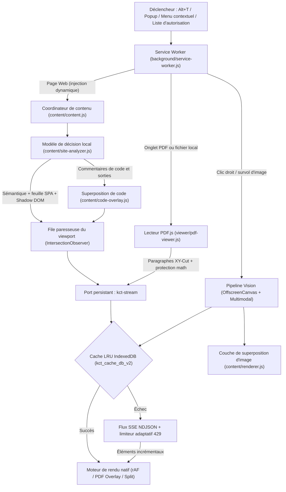

# NativeRead

[English](README.md) · [繁體中文](README.zh-TW.md) · [简体中文](README.zh-CN.md) · [日本語](README.ja.md) · [한국어](README.ko.md) · [Español](README.es.md) · **Français** · [Deutsch](README.de.md)

**NativeRead (v2.2.0)** est une extension de navigateur Manifest V3 et une PWA mobile qui traduit les pages Web, les PDF, les commentaires de code et les infographies intégrées tout en préservant la typographie et la mise en page d'origine. Elle reste silencieuse par défaut, s'exécute à la demande avec votre propre clé API LLM et diffuse les traductions paragraphe par paragraphe sans interrompre le rythme de lecture.

---

## 1. Aperçu du produit et démarrage rapide

### Fonctionnalités principales

| Fonctionnalité | Fonctionnement | Expérience de lecture |
| --- | --- | --- |
| **Traduction Web silencieuse par défaut** | Aucun `content_scripts` statique ; injection dynamique via `chrome.scripting` à la demande (`Alt+T`, bouton de la fenêtre contextuelle, menu contextuel ou liste d'autorisation par site `autoTranslateHosts`). | Zéro surcharge, zéro interface flottante et zéro utilisation d'API sur les sites que vous ne traduisez pas. |
| **Lecteur PDF.js intégré** | Intègre une version locale Apache-2.0 de `PDF.js` (`vendor/pdfjs/`) dans `viewer/pdf-viewer.html` ; prend en charge les PDF distants, les liens Google Drive et le glisser-déposer de fichiers `.pdf` locaux. | Basculez entre les modes **Overlay**, **Split** et **Original** (`1` / `2` / `3`) ; les figures, tableaux et équations affichées restent intacts. |
| **Superposition PDF Google Drive intégrée** | Détecte sur place les couches du lecteur `.ndfHFb-c4YZDc-cYSp0e-DARUcf`, fusionne les zones de texte d'une même colonne, reconstruit les points de conduite de la table des matières et mesure les métriques natives des glyphes à partir des images matricielles de la page. | Traduit les PDF Drive multipages directement dans Google Drive sans quitter l'onglet. |
| **Superposition d'images et d'infographies à la demande** | Strictement à la demande via le clic droit (**NativeRead Translate Image Text**) ou la pastille au survol (**譯圖**) sur les images `>= 200x140` px ; n'analyse jamais automatiquement les images de la page. | Remplace les blocs de texte sur place en utilisant les couleurs d'arrière-plan et de premier plan échantillonnées tout en préservant les diagrammes 3D et les illustrations. |
| **Commentaires de code et sorties de notebook** | Échange CSS `attr()` non destructif pour les blocs `<pre>` statiques (Pygments, Prism, Highlight.js, GitHub `.pl-c`), superposition en lecture seule pour CodeMirror 6 (`.cm-editor`) et boutons de traduction rapide sur les sorties Jupyter. | Le code reste modifiable et exécutable ; les superpositions se masquent automatiquement lorsque vous focalisez un éditeur ou passez en mode original. |
| **Mobile et multiplateforme** | Fournit une PWA mobile autonome (`docs/`), un Userscript universel (`docs/nativeread.user.js`), une archive ZIP d'extension Android (`docs/nativeread-android-extension.zip`) et une synchronisation locale par code QR `#nr_sync`. | Flux de traduction complet sur iOS Safari et les navigateurs Android sans ressaisir les clés API. |

### Démarrage rapide (Extension de bureau)

Nécessite Chromium 119+ (Chrome, Edge, Brave ou navigateurs compatibles).

1. Clonez le dépôt :
   ```bash
   git clone https://github.com/Chih-Kai-Wang/native-read.git
   ```
2. Ouvrez `chrome://extensions/` (ou `edge://extensions/`) et activez le **Mode développeur**.
3. Cliquez sur **Charger l'extension non empaquetée** et sélectionnez le répertoire `native-read` cloné.
4. Cliquez sur l'icône **NativeRead** dans la barre d'outils → **Options**, choisissez un fournisseur de modèle, saisissez votre clé API, cliquez sur **Test Connection** et enregistrez.
5. Déclenchez la traduction sur n'importe quelle page Web ou onglet PDF avec **`Alt+T`**, le bouton de la fenêtre contextuelle ou le menu clic droit. Cliquez sur `☆` / `★` dans la fenêtre contextuelle ou la pastille flottante pour ajouter ou retirer le domaine actuel de votre liste d'autorisation de traduction automatique.

### Fournisseurs de modèles pris en charge

Configurés dans `shared/config.js` (`PROVIDER_PRESETS`). Les points de terminaison locaux (`localhost`, `127.0.0.1`, `0.0.0.0`) ne nécessitent pas de clé API.

| ID du fournisseur | Protocole | URL de base par défaut | Modèle par défaut |
| --- | --- | --- | --- |
| `deepseek` | OpenAI | `https://api.deepseek.com/v1` | `deepseek-chat` |
| `openai` | OpenAI | `https://api.openai.com/v1` | `gpt-4o-mini` |
| `gemini` | Gemini Native | `https://generativelanguage.googleapis.com/v1beta` | `gemini-3.5-flash-lite` |
| `qwen` | OpenAI | `https://dashscope.aliyuncs.com/compatible-mode/v1` | `qwen-plus` |
| `siliconflow` | OpenAI | `https://api.siliconflow.cn/v1` | `deepseek-ai/DeepSeek-V3` |
| `moonshot` | OpenAI | `https://api.moonshot.cn/v1` | `moonshot-v1-8k` |
| `zhipu` | OpenAI | `https://open.bigmodel.cn/api/paas/v4` | `glm-4-flash` |
| `openrouter` | OpenAI | `https://openrouter.ai/api/v1` | `google/gemini-2.5-flash` |
| `custom` | OpenAI | `http://localhost:11434/v1` | `qwen2.5:7b` |

- **Langues cibles** : `zh-TW` (par défaut), `zh-CN`, `ja`, `ko`, `es`, `fr`, `de`, `vi`, `pt`, ainsi que des invites de langue personnalisées.
- **Effort de réflexion (`thinkingEffort`)** : `fastest` (par défaut), `balanced` ou `deep`. Associe automatiquement Gemini 3.x/4.x à `thinkingLevel` (`MINIMAL` / `LOW` / `MEDIUM`), Gemini 2.5 Flash à `thinkingBudget` (`0` / `512` / `2048`), OpenAI `o1`/`o3`/`o4` à `reasoning_effort: "low"`, et DashScope `qwen3` à `enable_thinking: false` en mode `fastest` tout en supprimant les parties `thought` des réponses.

### Prise en charge mobile et multiplateforme

- **PWA mobile (`https://chih-kai-wang.github.io/native-read/`)** : Installable sur l'écran d'accueil sous iOS Safari et Android Chrome. Inclut un lecteur PDF.js mobile (overlay / split / original), un traducteur d'articles par URL Web ou collage direct, un App Shell hors ligne (`docs/sw.js`) et un cache IndexedDB local.
- **Userscript universel (`https://chih-kai-wang.github.io/native-read/nativeread.user.js`)** : Fonctionne dans iOS Safari (via *Stay* ou *Userscripts*) et les navigateurs Android (*Tampermonkey*, *Lemur*, *Kiwi*, *Firefox*). Injecte un onglet latéral Shadow DOM `NR` déplaçable et bascule sur `GM_xmlhttpRequest` lorsque les CSP strictes de la page bloquent `fetch`.
- **Archive ZIP d'extension Android (`https://chih-kai-wang.github.io/native-read/nativeread-android-extension.zip`)** : Paquet MV3 complet pour les navigateurs Android basés sur Chromium (*Lemur*, *Kiwi*, *Quetta*, *Edge Android*) avec traduction par sélection tactile (`touchend` / `selectionchange`).
- **Synchronisation locale par code QR `#nr_sync`** : Générez un lien de synchronisation et un code QR dans la page Options sur ordinateur ; le scanner sur mobile importe votre fournisseur, clé API, modèle et préférences dans la PWA, le Userscript ou l'extension Android et efface immédiatement le fragment d'URL.

---

## 2. Architecture technique



### 2.1 Modèle de décision local sans latence

Toutes les décisions de segmentation de page, de filtrage et de typographie s'exécutent localement dans `content/site-analyzer.js` et `content/renderer.js` sans aucun appel LLM supplémentaire :

- **Détection du contenu principal (`findContentRoots`, `scoreReadabilityContainer`)** : Donne la priorité aux cellules Jupyter/notebook intégrées (`LESSON_CELL_SELECTOR`), aux pages du lecteur PDF Google Drive (`.ndfHFb-c4YZDc-cYSp0e-DARUcf`) et aux conteneurs sémantiques (`article`, `main`, `[role="main"]`, `.markdown-body`, `.prose`, `#mw-content-text`). Les conteneurs sont notés selon `textLen + pCount * 40`, pénalisés lorsque `linkRatio > 0.55`, valorisés à `1.25x` pour les conteneurs d'articles/documents et affinés vers des conteneurs internes plus resserrés lorsqu'ils conservent `>= 65%` du texte. Les titres de niveau supérieur `#firstHeading` / `h1` sont préservés.
- **Analyse DOM en deux passes (`collectUniversalCandidateElements`)** :
  - *Passe 1* : Collecte les blocs sémantiques (`h1–h6, p, li, blockquote, td, th, figcaption, summary, dt, dd`), en ignorant les conteneurs imbriqués afin de ne retenir que les blocs de prose feuilles.
  - *Passe 2* : Parcourt les candidats feuilles `DIV`, `SPAN`, `A`, `LABEL` et `BUTTON` pour les SPA modernes, en rejetant les hôtes Shadow DOM, les éléments avec enfants de type bloc ou contrôles interactifs (`LEAF_FORBIDDEN_DESCENDANT_SELECTOR`), les compteurs de métadonnées purs (`PURE_METADATA_REGEX`) et les nœuds enveloppes `div`/`span` qui n'entourent que des liens `<a href>`. Les deux passes sont fusionnées dans l'ordre du document DOM (`compareDocumentPosition`).
- **Parcours du Shadow DOM (`queryAllDeep`, `ensureShadowModeStyle`)** : Parcourt les arborescences `shadowRoot` ouvertes jusqu'à la profondeur 5 tout en ignorant les éditeurs de code et les nœuds d'interface (`SHADOW_SKIP_SELECTOR`), et injecte des règles `:host-context(html.kct-mode-*)` pour que le basculement Replace / Original / Bilingual fonctionne à l'intérieur du Shadow DOM.
- **Jetons de protection en ligne (`extractBlockContent`, `buildTranslatedFragment`)** : Remplace le code en ligne (`code, kbd, var`) par `[[C#]]`, les formules mathématiques et citations (`.katex, .MathJax, mjx-container, math, .mwe-math-element, sup.reference`) par `[[M#]]`, et les liens `<a href>` courts ou non traduisibles (`<= 28` caractères) par `[[L#]]`. Le moteur de rendu restaure chaque jeton en clonant le nœud DOM d'origine (`cloneNode(true)`) dans un `DocumentFragment`.
- **Filtrage linguistique (`shouldTranslateText`)** : Filtre les URL, adresses e-mail, chemins de fichiers, invites Jupyter `In[]`/`Out[]`, identifiants de code ASCII à jeton unique et textes déjà rédigés dans la langue cible à l'aide de ratios de scripts Unicode (pour `zh-TW`/`zh-CN`, ignore un ratio Han `>= 0.55` avec `< 6` mots latins tout en traduisant le texte japonais avec un ratio Kana `>= 0.12`).
- **Appariement de gènes typographiques (`probeTypography`, `sanitizeFontFamily`, `content/content.css`)** : Classe chaque bloc en `serif`, `sans` ou `mono` à partir de `fontFamily` calculé, supprime les familles génériques CSS fourre-tout (`serif`, `sans-serif`, `monospace`, `system-ui`, etc.) afin de conserver jusqu'à 5 polices latines spécifiques au site dans `--kct-orig-font`, et ajoute la pile correspondante de la langue cible (`var(--kct-orig-font), var(--kct-font-serif|sans|mono)`). Les blocs de prose denses non contraints avec `lineHeight / fontSize < 1.62` reçoivent une élévation sélective `line-height: 1.72` (`data-kct-lh-lift="1"`).

### 2.2 Doubles pipelines PDF à mise en page native

NativeRead maintient deux pipelines PDF spécialisés, adaptés à la manière dont les PDF sont rendus dans le navigateur :

| Étape | Lecteur PDF.js intégré (`viewer/pdf-viewer.js`) | Superposition Google Drive intégrée (`site-analyzer.js` + `renderer.js`) |
| --- | --- | --- |
| **Source de texte et de géométrie** | `pdfPage.getTextContent()` transformé en coordonnées CSS du viewport ; ignore le texte pivoté (`\|angle\| > 0.25`). | Nœuds `<p>` masqués positionnés en pourcentage dans `.ndfHFb-c4YZDc-cYSp0e-DARUcf-Df1ZY-bN97Pc-haAclf`. |
| **Regroupement en colonnes et paragraphes** | Regroupement par ligne de base, absorption géométrique des exposants/indices, découpage contigu des gouttières de colonnes, suppression des césures et ordre de lecture récursif XY-Cut (Y-Cut → X-Cut → séparation des éléments chevauchant une vallée X intérieure). | Fusion inter-groupes d'une même colonne (`leftDiff <= 3.6%`, `hRatio <= 0.36`), suppression des césures et limitation de hauteur sûre `nearestBelowTop` ; les nœuds `<p>` absorbés sont masqués via `data-kct-pdf-merged="absorbed"`. |
| **Gestion des mathématiques et de la table des matières** | Ignore les équations affichées (`isDisplayedMathBlock`), protège les mathématiques en ligne avec `[[M#]]` et normalise le LaTeX résiduel en Unicode (`cleanLatexMathInText`). | `detectPdfTocEntries` détecte `>= 3` lignes de table des matières alignées à droite (à `1.2%` près), ne traduit que les titres et reconstruit des lignes flex natives avec des points de conduite CSS (`.kct-pdf-toc-leader`) et des numéros de page tabulaires. |
| **Typographie et graisse des polices** | Lit les métadonnées de police PDF (`isSerif`, `isBold`, `isItalic`, `isMono`, `isMathFont`) depuis `styles` et `commonObjs`. | `ensurePdfLayerTypography` mesure les bandes d'encre de hauteur d'x (`0.53` latin / `0.88` CJK) et les ratios de trait (`>= 1.3x` médiane = gras) directement à partir des images matricielles `` de la page, en regroupant les tailles quasi égales (tolérance `1.08x`) vers une médiane partagée. |
| **Protection des couleurs et des collisions** | Un seul `ctx.getImageData` par page échantillonne le `bg` médian du périmètre + `fg` à contraste WCAG ; `refineMaxHeightWithCanvasInk` analyse sous chaque paragraphe pour éviter de chevaucher les figures/filets et détecte les étiquettes compactes de diagrammes. | `samplePdfImageColors` échantillonne le `bg` médian du périmètre et le `fg` ajusté au contraste depuis chaque `` de page (lié à `img.currentSrc \|\| img.src`), avec un halo `box-shadow` de `2px` et une expansion au `:hover`. |
| **Modes d'affichage** | **Overlay**, **Split** (canevas + cartes traduites), **Original**, plus fenêtre contextuelle de comparaison au clic. | **Replace**, **Original** et **Bilingual** (superposition compacte sur place qui se déploie en carte bilingue au survol). |

### 2.3 Pipeline de superposition d'images multimodale à la demande

1. **Déclenchement explicite par l'utilisateur** : Activé uniquement lorsque l'utilisateur fait un clic droit sur une image (**NativeRead 翻譯圖片文字**) ou clique sur la pastille au survol (**譯圖**) sur les images de contenu `>= 200x140` px (à l'exclusion des zones nav/header/footer et des images matricielles de pages PDF Google Drive).
2. **Récupération en arrière-plan et réduction d'échelle (`background/service-worker.js`)** : `prepareImagePayloadForVision` télécharge les images `http(s):` depuis le Service Worker (évitant la contamination CORS du Canvas de page ; limite de 16 Mo, délai d'attente de 20 s, détection MIME par octets magiques) ou accepte les URL `data:` pour les images locales/blob. À l'aide de `createImageBitmap` + `OffscreenCanvas`, il crée un tampon d'échantillonnage de `~480px` préservant le canal alpha et ré-encode les images dépassant `1600px` ou `4 MB`.
3. **Inférence Vision structurée et échantillonnage des couleurs** : `callVisionImageLLM` envoie une requête multimodale unique (Gemini `inlineData` ou OpenAI `image_url`, délai d'attente de 60 s) renvoyant `{"blocks":[{"box_2d":[ymin,xmin,ymax,xmax],"text":"...","role":"title|badge|body"}]}` en coordonnées 0–1000. `sampleImageBoxColors` calcule le `bg` modal du périmètre et le `fg` intérieur vérifié WCAG pour chaque zone, et met le résultat en cache dans IndexedDB par empreinte SHA-256 et par URL normalisée.
4. **Rendu en superposition sur place (`content/renderer.js`)** : `renderImageVisionOverlay` enveloppe l'`` dans `.kct-img-overlay-host`, aligne `.kct-img-overlay-layer` aux dimensions exactes de l'image, place chaque bloc avec réduction adaptative de la police (`fitVisionOverlayBlock`) et permet aux utilisateurs de basculer entre **原圖 / 顯示譯圖** à la demande.

### 2.4 Streaming, chargement paresseux du viewport, limitation de débit et cache LRU

- **Streaming SSE / NDJSON et repli résilient** : Les scripts de contenu et le lecteur PDF se connectent via un port persistant `kct-stream`. Le Service Worker diffuse les lignes NDJSON Gemini (`:streamGenerateContent?alt=sse`) ou OpenAI (`stream: true`) (`{"i":0,"t":"..."}`), analysées incrémentalement via `createIncrementalJsonScanner`. Les éléments manquants ou flux interrompus basculent vers le JSON par lots (`TRANSLATE_BATCH`) avec bissection récursive (`translateItemsWithFallback`, jusqu'à une profondeur de 3).
- **Micro-regroupement rAF et chargement paresseux du viewport** : Les traductions Web diffusées passent par `renderJobsWithRAF` par tranches allant jusqu'à `15` éléments par image d'animation (`scheduler.yield()` entre les tranches lorsque pris en charge). Les blocs hors écran sont différés via `IntersectionObserver` (`rootMargin: 600px 0px` pour le Web ; `500px 0px` pour PDF.js), mis en file d'attente en priorité pour le viewport avec jusqu'à `3` travailleurs de lots simultanés (`batchSize: 20`, `maxBatchChars: 5500`).
- **Limiteur de débit adaptatif 429 inter-cadres** : `background/service-worker.js` impose une limite globale de concurrence de `3` entre les cadres. En cas de HTTP `429`, il analyse `Retry-After` / `retryDelay`, déclenche une fenêtre de régulation adaptative de 90 s (concurrence `1`, intervalle de `4.3s` entre requêtes) ainsi qu'un refroidissement global, et distingue l'épuisement de quota quotidien/nul (`QUOTA_EXCEEDED`) des limites temporaires RPM (`RATE_LIMITED`).
- **Cache LRU IndexedDB (`shared/cache-db.js`)** : Stocke jusqu'à `20,000` entrées dans `kct_cache_db_v2` (magasin `entries`, indexé par `ts`), indexées par `protocol:model:thinkingEffort:targetLang:customLang:glossaryHash`. Les succès de cache mettent à jour `ts` avec anti-rebond (seuil `60s`, anti-rebond `250ms`) afin que l'éviction en cas de dépassement supprime les enregistrements les moins récemment utilisés.

### 2.5 Structure du projet

```text
native-read/
├── manifest.json                 # Manifeste MV3, permissions, commande Alt+T (sans content_scripts statiques)
├── shared/
│   ├── config.js                 # Paramètres schéma v5, préréglages fournisseurs, config réflexion, assistants URL/PDF
│   └── cache-db.js               # Cache LRU IndexedDB kct_cache_db_v2 à 20 000 entrées
├── background/
│   └── service-worker.js         # Injecteur dynamique, streamer SSE/NDJSON, limiteur 429, moteur Vision, garde #nr_sync
├── content/
│   ├── site-analyzer.js          # Modèle de décision local (Readability, SPA 2 passes, Shadow DOM, fusion/TOC PDF Drive)
│   ├── code-overlay.js           # Échange commentaires <pre> statiques, superposition CodeMirror 6, traducteur sorties Jupyter
│   ├── renderer.js               # Moteur de rendu DOM sûr, appariement polices, métriques raster PDF Drive, superpositions images
│   ├── content.js                # File paresseuse viewport, client kct-stream, UI Shadow DOM pastille/sélection/image
│   └── content.css               # Modes Replace/Original/Bilingual, piles de polices, styles PDF Drive et superposition d'images
├── viewer/                       # Lecteur PDF.js intégré (pdf-viewer.html / .css / .js)
├── popup/                        # Contrôles de la fenêtre contextuelle, liste d'autorisation, lanceur lecteur PDF
├── options/                      # Page Options, config fournisseur/modèle, glossaire, synchro QR locale, contrôles du cache
├── icons/                        # Icônes de l'extension (16 / 48 / 128 px)
├── scripts/
│   └── build-mobile.js           # Génère docs/nativeread.user.js, ZIP Android, et copie PDF.js/icônes
├── docs/                         # PWA mobile GitHub Pages (index.html, app.js, app.css, sw.js, paquets générés)
├── LICENSE                       # Licence MIT
└── README*.md                    # Documentation multilingue produit, architecture et sécurité
```

---

## 3. Architecture de confidentialité et de sécurité

| Domaine | Implémentation |
| --- | --- |
| **Stockage local** | Les paramètres de l'extension et les clés API résident uniquement dans `chrome.storage.local` (`kct_settings_v1`) ; les paramètres PWA dans `localStorage` ; les paramètres Userscript dans `GM_getValue`/`GM_setValue` (repli `localStorage`). Les caches de traduction résident localement dans IndexedDB (`kct_cache_db_v2`) et peuvent être effacés à tout moment. |
| **Points de terminaison réseau** | Le trafic de l'extension et du Userscript est envoyé directement à votre point de terminaison LLM configuré, avec les clés API placées strictement dans les en-têtes HTTP (`x-goog-api-key` ou `Authorization: Bearer`) et masquées des messages d'erreur (`redactApiKey`). Les PDF distants et les images à la demande sont récupérés directement depuis leurs URL sources par le Service Worker. |
| **Gestion du fragment `#nr_sync`** | Les charges utiles de synchronisation résident exclusivement dans le fragment `#` de l'URL (jamais `?query`), que les navigateurs ne transmettent pas dans les requêtes HTTP. `background/service-worker.js` n'accepte `#nr_sync` que depuis l'origine de l'extension ou `https://chih-kai-wang.github.io/native-read`, rejette les mutations de point de terminaison (`baseUrl` / `protocol` / `providerId`) sauf si une `apiKey` explicite est incluse, valide les schémas `http:`/`https:` et efface immédiatement le fragment avec `history.replaceState`. |
| **Sécurité DOM sans `innerHTML`** | Toutes les chaînes traduites, fenêtres contextuelles et superpositions sont écrites via `document.createTextNode` et `.textContent`. Les espaces réservés en ligne (`[[C#]]`, `[[M#]]`, `[[L#]]`) ne restaurent que des nœuds DOM préexistants clonés. |
| **Durcissement CSP MV3 et PDF.js** | PDF.js est intégré localement avec `isEvalSupported: false` dans `viewer/pdf-viewer.js` et `docs/app.js`. Les actions privilégiées du Service Worker (`ENSURE_AND_COMMAND`, `TEST_CONNECTION`, `OPEN_PDF_VIEWER`, `GET_SW_DEBUG`, `CLEAR_CACHE`) imposent `isExtensionSender(sender)`. |
| **Isolation de l'interface et du QR** | Les pastilles flottantes, fenêtres de sélection, déclencheurs au survol d'image et contrôles Userscript sont isolés dans le Shadow DOM (`all: initial`). Les codes QR de synchronisation sont générés localement dans la page Options sans appeler de services QR externes. |

> **Remarque sur la PWA mobile (`docs/app.js`)** : Pour les URL de PDF, la politique de NativeRead consiste à n'effectuer que des requêtes directes depuis le navigateur — en supprimant l'ancien repli proxy CORS `api.allorigins.win` au profit d'une récupération directe avec délai d'attente et d'une indication de téléchargement de fichier local, afin que les URL ou octets de PDF privés ne soient jamais envoyés à un relais tiers. Dans l'onglet facultatif **Web URL** de la PWA, l'extraction d'articles publics inter-origines (`fetchReadableArticleFromUrl`) utilise actuellement `r.jina.ai` (avec un repli `api.allorigins.win`) ; si vous exigez zéro relais tiers sur mobile, collez directement le texte de l'article dans l'onglet Web ou utilisez plutôt le Userscript / l'extension Android.

---

## Développement

Construisez les artefacts de distribution mobile et exécutez les vérifications syntaxiques sur tous les fichiers JavaScript :

```bash
node scripts/build-mobile.js
for f in shared/*.js background/*.js content/*.js popup/*.js options/*.js viewer/*.js scripts/*.js docs/app.js docs/sw.js docs/nativeread.user.js; do node --check "$f" || exit 1; done
```

`docs/nativeread.user.js`, `docs/nativeread-android-extension.zip`, `docs/vendor/pdfjs/`, `docs/icons/` et `docs/.nojekyll` sont générés par `scripts/build-mobile.js` — modifiez les modules sources sous `shared/`, `content/`, `viewer/` et `docs/app.js`, puis relancez le script de build.

---

## Licence

Publié sous la [licence MIT](LICENSE). La version intégrée de PDF.js (`vendor/pdfjs/` et `docs/vendor/pdfjs/`) est sous licence Apache-2.0 (voir [docs/vendor/pdfjs/LICENSE](docs/vendor/pdfjs/LICENSE)).