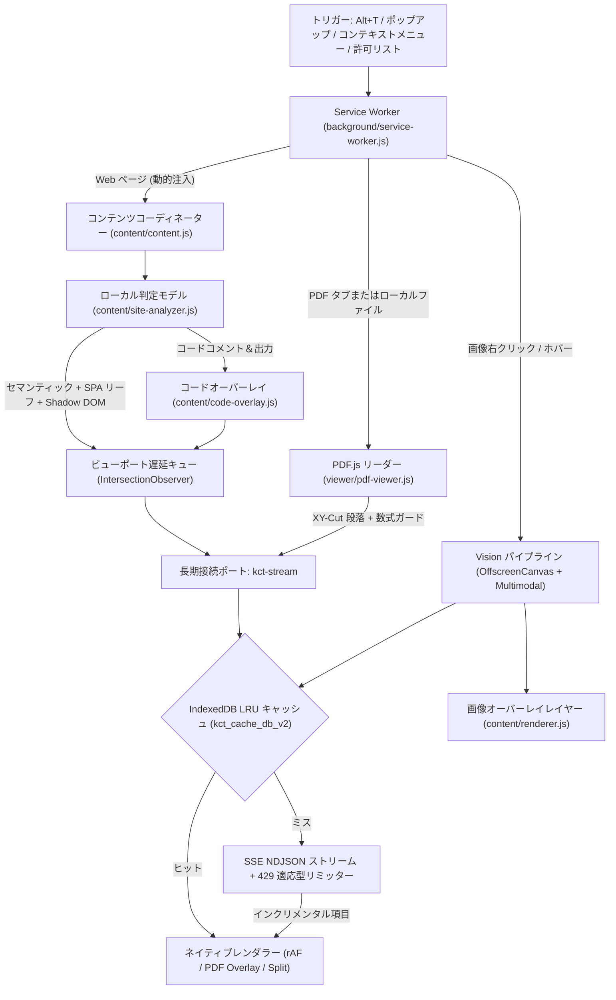

# NativeRead

[English](README.md) · [繁體中文](README.zh-TW.md) · [简体中文](README.zh-CN.md) · **日本語** · [한국어](README.ko.md) · [Español](README.es.md) · [Français](README.fr.md) · [Deutsch](README.de.md)

**NativeRead (v2.2.0)** は、元のページのタイポグラフィとレイアウトを保ったまま、Web ページ、PDF、コードコメント、埋め込みインフォグラフィックを翻訳する Manifest V3 ブラウザ拡張機能およびモバイル PWA です。デフォルトでは完全に静かに待機し、ユーザー自身の LLM API キーを使ってオンデマンドで動作し、読書のリズムを崩さずに段落単位でストリーミング翻訳を行います。

---

## 1. 製品概要とクイックスタート

### 主な機能

| 機能 | 仕組み | 読書体験 |
| --- | --- | --- |
| **デフォルトで静かな Web 翻訳** | 静的な `content_scripts` は一切使用せず、`chrome.scripting` 経由でオンデマンドに動的注入（`Alt+T`、ポップアップボタン、コンテキストメニュー、またはサイト単位の許可リスト `autoTranslateHosts`）。 | 翻訳しないサイトではオーバーヘッドゼロ、フローティング UI ゼロ、API 消費ゼロ。 |
| **内蔵 PDF.js リーダー** | `viewer/pdf-viewer.html` 内にローカルの Apache-2.0 版 `PDF.js`（`vendor/pdfjs/`）をバンドル。リモート PDF、Google ドライブのリンク、ローカルの `.pdf` ドラッグ＆ドロップに対応。 | **Overlay**、**Split**、**Original** の各モードを切り替え可能（`1` / `2` / `3`）。図表、表、独立数式はそのまま保持。 |
| **Google ドライブ PDF ページ内オーバーレイ** | `.ndfHFb-c4YZDc-cYSp0e-DARUcf` ビューアレイヤーをその場で検出し、同一カラム内のテキストボックスを統合、目次のリーダー罫線を再構築し、ページラスター画像から元のグリフメトリクスを計測。 | タブを離れることなく、Google ドライブ上で複数ページの PDF を直接翻訳。 |
| **オンデマンド画像・インフォグラフィックオーバーレイ** | `>= 200x140` px の画像に対する右クリック（**NativeRead Translate Image Text**）またはホバーピル（**譯圖**）のみで起動。ページ内の画像を自動スキャンすることは決してありません。 | 3D 図やイラストを保ったまま、サンプリングした背景色・前景色を使ってテキストブロックをその場で置換。 |
| **コードコメントと Notebook 出力** | 静的 `<pre>` ブロック（Pygments、Prism、Highlight.js、GitHub `.pl-c`）には非破壊な CSS `attr()` スワップ、CodeMirror 6（`.cm-editor`）には読み取り専用オーバーレイ、Jupyter 出力にはクイック翻訳ボタンを提供。 | コードの編集や実行はそのまま可能。エディタにフォーカスするか原文モードに切り替えるとオーバーレイは自動的に非表示。 |
| **モバイル＆クロスプラットフォーム** | スタンドアロンのモバイル PWA（`docs/`）、汎用 Userscript（`docs/nativeread.user.js`）、Android 拡張機能 ZIP（`docs/nativeread-android-extension.zip`）、ローカル QR コード `#nr_sync` 同期を提供。 | API キーを再入力することなく、iOS Safari や Android ブラウザで完全な翻訳ワークフローを利用可能。 |

### クイックスタート（デスクトップ拡張機能）

Chromium 119+（Chrome、Edge、Brave、または互換ブラウザ）が必要です。

1. リポジトリをクローンします：
   ```bash
   git clone https://github.com/Chih-Kai-Wang/native-read.git
   ```
2. `chrome://extensions/`（または `edge://extensions/`）を開き、**デベロッパー モード**を有効にします。
3. **パッケージ化されていない拡張機能を読み込む**をクリックし、クローンした `native-read` ディレクトリを選択します。
4. **NativeRead** ツールバーアイコン → **Options** をクリックし、モデルプロバイダーを選択して API キーを入力し、**Test Connection** をクリックして保存します。
5. 任意の Web ページまたは PDF タブで **`Alt+T`**、ポップアップボタン、または右クリックメニューから翻訳を実行します。ポップアップまたはフローティングピルの `☆` / `★` をクリックすると、現在のドメインを自動翻訳許可リストに追加・削除できます。

### 対応モデルプロバイダー

`shared/config.js`（`PROVIDER_PRESETS`）で設定されています。ローカルエンドポイント（`localhost`、`127.0.0.1`、`0.0.0.0`）では API キーは不要です。

| プロバイダー ID | プロトコル | デフォルト Base URL | デフォルトモデル |
| --- | --- | --- | --- |
| `deepseek` | OpenAI | `https://api.deepseek.com/v1` | `deepseek-chat` |
| `openai` | OpenAI | `https://api.openai.com/v1` | `gpt-4o-mini` |
| `gemini` | Gemini Native | `https://generativelanguage.googleapis.com/v1beta` | `gemini-3.5-flash-lite` |
| `qwen` | OpenAI | `https://dashscope.aliyuncs.com/compatible-mode/v1` | `qwen-plus` |
| `siliconflow` | OpenAI | `https://api.siliconflow.cn/v1` | `deepseek-ai/DeepSeek-V3` |
| `moonshot` | OpenAI | `https://api.moonshot.cn/v1` | `moonshot-v1-8k` |
| `zhipu` | OpenAI | `https://open.bigmodel.cn/api/paas/v4` | `glm-4-flash` |
| `openrouter` | OpenAI | `https://openrouter.ai/api/v1` | `google/gemini-2.5-flash` |
| `custom` | OpenAI | `http://localhost:11434/v1` | `qwen2.5:7b` |

- **翻訳先言語**: `zh-TW`（デフォルト）、`zh-CN`、`ja`、`ko`、`es`、`fr`、`de`、`vi`、`pt`、およびカスタム言語プロンプト。
- **思考深度（`thinkingEffort`）**: `fastest`（デフォルト）、`balanced`、または `deep`。Gemini 3.x/4.x は `thinkingLevel`（`MINIMAL` / `LOW` / `MEDIUM`）に、Gemini 2.5 Flash は `thinkingBudget`（`0` / `512` / `2048`）に、OpenAI `o1`/`o3`/`o4` は `reasoning_effort: "low"` に、DashScope `qwen3` は `fastest` モードで `enable_thinking: false` に自動マッピングされ、レスポンスから `thought` パートが除去されます。

### モバイル＆クロスプラットフォーム対応

- **モバイル PWA（`https://chih-kai-wang.github.io/native-read/`）**: iOS Safari および Android Chrome のホーム画面に追加してインストール可能。モバイル用 PDF.js リーダー（overlay / split / original）、Web URL および直接貼り付けによる記事翻訳、オフライン App Shell（`docs/sw.js`）、ローカル IndexedDB キャッシュを備えています。
- **汎用 Userscript（`https://chih-kai-wang.github.io/native-read/nativeread.user.js`）**: iOS Safari（*Stay* または *Userscripts* 経由）および Android ブラウザ（*Tampermonkey*、*Lemur*、*Kiwi*、*Firefox*）で動作します。ドラッグ可能な Shadow DOM の `NR` エッジタブを注入し、厳格なページ CSP によって `fetch` がブロックされた場合は `GM_xmlhttpRequest` にフォールバックします。
- **Android 拡張機能 ZIP（`https://chih-kai-wang.github.io/native-read/nativeread-android-extension.zip`）**: Chromium ベースの Android ブラウザ（*Lemur*、*Kiwi*、*Quetta*、*Edge Android*）向けの完全な MV3 パッケージ。タッチ選択翻訳（`touchend` / `selectionchange`）に対応しています。
- **ローカル QR コード `#nr_sync` 同期**: デスクトップの Options ページで同期リンクと QR コードを生成し、モバイルでスキャンすると、プロバイダー、API キー、モデル、設定が PWA、Userscript、または Android 拡張機能にインポートされ、URL フラグメントは即座に消去されます。

---

## 2. 技術アーキテクチャ



### 2.1 ローカル・ゼロレイテンシ判定モデル

ページのセグメンテーション、フィルタリング、タイポグラフィの判定はすべて `content/site-analyzer.js` と `content/renderer.js` 内でローカルに実行され、追加の LLM 呼び出しは一切発生しません：

- **本文検出（`findContentRoots`、`scoreReadabilityContainer`）**: 埋め込み Jupyter/Notebook セル（`LESSON_CELL_SELECTOR`）、Google ドライブ PDF ビューアページ（`.ndfHFb-c4YZDc-cYSp0e-DARUcf`）、およびセマンティックコンテナ（`article`、`main`、`[role="main"]`、`.markdown-body`、`.prose`、`#mw-content-text`）を優先します。コンテナは `textLen + pCount * 40` でスコアリングされ、`linkRatio > 0.55` の場合はペナルティ、記事・ドキュメントコンテナには `1.25x` のブーストが適用され、テキストの `>= 65%` を保持するよりタイトな内部コンテナへと絞り込まれます。トップレベルの `#firstHeading` / `h1` 見出しは保持されます。
- **2 パス DOM スキャン（`collectUniversalCandidateElements`）**:
  - *パス 1*: セマンティックブロック（`h1–h6, p, li, blockquote, td, th, figcaption, summary, dt, dd`）を収集し、ネストされたコンテナをスキップしてリーフの散文ブロックのみを取得します。
  - *パス 2*: モダン SPA 向けに `DIV`、`SPAN`、`A`、`LABEL`、`BUTTON` のリーフ候補を走査し、Shadow DOM ホスト、ブロック要素やインタラクティブコントロールを含む要素（`LEAF_FORBIDDEN_DESCENDANT_SELECTOR`）、純粋なメタデータカウンター（`PURE_METADATA_REGEX`）、および `<a href>` リンクのみを囲むラッパー `div`/`span` ノードを除外します。両パスの結果は DOM ドキュメント順（`compareDocumentPosition`）にマージされます。
- **Shadow DOM 走査（`queryAllDeep`、`ensureShadowModeStyle`）**: コードエディタや UI ノード（`SHADOW_SKIP_SELECTOR`）をスキップしながら深さ 5 までのオープンな `shadowRoot` ツリーを走査し、`:host-context(html.kct-mode-*)` ルールを注入することで、Shadow DOM 内でも置換 / 原文 / バイリンガルの切り替えが機能するようにします。
- **インライン保護トークン（`extractBlockContent`、`buildTranslatedFragment`）**: インラインコード（`code, kbd, var`）を `[[C#]]`、数式や引用（`.katex, .MathJax, mjx-container, math, .mwe-math-element, sup.reference`）を `[[M#]]`、短いまたは翻訳不要な `<a href>` リンク（`<= 28` 文字）を `[[L#]]` に置換します。レンダラーは元の DOM ノードを複製（`cloneNode(true)`）して `DocumentFragment` に戻すことで各トークンを復元します。
- **言語フィルタリング（`shouldTranslateText`）**: URL、メールアドレス、ファイルパス、Jupyter の `In[]`/`Out[]` プロンプト、単一トークンの ASCII コード識別子、および Unicode スクリプト比率を用いてすでに翻訳先言語で書かれているテキストを除外します（`zh-TW`/`zh-CN` の場合、漢字比率 `>= 0.55` かつラテン単語 `< 6` のテキストはスキップしつつ、仮名比率 `>= 0.12` の日本語テキストは翻訳対象として維持します）。
- **フォント遺伝子ペアリング（`probeTypography`、`sanitizeFontFamily`、`content/content.css`）**: 計算済み `fontFamily` から各ブロックを `serif`、`sans`、`mono` に分類し、汎用 CSS フォールバックファミリー（`serif`、`sans-serif`、`monospace`、`system-ui` など）を除去して最大 5 つのサイト固有ラテンフォントを `--kct-orig-font` に残し、対応する翻訳先言語スタック（`var(--kct-orig-font), var(--kct-font-serif|sans|mono)`）を連結します。`lineHeight / fontSize < 1.62` の高密度で高さ制限のない散文ブロックには、選択的に `line-height: 1.72` のリフト（`data-kct-lh-lift="1"`）が適用されます。

### 2.2 デュアル PDF ネイティブレイアウト・パイプライン

NativeRead は、ブラウザでの PDF レンダリング方式に合わせて特化した 2 つの PDF パイプラインを備えています：

| ステージ | 内蔵 PDF.js リーダー（`viewer/pdf-viewer.js`） | Google ドライブ ページ内オーバーレイ（`site-analyzer.js` + `renderer.js`） |
| --- | --- | --- |
| **テキスト＆ジオメトリ取得元** | CSS ビューポート座標に変換された `pdfPage.getTextContent()`。回転したテキスト（`\|angle\| > 0.25`）はスキップ。 | `.ndfHFb-c4YZDc-cYSp0e-DARUcf-Df1ZY-bN97Pc-haAclf` 内のパーセンテージ配置された非表示 `<p>` ノード。 |
| **カラム＆段落グルーピング** | ベースライン行クラスタリング、幾何学的な上付き・下付き文字の吸収、連続ガターによるカラム分割、ハイフネーション解除、および再帰的 XY-Cut 読み順（Y-Cut → X-Cut → 内部 X バレー跨ぎ分割）。 | グループを跨ぐ同一カラム統合（`leftDiff <= 3.6%`、`hRatio <= 0.36`）、ハイフネーション解除、および `nearestBelowTop` による安全高さクランプ。吸収された `<p>` ノードは `data-kct-pdf-merged="absorbed"` で非表示化。 |
| **数式＆目次処理** | 独立数式ブロック（`isDisplayedMathBlock`）をスキップし、インライン数式を `[[M#]]` で保護、漏れた LaTeX を Unicode に正規化（`cleanLatexMathInText`）。 | `detectPdfTocEntries` が右揃えの目次行を `>= 3` 行（`1.2%` 以内）検出し、タイトルのみを翻訳して CSS ドットリーダー（`.kct-pdf-toc-leader`）と等幅ページ番号を持つネイティブ flex 行を再構築。 |
| **タイポグラフィ＆ウェイト計測** | `styles` と `commonObjs` から PDF フォントメタデータ（`isSerif`、`isBold`、`isItalic`、`isMono`、`isMathFont`）を読み取り。 | `ensurePdfLayerTypography` がページ `` ラスター画像から直接 x-height インクバンド（ラテン `0.53` / CJK `0.88`）とストローク比率（中央値の `>= 1.3x` = bold）を計測し、ほぼ同じサイズ（`1.08x` 許容）を共通の中央値にクラスタリング。 |
| **色＆衝突保護** | ページごとに 1 回の `ctx.getImageData` で周囲の中央値 `bg` と WCAG コントラスト `fg` をサンプリング。`refineMaxHeightWithCanvasInk` が各段落の下方をスキャンして図表や罫線との重なりを回避し、コンパクトな図表ラベルも検出。 | `samplePdfImageColors` が各ページ ``（`img.currentSrc \|\| img.src` にバインド）から周囲の中央値 `bg` とコントラスト調整済み `fg` をサンプリングし、`2px` の box-shadow ハローと `:hover` 展開を適用。 |
| **表示モード** | **Overlay**、**Split**（キャンバス + 翻訳カード）、**Original**、およびクリック比較ポップオーバー。 | **Replace**、**Original**、**Bilingual**（ホバーでバイリンガルカードに展開するコンパクトなその場オーバーレイ）。 |

### 2.3 オンデマンド・マルチモーダル画像オーバーレイ・パイプライン

1. **明示的なユーザートリガー**: コンテンツ画像（`>= 200x140` px、nav/header/footer および Google ドライブ PDF ページラスターを除く）に対する右クリック（**NativeRead 翻譯圖片文字**）またはホバーピル（**譯圖**）のクリック時のみ起動します。
2. **バックグラウンド取得＆縮小（`background/service-worker.js`）**: `prepareImagePayloadForVision` が Service Worker から `http(s):` 画像をダウンロードし（ページ Canvas の CORS 汚染を回避；上限 16 MB、タイムアウト 20 秒、マジックバイトによる MIME スニッフィング）、ローカル/blob 画像には `data:` URL を受け付けます。`createImageBitmap` + `OffscreenCanvas` を用いて `~480px` のアルファ保持サンプルバッファを作成し、`1600px` または `4 MB` を超える画像は再エンコードします。
3. **構造化 Vision 推論＆色サンプリング**: `callVisionImageLLM` が単一のマルチモーダルリクエスト（Gemini `inlineData` または OpenAI `image_url`、タイムアウト 60 秒）を送信し、0–1000 座標の `{"blocks":[{"box_2d":[ymin,xmin,ymax,xmax],"text":"...","role":"title|badge|body"}]}` を取得します。`sampleImageBoxColors` が各ボックスの周囲最頻値 `bg` と WCAG チェック済み内部 `fg` を計算し、SHA-256 ダイジェストと正規化 URL の両方をキーとして IndexedDB にキャッシュします。
4. **その場オーバーレイ描画（`content/renderer.js`）**: `renderImageVisionOverlay` が `` を `.kct-img-overlay-host` でラップし、`.kct-img-overlay-layer` を正確な画像寸法に合わせ、適応型フォント縮小（`fitVisionOverlayBlock`）で各ブロックを配置し、ユーザーがオンデマンドで **原圖 / 顯示譯圖** を切り替えられるようにします。

### 2.4 ストリーミング、ビューポート遅延読み込み、レート制限、LRU キャッシュ

- **SSE / NDJSON ストリーミング＆耐障害フォールバック**: コンテンツスクリプトと PDF ビューアは長期接続ポート `kct-stream` で接続します。Service Worker は Gemini（`:streamGenerateContent?alt=sse`）または OpenAI（`stream: true`）の NDJSON 行（`{"i":0,"t":"..."}`）をストリーミングし、`createIncrementalJsonScanner` で逐次パースします。欠落項目や切断されたストリームは、再帰的二分法（`translateItemsWithFallback`、深さ 3 まで）を備えたバッチ JSON（`TRANSLATE_BATCH`）へフォールバックします。
- **rAF マイクロバッチ処理＆ビューポート遅延読み込み**: ストリーミングされた Web 翻訳は `renderJobsWithRAF` を通じてアニメーションフレームあたり最大 `15` 項目ずつフラッシュされます（対応環境ではスライス間に `scheduler.yield()` を実行）。画面外ブロックは `IntersectionObserver`（Web は `rootMargin: 600px 0px`、PDF.js は `500px 0px`）で遅延され、ビューポート優先で最大 `3` つの並列バッチワーカー（`batchSize: 20`、`maxBatchChars: 5500`）にキューイングされます。
- **フレーム横断 429 適応型レートリミッター**: `background/service-worker.js` はフレーム全体で同時実行数上限 `3` を強制します。HTTP `429` 発生時には `Retry-After` / `retryDelay` を解析し、90 秒間の適応型ペーシングウィンドウ（同時実行数 `1`、リクエスト間隔 `4.3s`）とグローバルクールダウンを発動し、日次/ゼロクォータ枯渇（`QUOTA_EXCEEDED`）と一時的な RPM 制限（`RATE_LIMITED`）を区別します。
- **IndexedDB LRU キャッシュ（`shared/cache-db.js`）**: `kct_cache_db_v2`（ストア `entries`、`ts` インデックス付き）に最大 `20,000` エントリを保存し、`protocol:model:thinkingEffort:targetLang:customLang:glossaryHash` をキーとします。キャッシュヒット時には `ts` をデバウンス更新（`60s` しきい値、`250ms` デバウンス）し、上限超過時には最も長く使われていないレコードから削除します。

### 2.5 プロジェクト構成

```text
native-read/
├── manifest.json                 # MV3 マニフェスト、権限、Alt+T コマンド（静的 content_scripts なし）
├── shared/
│   ├── config.js                 # スキーマ v5 設定、プロバイダープリセット、思考設定、URL/PDF ヘルパー
│   └── cache-db.js               # IndexedDB kct_cache_db_v2 20,000 エントリ LRU キャッシュ
├── background/
│   └── service-worker.js         # 動的インジェクター、SSE/NDJSON ストリーマー、429 リミッター、Vision エンジン、#nr_sync ガード
├── content/
│   ├── site-analyzer.js          # ローカル判定モデル（Readability、2 パス SPA、Shadow DOM、Drive PDF 統合/目次）
│   ├── code-overlay.js           # 静的 <pre> コメント置換、CodeMirror 6 オーバーレイ、Jupyter 出力翻訳
│   ├── renderer.js               # 安全な DOM レンダラー、フォント遺伝子ペアリング、Drive PDF ラスター計測、画像オーバーレイ
│   ├── content.js                # ビューポート遅延キュー、kct-stream クライアント、Shadow DOM ピル/選択/画像 UI
│   └── content.css               # Replace/Original/Bilingual モード、フォントスタック、Drive PDF＆画像オーバーレイスタイル
├── viewer/                       # 内蔵 PDF.js リーダー（pdf-viewer.html / .css / .js）
├── popup/                        # 拡張機能ポップアップ操作、許可リスト切り替え、PDF リーダー起動
├── options/                      # 設定ページ、プロバイダー/モデル設定、用語集、ローカル QR 同期、キャッシュ管理
├── icons/                        # 拡張機能アイコン（16 / 48 / 128 px）
├── scripts/
│   └── build-mobile.js           # docs/nativeread.user.js、Android ZIP の生成、PDF.js/アイコンのコピー
├── docs/                         # GitHub Pages モバイル PWA（index.html, app.js, app.css, sw.js, 生成バンドル）
├── LICENSE                       # MIT ライセンス
└── README*.md                    # 多言語の製品・アーキテクチャ・セキュリティドキュメント
```

---

## 3. プライバシーとセキュリティアーキテクチャ

| 領域 | 実装 |
| --- | --- |
| **ローカルストレージ** | 拡張機能の設定と API キーは `chrome.storage.local`（`kct_settings_v1`）のみに保存されます。PWA 設定は `localStorage`、Userscript 設定は `GM_getValue`/`GM_setValue`（`localStorage` フォールバック）に保存されます。翻訳キャッシュは IndexedDB（`kct_cache_db_v2`）にローカル保存され、いつでも削除できます。 |
| **ネットワークエンドポイント** | 拡張機能と Userscript の通信は設定した LLM エンドポイントへ直接送信され、API キーは HTTP ヘッダー（`x-goog-api-key` または `Authorization: Bearer`）のみに配置され、エラーメッセージからはマスク（`redactApiKey`）されます。リモート PDF とオンデマンド画像は Service Worker によって元の URL から直接取得されます。 |
| **`#nr_sync` フラグメント処理** | 同期ペイロードは URL の `#` フラグメントのみに格納され（`?query` は不使用）、ブラウザが HTTP リクエストで送信することはありません。`background/service-worker.js` は拡張機能のオリジンまたは `https://chih-kai-wang.github.io/native-read` からの `#nr_sync` のみを受け入れ、明示的な `apiKey` が含まれない限りエンドポイント変更（`baseUrl` / `protocol` / `providerId`）を拒否し、`http:`/`https:` スキームを検証した上で、`history.replaceState` によりフラグメントを即座に消去します。 |
| **ゼロ `innerHTML` DOM 安全性** | すべての翻訳文字列、ポップオーバー、オーバーレイは `document.createTextNode` と `.textContent` 経由で書き込まれます。インラインプレースホルダー（`[[C#]]`、`[[M#]]`、`[[L#]]`）は既存の複製された DOM ノードのみを復元します。 |
| **MV3 CSP＆PDF.js ハードニング** | PDF.js は `viewer/pdf-viewer.js` と `docs/app.js` の両方で `isEvalSupported: false` を指定してローカルにバンドルされています。特権 Service Worker アクション（`ENSURE_AND_COMMAND`、`TEST_CONNECTION`、`OPEN_PDF_VIEWER`、`GET_SW_DEBUG`、`CLEAR_CACHE`）は `isExtensionSender(sender)` を強制します。 |
| **UI＆QR 分離** | フローティングピル、選択ポップオーバー、画像ホバートリガー、Userscript コントロールは Shadow DOM（`all: initial`）内に分離されています。同期用 QR コードは外部 QR サービスを呼び出すことなく Options ページ内でローカル生成されます。 |

> **モバイル PWA（`docs/app.js`）に関する注意**: PDF URL に対して、NativeRead のポリシーはブラウザからの直接フェッチのみです。従来の `api.allorigins.win` CORS プロキシフォールバックを廃止し、タイムアウト付きの直接フェッチとローカルファイルダウンロード案内を採用することで、非公開の PDF URL やバイト列がサードパーティの中継サーバーに送信されないようにしています。PWA のオプション機能である **Web URL** タブでは、クロスオリジンの公開記事抽出（`fetchReadableArticleFromUrl`）に現在 `r.jina.ai`（および `api.allorigins.win` フォールバック）を使用しています。モバイルでサードパーティ中継を一切使いたくない場合は、Web タブに記事テキストを直接貼り付けるか、Userscript または Android 拡張機能をご利用ください。

---

## 開発

モバイル配布用アーティファクトをビルドし、すべての JavaScript ファイルに対して構文チェックを実行します：

```bash
node scripts/build-mobile.js
for f in shared/*.js background/*.js content/*.js popup/*.js options/*.js viewer/*.js scripts/*.js docs/app.js docs/sw.js docs/nativeread.user.js; do node --check "$f" || exit 1; done
```

`docs/nativeread.user.js`、`docs/nativeread-android-extension.zip`、`docs/vendor/pdfjs/`、`docs/icons/`、および `docs/.nojekyll` は `scripts/build-mobile.js` によって生成されます。`shared/`、`content/`、`viewer/`、`docs/app.js` 配下のソースモジュールを編集した後、ビルドスクリプトを再実行してください。

---

## ライセンス

[MIT License](LICENSE) の下で公開されています。バンドルされている PDF.js（`vendor/pdfjs/` および `docs/vendor/pdfjs/`）は Apache-2.0 License の下でライセンスされています（[docs/vendor/pdfjs/LICENSE](docs/vendor/pdfjs/LICENSE) を参照）。