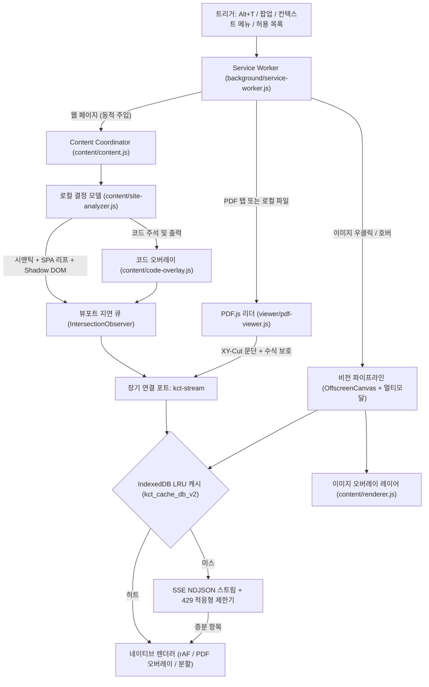

# NativeRead

[English](README.md) · [繁體中文](README.zh-TW.md) · [简体中文](README.zh-CN.md) · [日本語](README.ja.md) · **한국어** · [Español](README.es.md) · [Français](README.fr.md) · [Deutsch](README.de.md)

**NativeRead (v2.2.0)**는 웹 페이지, PDF, 코드 주석, 임베디드 인포그래픽을 원본 페이지의 타이포그래피와 레이아웃을 유지한 채 번역하는 Manifest V3 브라우저 확장 프로그램이자 모바일 PWA입니다. 기본 상태에서는 대기 상태로 조용히 유지되며, 사용자의 LLM API 키를 사용해 요청 시에만 실행되고, 읽기 흐름을 끊지 않고 문단 단위로 번역을 스트리밍합니다.

---

## 1. 제품 개요 및 빠른 시작

### 주요 기능

| 기능 | 작동 방식 | 읽기 경험 |
| --- | --- | --- |
| **기본 대기(Silent-by-Default) 웹 번역** | 정적 `content_scripts` 없음; 요청 시(`Alt+T`, 팝업 버튼, 컨텍스트 메뉴 또는 사이트별 허용 목록 `autoTranslateHosts`) `chrome.scripting`을 통해 동적으로 주입됩니다. | 번역하지 않는 사이트에서는 오버헤드, 플로팅 UI, API 사용량이 전혀 발생하지 않습니다. |
| **내장 PDF.js 리더** | `viewer/pdf-viewer.html` 내부에 로컬 Apache-2.0 `PDF.js`(`vendor/pdfjs/`)를 번들링하며, 원격 PDF, Google Drive 링크 및 로컬 `.pdf` 드래그 앤 드롭을 지원합니다. | **오버레이(Overlay)**, **분할(Split)**, **원본(Original)** 모드(`1` / `2` / `3`) 간 전환이 가능하며, 그림, 표, 수식 블록이 그대로 유지됩니다. |
| **Google Drive PDF 페이지 내 오버레이** | `.ndfHFb-c4YZDc-cYSp0e-DARUcf` 뷰어 레이어를 제자리에서 감지하고, 동일 열의 텍스트 상자를 병합하며, 목차(TOC) 점선 리더를 재구성하고, 페이지 래스터에서 네이티브 글리프 메트릭을 측정합니다. | 탭을 벗어나지 않고 Google Drive 내에서 다중 페이지 Drive PDF를 직접 번역합니다. |
| **온디맨드 이미지 및 인포그래픽 오버레이** | `>= 200x140` px 이미지에서 우클릭(**NativeRead Translate Image Text**) 또는 호버 알약 버튼(**譯圖**)을 통해서만 실행되며, 페이지 이미지를 자동으로 스캔하지 않습니다. | 샘플링된 배경/전경 색상을 사용하여 텍스트 블록을 제자리에서 교체하고, 3D 다이어그램과 일러스트레이션은 보존합니다. |
| **코드 주석 및 노트북 출력** | 정적 `<pre>` 블록(Pygments, Prism, Highlight.js, GitHub `.pl-c`)에 대한 비파괴적 CSS `attr()` 교체, CodeMirror 6(`.cm-editor`)용 읽기 전용 오버레이, Jupyter 출력의 빠른 번역 버튼을 제공합니다. | 코드는 편집 및 실행 가능한 상태로 유지되며, 에디터에 포커스하거나 원본 모드로 전환하면 오버레이가 자동으로 숨겨집니다. |
| **모바일 및 크로스 플랫폼** | 독립 실행형 모바일 PWA(`docs/`), 범용 유저스크립트(`docs/nativeread.user.js`), Android 확장 프로그램 ZIP(`docs/nativeread-android-extension.zip`), 로컬 QR 코드 `#nr_sync` 동기화를 제공합니다. | API 키를 다시 입력할 필요 없이 iOS Safari 및 Android 브라우저에서 전체 번역 워크플로우를 사용할 수 있습니다. |

### 빠른 시작 (데스크톱 확장 프로그램)

Chromium 119+ (Chrome, Edge, Brave 또는 호환 브라우저)가 필요합니다.

1. 저장소 클론:
   ```bash
   git clone https://github.com/Chih-Kai-Wang/native-read.git
   ```
2. `chrome://extensions/` (또는 `edge://extensions/`)를 열고 **개발자 모드**를 활성화합니다.
3. **압축해제된 확장 프로그램을 로드합니다**를 클릭하고 클론한 `native-read` 디렉터리를 선택합니다.
4. **NativeRead** 툴바 아이콘 → **옵션(Options)**을 클릭하고, 모델 제공자를 선택한 뒤 API 키를 입력하고 **Test Connection**을 클릭하여 저장합니다.
5. 아무 웹 페이지나 PDF 탭에서 **`Alt+T`**, 팝업 버튼 또는 우클릭 메뉴로 번역을 실행합니다. 팝업이나 플로팅 알약 버튼에서 `☆` / `★`를 클릭하여 현재 도메인을 자동 번역 허용 목록에 추가하거나 제거할 수 있습니다.

### 지원되는 모델 제공자

`shared/config.js` (`PROVIDER_PRESETS`)에 구성되어 있습니다. 로컬 엔드포인트(`localhost`, `127.0.0.1`, `0.0.0.0`)는 API 키가 필요하지 않습니다.

| 제공자 ID | 프로토콜 | 기본 Base URL | 기본 모델 |
| --- | --- | --- | --- |
| `deepseek` | OpenAI | `https://api.deepseek.com/v1` | `deepseek-chat` |
| `openai` | OpenAI | `https://api.openai.com/v1` | `gpt-4o-mini` |
| `gemini` | Gemini Native | `https://generativelanguage.googleapis.com/v1beta` | `gemini-3.5-flash-lite` |
| `qwen` | OpenAI | `https://dashscope.aliyuncs.com/compatible-mode/v1` | `qwen-plus` |
| `siliconflow` | OpenAI | `https://api.siliconflow.cn/v1` | `deepseek-ai/DeepSeek-V3` |
| `moonshot` | OpenAI | `https://api.moonshot.cn/v1` | `moonshot-v1-8k` |
| `zhipu` | OpenAI | `https://open.bigmodel.cn/api/paas/v4` | `glm-4-flash` |
| `openrouter` | OpenAI | `https://openrouter.ai/api/v1` | `google/gemini-2.5-flash` |
| `custom` | OpenAI | `http://localhost:11434/v1` | `qwen2.5:7b` |

- **대상 언어**: `zh-TW` (기본값), `zh-CN`, `ja`, `ko`, `es`, `fr`, `de`, `vi`, `pt` 및 사용자 지정 언어 프롬프트.
- **사고 강도 (`thinkingEffort`)**: `fastest` (기본값), `balanced`, `deep`. Gemini 3.x/4.x는 `thinkingLevel` (`MINIMAL` / `LOW` / `MEDIUM`)로, Gemini 2.5 Flash는 `thinkingBudget` (`0` / `512` / `2048`)로, OpenAI `o1`/`o3`/`o4`는 `reasoning_effort: "low"`로, DashScope `qwen3`는 `fastest` 모드에서 `enable_thinking: false`로 자동 매핑되며 응답에서 `thought` 파트를 제거합니다.

### 모바일 및 크로스 플랫폼 지원

- **모바일 PWA (`https://chih-kai-wang.github.io/native-read/`)**: iOS Safari 및 Android Chrome에서 홈 화면에 설치할 수 있습니다. 모바일 PDF.js 리더(오버레이 / 분할 / 원본), 웹 URL 및 직접 붙여넣기 문서 번역기, 오프라인 App Shell(`docs/sw.js`), 로컬 IndexedDB 캐싱을 포함합니다.
- **범용 유저스크립트 (`https://chih-kai-wang.github.io/native-read/nativeread.user.js`)**: iOS Safari(*Stay* 또는 *Userscripts* 경유) 및 Android 브라우저(*Tampermonkey*, *Lemur*, *Kiwi*, *Firefox*)에서 실행됩니다. 드래그 가능한 Shadow DOM `NR` 엣지 탭을 주입하며, 엄격한 페이지 CSP가 `fetch`를 차단할 경우 `GM_xmlhttpRequest`로 폴백합니다.
- **Android 확장 프로그램 ZIP (`https://chih-kai-wang.github.io/native-read/nativeread-android-extension.zip`)**: Chromium 기반 Android 브라우저(*Lemur*, *Kiwi*, *Quetta*, *Edge Android*)용 전체 MV3 패키지로, 터치 선택 번역(`touchend` / `selectionchange`)을 지원합니다.
- **로컬 QR 코드 `#nr_sync` 동기화**: 데스크톱 옵션 페이지에서 동기화 링크와 QR 코드를 생성합니다. 모바일에서 스캔하면 제공자, API 키, 모델 및 환경설정이 PWA, 유저스크립트 또는 Android 확장 프로그램으로 가져와지며 URL 프래그먼트는 즉시 삭제됩니다.

---

## 2. 기술 아키텍처



### 2.1 로컬 제로 레이턴시 결정 모델

모든 페이지 분할, 필터링 및 타이포그래피 결정은 추가 LLM 호출 없이 `content/site-analyzer.js`와 `content/renderer.js`에서 로컬로 실행됩니다:

- **본문 영역 감지 (`findContentRoots`, `scoreReadabilityContainer`)**: 임베디드 Jupyter/노트북 셀(`LESSON_CELL_SELECTOR`), Google Drive PDF 뷰어 페이지(`.ndfHFb-c4YZDc-cYSp0e-DARUcf`) 및 시맨틱 컨테이너(`article`, `main`, `[role="main"]`, `.markdown-body`, `.prose`, `#mw-content-text`)를 우선합니다. 컨테이너는 `textLen + pCount * 40`으로 점수가 매겨지며, `linkRatio > 0.55`일 때 감점되고, 기사/문서 컨테이너에는 `1.25x` 가산점이 부여되며, 텍스트의 `>= 65%`를 유지하는 더 좁은 내부 컨테이너로 정제됩니다. 최상위 `#firstHeading` / `h1` 제목은 보존됩니다.
- **2-패스 DOM 스캔 (`collectUniversalCandidateElements`)**:
  - *패스 1*: 시맨틱 블록(`h1–h6, p, li, blockquote, td, th, figcaption, summary, dt, dd`)을 수집하며, 중첩된 컨테이너를 건너뛰어 리프 산문 블록만 선택합니다.
  - *패스 2*: 최신 SPA를 위해 `DIV`, `SPAN`, `A`, `LABEL`, `BUTTON` 리프 후보를 탐색하며, Shadow DOM 호스트, 블록 자식 또는 대화형 컨트롤(`LEAF_FORBIDDEN_DESCENDANT_SELECTOR`)이 있는 요소, 순수 메타데이터 카운터(`PURE_METADATA_REGEX`), `<a href>` 링크만 감싸는 래퍼 `div`/`span` 노드는 제외합니다. 두 패스는 DOM 문서 순서(`compareDocumentPosition`)로 병합됩니다.
- **Shadow DOM 순회 (`queryAllDeep`, `ensureShadowModeStyle`)**: 코드 에디터와 UI 노드(`SHADOW_SKIP_SELECTOR`)를 건너뛰면서 최대 깊이 5까지 열린 `shadowRoot` 트리를 순회하고, `:host-context(html.kct-mode-*)` 규칙을 주입하여 Shadow DOM 내부에서도 교체 / 원본 / 이중 언어 전환이 작동하도록 합니다.
- **인라인 보호 토큰 (`extractBlockContent`, `buildTranslatedFragment`)**: 인라인 코드(`code, kbd, var`)는 `[[C#]]`로, 수식 및 인용(`.katex, .MathJax, mjx-container, math, .mwe-math-element, sup.reference`)은 `[[M#]]`로, 짧거나 번역 불필요한 `<a href>` 링크(`<= 28`자)는 `[[L#]]`로 치환합니다. 렌더러는 원본 DOM 노드를 복제(`cloneNode(true)`)하여 `DocumentFragment`로 각 토큰을 복원합니다.
- **언어 필터링 (`shouldTranslateText`)**: URL, 이메일, 파일 경로, Jupyter `In[]`/`Out[]` 프롬프트, 단일 토큰 ASCII 코드 식별자 및 유니코드 스크립트 비율을 사용해 이미 대상 언어로 작성된 텍스트를 필터링합니다(`zh-TW`/`zh-CN`의 경우 라틴 단어 `< 6`개이면서 한자 비율 `>= 0.55`이면 건너뛰지만, 가나 비율 `>= 0.12`인 일본어 텍스트는 계속 번역합니다).
- **폰트 유전자 페어링 (`probeTypography`, `sanitizeFontFamily`, `content/content.css`)**: 계산된 `fontFamily`에서 각 블록을 `serif`, `sans`, `mono`로 분류하고, 일반 CSS 포괄 패밀리(`serif`, `sans-serif`, `monospace`, `system-ui` 등)를 제거하여 최대 5개의 사이트별 라틴 폰트가 `--kct-orig-font`에 남도록 한 뒤, 일치하는 대상 언어 스택(`var(--kct-orig-font), var(--kct-font-serif|sans|mono)`)을 추가합니다. `lineHeight / fontSize < 1.62`인 조밀하고 줄 제한이 없는 산문 블록에는 선택적 `line-height: 1.72` 리프트(`data-kct-lh-lift="1"`)가 적용됩니다.

### 2.2 이중 PDF 네이티브 레이아웃 파이프라인

NativeRead는 브라우저에서 PDF가 렌더링되는 방식에 맞춰 두 가지 특화된 PDF 파이프라인을 유지합니다:

| 단계 | 내장 PDF.js 리더 (`viewer/pdf-viewer.js`) | Google Drive 페이지 내 오버레이 (`site-analyzer.js` + `renderer.js`) |
| --- | --- | --- |
| **텍스트 및 지오메트리 소스** | CSS 뷰포트 좌표로 변환된 `pdfPage.getTextContent()`; 회전된 텍스트(`\|angle\| > 0.25`)는 건너뜁니다. | `.ndfHFb-c4YZDc-cYSp0e-DARUcf-Df1ZY-bN97Pc-haAclf` 내부의 백분율 위치 지정 숨겨진 `<p>` 노드. |
| **열 및 문단 그룹화** | 베이스라인 행 클러스터링, 기하학적 위첨자/아래첨자 흡수, 연속 거터 열 분할, 하이픈 제거 및 재귀적 XY-Cut 읽기 순서(Y-Cut → X-Cut → 내부 X-밸리 걸침 분할). | 교차 그룹 동일 열 병합(`leftDiff <= 3.6%`, `hRatio <= 0.36`), 하이픈 제거 및 `nearestBelowTop` 안전 높이 클램핑; 흡수된 `<p>` 노드는 `data-kct-pdf-merged="absorbed"`로 숨겨집니다. |
| **수식 및 목차(TOC) 처리** | 표시 수식(`isDisplayedMathBlock`)을 건너뛰고, 인라인 수식은 `[[M#]]`로 보호하며, 유출된 LaTeX를 유니코드로 정규화(`cleanLatexMathInText`)합니다. | `detectPdfTocEntries`가 오른쪽 정렬된 `>= 3`개의 목차 행(`1.2%` 이내)을 찾아 제목만 번역하고, CSS 점선 리더(`.kct-pdf-toc-leader`)와 표 형식 페이지 번호가 있는 네이티브 flex 행으로 재구성합니다. |
| **타이포그래피 및 굵기 크기 조정** | `styles` 및 `commonObjs`에서 PDF 폰트 메타데이터(`isSerif`, `isBold`, `isItalic`, `isMono`, `isMathFont`)를 읽습니다. | `ensurePdfLayerTypography`가 페이지 `` 래스터에서 직접 x-height 잉크 밴드(라틴 `0.53` / CJK `0.88`)와 획 비율(중앙값 `>= 1.3x` = 굵게)을 측정하고, 거의 동일한 크기(`1.08x` 허용 오차)를 공유 중앙값으로 클러스터링합니다. |
| **색상 및 충돌 보호** | 페이지당 단일 `ctx.getImageData`로 둘레 중앙값 `bg` + WCAG 대비 `fg`를 샘플링하며, `refineMaxHeightWithCanvasInk`가 각 문단 아래를 스캔하여 그림/선과 겹치지 않도록 하고 콤팩트한 다이어그램 레이블을 감지합니다. | `samplePdfImageColors`가 각 페이지 ``(`img.currentSrc \|\| img.src`에 바인딩)에서 둘레 중앙값 `bg`와 대비 조정된 `fg`를 샘플링하며, `2px` box-shadow 헤일로와 `:hover` 확장을 적용합니다. |
| **표시 모드** | **오버레이(Overlay)**, **분할(Split)**(캔버스 + 번역 카드), **원본(Original)** 및 클릭 비교 팝오버. | **교체(Replace)**, **원본(Original)** 및 **이중 언어(Bilingual)**(호버 시 이중 언어 카드로 확장되는 콤팩트한 제자리 오버레이). |

### 2.3 온디맨드 멀티모달 이미지 오버레이 파이프라인

1. **명시적 사용자 트리거**: 사용자가 콘텐츠 이미지(`>= 200x140` px, nav/header/footer 및 Google Drive PDF 페이지 래스터 제외)에서 우클릭(**NativeRead 翻譯圖片文字**)하거나 호버 알약 버튼(**譯圖**)을 클릭할 때만 활성화됩니다.
2. **백그라운드 가져오기 및 다운스케일링 (`background/service-worker.js`)**: `prepareImagePayloadForVision`은 Service Worker에서 `http(s):` 이미지를 다운로드하거나(페이지 Canvas CORS 오염 방지; 16 MB 제한, 20초 타임아웃, 매직 바이트 MIME 스니핑) 로컬/blob 이미지용 `data:` URL을 수락합니다. `createImageBitmap` + `OffscreenCanvas`를 사용하여 `~480px` 알파 보존 샘플 버퍼를 생성하고, `1600px` 또는 `4 MB`를 초과하는 이미지를 다시 인코딩합니다.
3. **구조화된 비전 추론 및 색상 샘플링**: `callVisionImageLLM`이 단일 멀티모달 요청(Gemini `inlineData` 또는 OpenAI `image_url`, 60초 타임아웃)을 보내 0–1000 좌표의 `{"blocks":[{"box_2d":[ymin,xmin,ymax,xmax],"text":"...","role":"title|badge|body"}]}`를 반환받습니다. `sampleImageBoxColors`는 각 상자의 최빈 둘레 `bg`와 WCAG 검증된 내부 `fg`를 계산하고, SHA-256 다이제스트와 정규화된 URL 모두로 IndexedDB에 결과를 캐싱합니다.
4. **제자리 오버레이 렌더링 (`content/renderer.js`)**: `renderImageVisionOverlay`가 ``를 `.kct-img-overlay-host`로 감싸고, `.kct-img-overlay-layer`를 정확한 이미지 크기에 맞추며, 적응형 폰트 축소(`fitVisionOverlayBlock`)로 각 블록을 배치하고, 사용자가 요청 시 **原圖 / 顯示譯圖**를 전환할 수 있게 합니다.

### 2.4 스트리밍, 뷰포트 지연 로딩, 속도 제한 및 LRU 캐시

- **SSE / NDJSON 스트리밍 및 복원력 있는 폴백**: 콘텐츠 스크립트와 PDF 뷰어는 장기 연결 `kct-stream` 포트를 통해 연결됩니다. Service Worker는 Gemini(`:streamGenerateContent?alt=sse`) 또는 OpenAI(`stream: true`) NDJSON 라인(`{"i":0,"t":"..."}`)을 스트리밍하며, `createIncrementalJsonScanner`를 통해 증분 파싱합니다. 누락된 항목이나 끊어진 스트림은 재귀적 이분법(`translateItemsWithFallback`, 최대 깊이 3)을 사용하는 배치 JSON(`TRANSLATE_BATCH`)으로 폴백합니다.
- **rAF 마이크로 배칭 및 뷰포트 지연 로딩**: 스트리밍된 웹 번역은 애니메이션 프레임당 최대 `15`개 항목 슬라이스로 `renderJobsWithRAF`를 통해 플러시됩니다(지원되는 경우 슬라이스 간 `scheduler.yield()` 사용). 화면 밖 블록은 `IntersectionObserver`(웹: `rootMargin: 600px 0px`, PDF.js: `500px 0px`)를 통해 지연되며, 최대 `3`개의 동시 배치 워커(`batchSize: 20`, `maxBatchChars: 5500`)로 뷰포트 우선 큐에 대기합니다.
- **교차 프레임 429 적응형 속도 제한기**: `background/service-worker.js`는 프레임 전체에 걸쳐 전역 동시성 상한 `3`을 적용합니다. HTTP `429` 발생 시 `Retry-After` / `retryDelay`를 파싱하여 90초 적응형 페이싱 창(동시성 `1`, 요청 간 간격 `4.3s`)과 전역 쿨다운을 트리거하고, 일일/제로 할당량 소진(`QUOTA_EXCEEDED`)과 일시적 RPM 제한(`RATE_LIMITED`)을 구분합니다.
- **IndexedDB LRU 캐시 (`shared/cache-db.js`)**: `kct_cache_db_v2`(스토어 `entries`, `ts`로 인덱싱됨)에 최대 `20,000`개 항목을 저장하며, 키는 `protocol:model:thinkingEffort:targetLang:customLang:glossaryHash`입니다. 캐시 히트 시 `ts`를 디바운스 갱신(`60s` 임계값, `250ms` 디바운스)하여 오버플로 제거 시 가장 오래전에 사용된 레코드가 삭제되도록 합니다.

### 2.5 프로젝트 구조

```text
native-read/
├── manifest.json                 # MV3 매니페스트, 권한, Alt+T 명령 (정적 content_scripts 없음)
├── shared/
│   ├── config.js                 # 스키마 v5 설정, 제공자 프리셋, 사고 설정, URL/PDF 헬퍼
│   └── cache-db.js               # IndexedDB kct_cache_db_v2 20,000개 항목 LRU 캐시
├── background/
│   └── service-worker.js         # 동적 주입기, SSE/NDJSON 스트리머, 429 제한기, 비전 엔진, #nr_sync 가드
├── content/
│   ├── site-analyzer.js          # 로컬 결정 모델 (Readability, 2-패스 SPA, Shadow DOM, Drive PDF 병합/TOC)
│   ├── code-overlay.js           # 정적 <pre> 주석 교체, CodeMirror 6 오버레이, Jupyter 출력 번역기
│   ├── renderer.js               # 안전한 DOM 렌더러, 폰트 유전자 페어링, Drive PDF 래스터 메트릭, 이미지 오버레이
│   ├── content.js                # 뷰포트 지연 큐, kct-stream 클라이언트, Shadow DOM 알약/선택/이미지 UI
│   └── content.css               # 교체/원본/이중 언어 모드, 폰트 스택, Drive PDF 및 이미지 오버레이 스타일
├── viewer/                       # 내장 PDF.js 리더 (pdf-viewer.html / .css / .js)
├── popup/                        # 확장 프로그램 팝업 컨트롤, 허용 목록 토글, PDF 리더 실행기
├── options/                      # 설정 페이지, 제공자/모델 구성, 용어집, 로컬 QR 동기화, 캐시 제어
├── icons/                        # 확장 프로그램 아이콘 (16 / 48 / 128 px)
├── scripts/
│   └── build-mobile.js           # docs/nativeread.user.js, Android ZIP 생성 및 PDF.js/아이콘 복사
├── docs/                         # GitHub Pages 모바일 PWA (index.html, app.js, app.css, sw.js, 생성된 번들)
├── LICENSE                       # MIT 라이선스
└── README*.md                    # 다국어 제품, 아키텍처 및 보안 문서
```

---

## 3. 개인정보 보호 및 보안 아키텍처

| 영역 | 구현 |
| --- | --- |
| **로컬 저장소** | 확장 프로그램 설정과 API 키는 `chrome.storage.local`(`kct_settings_v1`)에만 저장되며, PWA 설정은 `localStorage`에, 유저스크립트 설정은 `GM_getValue`/`GM_setValue`(`localStorage` 폴백)에 저장됩니다. 번역 캐시는 IndexedDB(`kct_cache_db_v2`)에 로컬로 저장되며 언제든지 삭제할 수 있습니다. |
| **네트워크 엔드포인트** | 확장 프로그램과 유저스크립트 트래픽은 구성된 LLM 엔드포인트로 직접 전송되며, API 키는 HTTP 헤더(`x-goog-api-key` 또는 `Authorization: Bearer`)에만 배치되고 오류 메시지에서 마스킹(`redactApiKey`)됩니다. 원격 PDF와 온디맨드 이미지는 Service Worker가 원본 URL에서 직접 가져옵니다. |
| **`#nr_sync` 프래그먼트 처리** | 동기화 페이로드는 브라우저가 HTTP 요청으로 전송하지 않는 URL `#` 프래그먼트에만 존재합니다(`?query`에는 절대 포함되지 않음). `background/service-worker.js`는 확장 프로그램 출처 또는 `https://chih-kai-wang.github.io/native-read`에서만 `#nr_sync`를 수락하고, 명시적 `apiKey`가 포함되지 않은 엔드포인트 변경(`baseUrl` / `protocol` / `providerId`)을 거부하며, `http:`/`https:` 스킴을 검증하고, `history.replaceState`로 프래그먼트를 즉시 지웁니다. |
| **제로 `innerHTML` DOM 안전성** | 모든 번역 문자열, 팝오버 및 오버레이는 `document.createTextNode`와 `.textContent`를 통해 작성됩니다. 인라인 자리 표시자(`[[C#]]`, `[[M#]]`, `[[L#]]`)는 복제된 기존 DOM 노드만 복원합니다. |
| **MV3 CSP 및 PDF.js 강화** | PDF.js는 `viewer/pdf-viewer.js` 및 `docs/app.js` 모두에서 `isEvalSupported: false`로 로컬 번들링됩니다. 권한이 있는 Service Worker 작업(`ENSURE_AND_COMMAND`, `TEST_CONNECTION`, `OPEN_PDF_VIEWER`, `GET_SW_DEBUG`, `CLEAR_CACHE`)은 `isExtensionSender(sender)`를 강제합니다. |
| **UI 및 QR 격리** | 플로팅 알약 버튼, 선택 팝오버, 이미지 호버 트리거 및 유저스크립트 컨트롤은 Shadow DOM(`all: initial`) 내부에 격리됩니다. 동기화 QR 코드는 외부 QR 서비스를 호출하지 않고 옵션 페이지에서 로컬로 생성됩니다. |

> **모바일 PWA(`docs/app.js`) 관련 참고 사항**: PDF URL의 경우 NativeRead의 정책은 브라우저 직접 가져오기 전용입니다. 비공개 PDF URL/바이트가 타사 릴레이로 전송되지 않도록 기존의 `api.allorigins.win` CORS 프록시 폴백을 제거하고 타임아웃이 있는 직접 가져오기 및 로컬 파일 다운로드 안내를 제공합니다. PWA의 선택적 **Web URL** 탭에서는 교차 출처 공개 문서 추출(`fetchReadableArticleFromUrl`)이 현재 `r.jina.ai`(`api.allorigins.win` 폴백 포함)를 사용합니다. 모바일에서 타사 릴레이를 전혀 사용하지 않으려면 Web 탭에 문서 텍스트를 직접 붙여넣거나 유저스크립트 / Android 확장 프로그램을 사용하세요.

---

## 개발

모바일 배포 아티팩트를 빌드하고 모든 JavaScript 파일에 대해 구문 검사를 실행합니다:

```bash
node scripts/build-mobile.js
for f in shared/*.js background/*.js content/*.js popup/*.js options/*.js viewer/*.js scripts/*.js docs/app.js docs/sw.js docs/nativeread.user.js; do node --check "$f" || exit 1; done
```

`docs/nativeread.user.js`, `docs/nativeread-android-extension.zip`, `docs/vendor/pdfjs/`, `docs/icons/` 및 `docs/.nojekyll`은 `scripts/build-mobile.js`에 의해 생성됩니다. `shared/`, `content/`, `viewer/` 및 `docs/app.js` 아래의 소스 모듈을 편집한 다음 빌드 스크립트를 다시 실행하세요.

---

## 라이선스

[MIT License](LICENSE)에 따라 배포됩니다. 번들된 PDF.js(`vendor/pdfjs/` 및 `docs/vendor/pdfjs/`)는 Apache-2.0 라이선스가 적용됩니다([docs/vendor/pdfjs/LICENSE](docs/vendor/pdfjs/LICENSE) 참조).