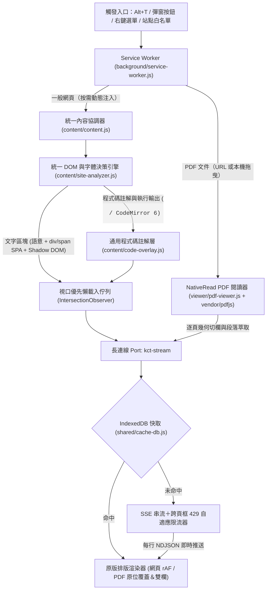

# NativeRead — 原版美感 AI 網頁與 PDF 翻譯（v2.2.0 電腦＆手機全平台版）

> 讓外文網頁與 PDF 白皮書讀起來像母語原版一樣自然 —— **預設靜默按需啟動、統一通用 DOM 遍歷（支援現代 SPA `div`/`span`、Shadow DOM、跨域 `<iframe>` 與程式碼編輯器）、SSE 串流逐段上屏、母語級字體基因配對、內建本機 PDF.js 原位翻譯閱讀器，並完整支援 Android 與 iOS 手機端（PWA / Userscript / Android 擴充包 / 零打字 QR Code 金鑰同步）**。

適用於所有桌面與手機端瀏覽器（Chrome、Edge、Brave、**Ego Lite**、Android **狐猴 Lemur / Kiwi / Edge / Firefox / Tampermonkey**，以及 **iPhone / iPad Safari**），零第三方伺服器中轉，直接使用你自己的 **Google Gemini / DeepSeek / OpenAI / OpenRouter / 本機 Ollama** API Key。

---

## 核心特色

| 核心能力 | 實際做法 | 閱讀體驗 |
| --- | --- | --- |
| **預設靜默・按需注入** | 零靜態常駐 `content_scripts`，未啟動的網站 100% 不注入任何腳本 | 日常瀏覽 0 負擔、0 懸浮球干擾、0 意外 API 消耗 |
| **統一通用 DOM 遍歷** | 不依賴硬編碼站點清單：以 DOM 元件能力驅動，結合語意區塊、現代 SPA `div`/`span`/`a` 葉子文字掃描、開放式 Shadow DOM 與跨域 `<iframe>` | Wikipedia、MDN、GitHub、X/Twitter、Reddit、Notion、Kaggle 課程與各式 Web App 皆走同一條乾淨管線 |
| **母語級原版字體配對** | 逐區塊探測原文計算樣式（Serif / Sans / Mono），保留原站西文字體在前，後方補配對應的母語明體／黑體／等寬字體與溫和行高保護 | 襯線文章自然配明體、現代網站保留原英數字體＋清晰黑體，絕不亂加框線破版 |
| **內建原版 PDF 翻譯閱讀器** | 內建本機 Apache-2.0 `PDF.js`（零外部 CDN），偵測 PDF 分頁按 `Alt+T` 或拖曳本機 `.pdf` 開啟；支援**原位覆蓋／雙欄對照／原版**三模式 | 雙欄論文與 Kaggle 白皮書自動切欄合併段落、取樣原紙張／色塊底色覆蓋，**圖表、架構圖與公式原封不動保留** |
| **SSE 串流＋視口懶載入** | Gemini `:streamGenerateContent?alt=sse` / OpenAI `stream: true` 逐行 NDJSON ＋ `IntersectionObserver` 捲動按需翻譯 | 首段最快 `< 1s` 上屏，長文與數十頁 PDF 捲到哪翻到哪，省下 50–80% Token |
| **思考強度分級控制** | 支援 `極速（最低思考）`／`平衡（Low）`／`深度（Medium）`，自動對應各模型最低思考檔位並過濾 `thought` 片段 | 維持高品質翻譯同時壓低首字延遲與思考 Token 費用 |
| **IndexedDB 本機快取** | 20,000 筆高容量本機 LRU 快取（網頁與 PDF 共享快取引擎） | 重訪已讀頁面與重開 PDF 毫秒命中、不重複扣款 |

---

## 統一架構圖



---

## 主要功能一覽

### 1. 全網站按需翻譯與單站白名單
- **三種即時啟動方式**（免重新整理頁面）：
  - 快捷鍵：**`Alt+T`**（macOS 亦為 `Option+T`；已譯網頁再按可快速在「純譯文 ↔ 原文」間切換；在 PDF 分頁按則直接開啟 PDF 原版翻譯閱讀器）。
  - 工具列彈窗：點擊 **「立即翻譯此頁面」**（或 PDF 分頁上的 **「翻譯此 PDF（原版排版閱讀器）」**），並支援強制重譯、一鍵還原與底部快速入口「PDF 閱讀器」。
  - 頁面右鍵選單：**「翻譯此頁面（NativeRead）」** 或選取文字後點 **「AI 翻譯選取文字」**。
- **單站自動翻譯白名單**：可在彈窗頂部或右下角 Shadow DOM 懸浮列點擊 **`☆ / ★`**，只讓常逛的網域（例如 `www.kaggle.com`、`docs.python.org`）自動啟動翻譯。

### 2. 原版 PDF 翻譯閱讀器（支援 Kaggle 白皮書、arXiv 論文與本機 PDF）
- **三模式一鍵切換**（快捷鍵 `1 / 2 / 3`）：
  1. **原位譯文（預設）**：保留原 PDF 畫布上的插圖、圖表與公式，自動取樣段落周邊底色與對比色，將母語明體／黑體譯文自動縮放貼合在原段落位置；點擊任一段落可彈出原文對照與一鍵複製。
  2. **雙欄對照**：左側完整保留原 PDF 畫布，右側同步排版譯文卡片。
  3. **原版**：一鍵隱藏覆蓋層檢視純原始 PDF。
- **雙欄學術論文切欄保護**：幾何段落分析會偵測多欄間距與縮排，正確保持左右雙欄獨立閱讀順序。
- **支援線上與本機檔案**：透過擴充權限直接抓取跨網域 PDF，也可隨時將電腦上的 `.pdf` 直接拖曳進閱讀器視窗。

### 3. 通用程式碼註解與互動編輯器支援
- 任何網站上的靜態 `<pre>`（Pygments、Prism、Highlight.js、GitHub `.pl-c` 等 `#` / `//` 註解）皆支援非破壞性註解翻譯，保留行內程式碼與數學公式（KaTeX / MathJax）。
- 針對 CodeMirror 6（如 JupyterLab / Kaggle Exercise）採用分離式唯讀疊加層顯示譯文註解；點擊編輯或切回原文自動隱藏，不改動底層程式碼或干擾執行與驗證。
- 偵測到程式執行輸出（如 Notebook Hint / Traceback）時提供「**譯**」按鈕一鍵翻譯並簡述可能原因。

### 4. 多服務商與思考強度控制
- **Google Gemini 原生介面（推薦）**：支援 `gemini-3.5-flash-lite`、`gemini-3.6-flash`、`gemini-3.8-flash`、`gemini-4-hydrogen`、`gemini-2.5-flash` 等，自動配置最低必要思考強度（`MINIMAL` / `LOW` / `thinkingBudget: 0`）。
- **OpenAI 相容端點**：內建 DeepSeek、OpenAI、通義千問 Qwen、SiliconFlow、Moonshot Kimi、智譜 GLM、OpenRouter，以及本機 **Ollama**（`http://localhost:11434/v1`）。

### 5. 手機與平板全平台支援（Android & iOS）
- **零打字掃碼／連結同步 API Key（`#nr_sync`）**：於電腦端設定頁點擊「**產生手機一鍵同步連結 & QR Code**」（由本機純 JS Canvas 繪製 ISO/IEC 18004 QR Code，金鑰僅編碼於不會傳送至伺服器的 URL `#` Fragment），手機掃描後 **0.1 秒自動匯入 API Key 與偏好並清除網址列**。
- **三種手機使用方式（任選或並用）**：
  1. **NativeRead 手機版 PWA（免換瀏覽器 · Android Chrome & iOS Safari 皆可「加到主畫面」）**：
     - 網址：`https://chih-kai-wang.github.io/native-read/`
     - 內建**手機版 PDF.js 原位覆蓋／上下對照白皮書翻譯器**、**網址／文章原版翻譯器**、離線 App Shell 與本機 IndexedDB 快取。
  2. **全平台 Userscript 單檔腳本（`nativeread.user.js`）**：
     - 安裝網址：`https://chih-kai-wang.github.io/native-read/nativeread.user.js`
     - 適用於 **Android**（Tampermonkey / 狐猴 Lemur / Kiwi / Firefox / Via）與 **iPhone / iPad Safari**（搭配免費的 *Stay* 或 *Userscripts* 擴充）；頁緣顯示可上下拖曳的透明 `NR` 觸控膠囊，點一下即可在任何網頁啟動原版串流翻譯與頁內設定面板。
  3. **Android 擴充瀏覽器安裝包（`nativeread-android-extension.zip`）**：
     - 下載網址：`https://chih-kai-wang.github.io/native-read/nativeread-android-extension.zip`
     - 適用於 **狐猴瀏覽器（Lemur Browser）、Kiwi Browser、Quetta、Microsoft Edge Android**，完整具備手機觸控選字（`touchend` / `selectionchange`）劃詞翻譯、可拖曳懸浮列與手機滿版 PDF 閱讀器。

---

## 安裝與快速上手

### 1. 載入未封裝擴充功能
1. Clone 本倉庫：
   ```bash
   git clone https://github.com/Chih-Kai-Wang/native-read.git
   ```
2. 在瀏覽器開啟 `chrome://extensions/`（Edge 為 `edge://extensions/`）。
3. 開啟右上角 **開發人員模式（Developer mode）**。
4. 點擊 **載入未封裝項目（Load unpacked）**，選擇 `native-read` 資料夾。

### 2. 設定 API Key 與偏好
1. 點擊工具列上的 **NativeRead** 圖示 → **模型與 API 設定 ↗**。
2. 選擇服務商（例如 **Google Gemini** 或 **DeepSeek**），填入 API Key 並點擊 **測試連線**，確認成功後 **儲存設定**。
3. 依個人喜好調整目標語言（預設繁體中文・台灣）、原版字體配對、思考強度與自動翻譯白名單。

---

## 隱私與安全

- **零第三方中轉伺服器**：請求皆由瀏覽器背景 Service Worker 直接送往您設定的模型端點，API Key 僅置於 HTTP Header，永不出現在 URL 或日誌。
- **完全本機儲存**：設定存於 `chrome.storage.local`，譯文快取存於本機 IndexedDB，隨時可一鍵清除。
- **嚴格 MV3 CSP 與零 XSS**：停用 PDF.js `eval` 探測（`isEvalSupported: false`）、無內嵌腳本、所有譯文與 UI 均採 `createTextNode` / `textContent` 安全寫入，Service Worker 關鍵控制訊息強制驗證擴充來源（`isExtensionSender`），懸浮列與劃詞彈窗完全隔離於 **Shadow DOM**。

---

## 專案結構

```text
native-read/
├── manifest.json                 # Manifest V3 清單、Alt+T 快捷鍵與按需動態注入權限
├── shared/
│   ├── config.js                 # Schema v5 設定、模型與思考強度解析、多語字體堆疊、PDF 判定與白名單工具
│   └── cache-db.js               # IndexedDB 本機 20,000 筆 LRU 快取層
├── background/
│   └── service-worker.js         # 按需注入器、PDF 閱讀器啟動、右鍵選單、SSE/NDJSON 串流與 429 自適應限流器
├── content/
│   ├── site-analyzer.js          # 統一 DOM 決策引擎（語意區塊 + div/span SPA 葉子掃描 + Shadow DOM + 字體探測）
│   ├── code-overlay.js           # 通用程式碼註解層（靜態 pre / CodeMirror 6 疊加層 / Output 快捷翻譯）
│   ├── renderer.js               # 原版排版安全渲染器（字體基因配對、智慧行高保護、rAF 分幀寫入與還原）
│   ├── content.js                # 視口優先懶載入協調器、kct-stream 串流客戶端與 Shadow DOM 懸浮／劃詞 UI
│   └── content.css               # 頁面層 Serif / Sans / Mono 字體映射、行高保護與模式切換樣式
├── viewer/
│   ├── pdf-viewer.html           # NativeRead 本機 PDF 原版翻譯閱讀器頁面
│   ├── pdf-viewer.css            # 玻璃工具列、原位覆蓋、雙欄對照與深淺色主題樣式
│   └── pdf-viewer.js             # PDF.js 渲染、雙欄幾何段落萃取、周邊底色取樣、自動字級適配與 SSE 串流
├── vendor/pdfjs/                 # Apache-2.0 官方 pdfjs-dist 本機模組（pdf.min.mjs / pdf.worker.min.mjs）
├── popup/                        # 全網與 PDF 通用控制面板（單站白名單與閱讀器入口）
├── options/                      # 進階設定頁（思考強度、排版風格、白名單、API 與 IndexedDB 快取）
├── icons/                        # 擴充功能圖示（16 / 48 / 128 px）
├── LICENSE                       # MIT License
└── README.md
```

---

## 更新日誌

- **`v2.2.0`（Android & iOS 手機全平台版）**：
  - 新增 **NativeRead 手機版 PWA**（`docs/`，支援加入主畫面、手機端 PDF 原位／上下對照白皮書翻譯器與網址文章閱讀器）。
  - 新增 **全平台獨立 Userscript（`docs/nativeread.user.js`）** 與 **Android 擴充功能安裝包（`docs/nativeread-android-extension.zip`）** 自動化建置腳本（`scripts/build-mobile.js`）。
  - 新增電腦端設定頁 **本機 Canvas QR Code 與 `#nr_sync` 零打字手機金鑰同步**（支援 PWA、Userscript 與 Android 擴充瀏覽器自動攔截匯入）。
  - 全面適配手機觸控體驗：觸控選字（`touchend` / `selectionchange`）劃詞翻譯、懸浮列手機安全區域與邊緣上下拖曳、PDF 閱讀器手機螢幕自適應滿版與上下對照排版。
- **`v2.1.0`（NativeRead 正式正名）**：
  - 正式更名為 **NativeRead（`native-read`）**。
  - 移除硬編碼站點清單與 Notebook 特殊架構分流，升級為統一元件能力驅動架構（`code-overlay.js`），新增通用 `div`/`span`/`a` 現代 SPA 葉子文字安全遍歷。
  - 內建本機 **PDF.js 原版翻譯閱讀器**，支援 Kaggle 白皮書、雙欄學術論文與本機拖曳 PDF 的原位覆蓋／雙欄對照／原版切換與依頁懶載入串流翻譯。
  - 強化安全與效能（Service Worker 來源驗證、PDF.js 停用 eval 探測、單頁單次畫布取樣與字體 CSS 注入過濾）。
- **`v2.0.0`**：全網站預設靜默按需動態注入、SSE 串流逐段上屏、視口優先懶載入、原版字體基因配對、三段思考強度控制、Shadow DOM 隔離 UI 與 IndexedDB 快取。
- **`v1.x`**：Kaggle Learn / JupyterLab / CodeMirror 6 專用翻譯、原生 Gemini 3.x 支援與 429 自適應限流。

---

## 授權條款

本專案採用 [MIT License](LICENSE) 開源釋出；`vendor/pdfjs/` 內含之 PDF.js 遵循 Apache-2.0 License（見 [vendor/pdfjs/LICENSE](vendor/pdfjs/LICENSE)）。
