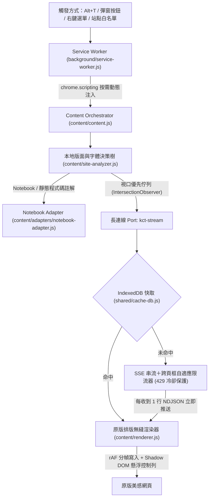

# 原版美感 AI 網頁翻譯助手（v2.0.0）

> 讓外文網頁讀起來像母語原站一樣自然 —— **預設靜默按需啟動、SSE 串流逐段上屏、本地零延遲版面與字體配對引擎、Shadow DOM 隔離 UI**，並完整保留 **Kaggle / JupyterLab / CodeMirror 6** 深度強化能力。

適用於所有 Chromium Manifest V3 瀏覽器（Google Chrome、Microsoft Edge、Brave、Arc、**Ego Lite** 等），零第三方伺服器中轉，直接使用你自己的 **Google Gemini / DeepSeek / OpenAI / OpenRouter / 本機 Ollama** API Key。

---

## 為什麼做這個擴充功能？

市面上的網頁翻譯外掛常有四個痛點：**背景偷偷常駐吃資源**、**粗暴塞入色塊框線破壞原站排版**、**把襯線長文一律強制改成死板黑體**，或是 **遇到 Jupyter Notebook / CodeMirror 編輯器就破壞程式碼與公式**。

本專案自 Kaggle 課程專用翻譯工具（`v1.x`）演進至 **`v2.0.0` 全網站通用版**，專注解決這四件事：

| 核心設計 | 實際做法 | 帶來的體驗 |
| --- | --- | --- |
| **預設靜默・按需注入** | 移除靜態 `content_scripts`，未啟動的網站（包含 Kaggle）完全不注入任何腳本 | 日常瀏覽 0 負擔、0 懸浮球干擾、0 意外 API 消耗 |
| **本地零延遲決策樹** | `< 10 ms` 本地識別網頁類型（Notebook / 技術文件 / 長文 / Web App）、Readability 主文評分、開放式 Shadow DOM 遍歷與語系過濾 | 不靠雲端 LLM 猜排版，精準避開導覽列、公式、程式碼與已是目標語言的文字 |
| **母語級原版字體配對** | 逐區塊探測原文計算樣式（Serif / Sans / Mono），保留原站西文字體在前，後方補配對應的母語明體／黑體／等寬字體與溫和行高 | Wikipedia / Medium 襯線文自動配明體，MDN / GitHub 保留 `Inter`＋清晰黑體，不破版 |
| **SSE 串流＋視口優先** | Gemini `:streamGenerateContent?alt=sse` / OpenAI `stream: true` 搭配逐行 NDJSON ＋ `IntersectionObserver`（上下 600px 預載） | 首段譯文最快 **`0.65s`** 上屏，捲到哪翻到哪，省下 50–80% 無效 Token |
| **思考強度分級控制** | 支援 `極速（最低思考）`／`平衡（Low）`／`深度（Medium）`，自動對應各模型最低思考檔位並過濾 `thought` 片段 | 維持高品質翻譯同時大幅壓低首字延遲與思考 Token 費用 |
| **IndexedDB 高容量快取** | 本機 20,000 筆 LRU 持久化快取（依模型、語言、思考強度與術語表分區） | 重訪已讀頁面秒出譯文、不重複扣款 |

---

## 系統架構



---

## 主要功能一覽

### 1. 全網站按需翻譯與單站白名單
- **三種即時啟動方式**（免重新整理頁面）：
  - 快捷鍵：**`Alt+T`**（macOS 亦為 `Option+T`；已譯頁面再按可快速在「純譯文 ↔ 原文」間切換）。
  - 工具列彈出面板：點擊 **「立即翻譯此頁面」**，支援強制重譯與一鍵還原。
  - 頁面右鍵選單：**「翻譯此頁面」** 或反白文字後選 **「AI 翻譯選取文字」**。
- **單站自動翻譯白名單**：可在彈窗頂部或右下角懸浮列點擊 **`☆ / ★`**，只讓常逛的網站（例如 `www.kaggle.com`、`docs.python.org`）自動翻譯，其餘網站維持靜默。

### 2. 三種顯示模式與多語系支援
- **純譯文（預設）**：直接融入原站版面結構，無任何多餘外框與色塊。
- **僅原文**：一鍵零延遲切回原文對照。
- **簡潔雙語**：以極細左側輔助線呈現原文＋譯文，不擁擠、不干擾視線。
- **支援語言**：繁體中文（台灣慣用語，預設）、簡體中文、日本語、한국어、Español、Français、Deutsch、Tiếng Việt、Português，並支援任意**自訂目標語言**。

### 3. 程式碼註解與 Kaggle / Jupyter Notebook 深度支援
- **通用程式碼註解翻譯**：支援靜態 `<pre>`（Pygments、Prism、Highlight.js、GitHub `.pl-c` 等 `#` / `//` 註解），保留語法高亮與行內公式（LaTeX / KaTeX / MathJax）。
- **CodeMirror 6 非侵入式疊加層**：針對 Kaggle Exercise / JupyterLab v4 互動式程式碼編輯器，採獨立唯讀疊加層顯示註解譯文；點擊編輯或切回原文時自動隱藏，**絕不改動底層程式碼，不干擾執行與 `check()` 驗證**。
- **Output 快捷翻譯與劃詞翻譯**：Code Cell 輸出旁提供「**譯**」按鈕，可一鍵翻譯 `hint()`、`solution()` 與 Python Traceback 並附帶簡短排錯說明；任意網頁選取文字即可彈出隔離式 Shadow DOM 劃詞翻譯卡片。

### 4. 多服務商與思考強度支援
- **Google Gemini 原生介面（推薦）**：支援 `gemini-3.5-flash-lite`（預設高速高性價比）、`gemini-3.6-flash`、`gemini-3.8-flash`、`gemini-4-hydrogen`、`gemini-2.5-flash` 等模型；依設定自動配置 `thinkingLevel`（`MINIMAL` / `LOW` / `MEDIUM`）或 `thinkingBudget: 0`。
- **OpenAI 相容介面**：內建 DeepSeek（`deepseek-chat`）、OpenAI、通義千問 Qwen、SiliconFlow、Moonshot Kimi、智譜 GLM、OpenRouter，以及任何自訂中轉站或本機 **Ollama**（`http://localhost:11434/v1`）。
- **跨頁框自適應限流器**：當遇到免費額度 `HTTP 429` 時自動降為序列排隊、讀取 `Retry-After` / `retryDelay` 平滑退避重試，避免多頁框同時併發撞線。

---

## 安裝與快速上手

### 步驟 1：載入未封裝擴充功能
1. 下載或 Clone 本倉庫：
   ```bash
   git clone https://github.com/Chih-Kai-Wang/kaggle-course-translator.git
   ```
2. 在瀏覽器開啟擴充功能管理頁：
   - Chrome / Brave / Ego Lite：`chrome://extensions/`
   - Edge：`edge://extensions/`
3. 開啟右上角 **開發人員模式（Developer mode）**。
4. 點擊 **載入未封裝項目（Load unpacked）**，選擇 `kaggle-course-translator` 資料夾。

### 步驟 2：填入 API Key 並測試連線
1. 點擊工具列上的擴充功能圖示 → **模型與 API 設定 ↗**。
2. 選擇服務商（例如 **Google Gemini** 或 **DeepSeek**），填入你的 API Key 與模型名稱。
3. 點擊 **測試連線** 確認正常回傳後，按 **儲存設定**。
4. （可選）於設定頁微調：
   - **原版美感字體配對**：`原版自動配對`（預設）／`統一系統黑體`／`完全沿用原站字體`。
   - **思考強度**：`極速 · 最低思考`（預設）／`平衡 · Low`／`深度 · Medium`。
   - **加速選項**：`視口優先懶翻譯`、`SSE 串流逐段上屏`、`每批最大段落數`。
   - **自動翻譯白名單** 與 **領域術語表**（自動於 Notebook 與技術文件站套用，一般新聞／部落格不會被 ML 術語干擾）。

---

## 隱私與安全保證

- **零第三方中轉**：所有請求皆由本機 Service Worker 直接發送至你設定的模型 API 端點，API Key 僅置於 HTTP Header（`x-goog-api-key` / `Authorization`），不出現於 URL 或日誌。
- **完全本機儲存**：設定與 API Key 存於 `chrome.storage.local`，譯文快取存於本機 IndexedDB，設定頁可隨時一鍵清除。
- **嚴格遵循 MV3 CSP 與零 XSS 設計**：無 `eval()`、無 `new Function()`、無內嵌 `<script>`，所有譯文與頁面 DOM 均以 `createTextNode` / `textContent` 安全寫入，絕不使用 `innerHTML` 拼接外部譯文；懸浮工具列與劃詞彈窗完全隔離於 **Shadow DOM**。

---

## 專案結構

```text
kaggle-course-translator/
├── manifest.json                         # Manifest V3 清單、Alt+T 快捷鍵與按需動態注入權限
├── shared/
│   ├── config.js                         # Schema v5 設定、模型預設、思考強度解析、多語字體堆疊與白名單工具
│   └── cache-db.js                       # IndexedDB 本機高容量 LRU 快取層（20,000 筆＋舊版自動遷移）
├── background/
│   └── service-worker.js                 # 按需注入器、右鍵選單、快捷鍵、SSE/NDJSON 串流引擎與 429 自適應限流器
├── content/
│   ├── site-analyzer.js                  # 本地決策樹（站點分類、Readability 主文評分、Shadow DOM 遍歷、語系與字體探測）
│   ├── renderer.js                       # 原版排版安全渲染器（字體族配對、智慧行高保護、rAF 分幀寫入與完整還原）
│   ├── adapters/
│   │   └── notebook-adapter.js           # 程式碼註解（靜態 pre / CodeMirror 6 疊加層）與 Jupyter Output 翻譯按鈕
│   ├── content.js                        # 視口優先懶載入協調器、kct-stream 串流客戶端與 Shadow DOM 懸浮／劃詞 UI
│   └── content.css                       # 頁面層原版字體映射（Serif / Sans / Mono）、行高保護與模式切換樣式
├── popup/                                # 全網通用快速彈窗（單站白名單開關、模式／範圍切換與即時進度）
├── options/                              # 進階設定頁（服務商、思考強度、排版風格、白名單管理、術語表與快取）
├── icons/                                # 擴充功能圖示（16 / 48 / 128 px）
├── LICENSE                               # MIT License
└── README.md
```

---

## 更新日誌

- **`v2.0.0`**：全面升級為全網站原版美感 AI 翻譯擴充功能；改採預設靜默＋按需動態注入、SSE 串流逐段上屏、視口優先 `IntersectionObserver` 懶載入、本地版面決策樹與 Serif/Sans/Mono 字體基因配對、Shadow DOM 隔離 UI、三段思考強度控制、IndexedDB 20,000 筆快取，以及單站自動翻譯白名單。
- **`v1.2.x`**：原生整合 Google Gemini 3.x / 4-Hydrogen API、加入跨頁框自適應 429 冷卻限流器、優化大批次翻譯與手動觸發體驗。
- **`v1.1.x`**：支援多語言目標切換、繁體中文（台灣）原版無框排版、CodeMirror 6 非侵入式 Python 註解疊加層。

---

## 授權條款

本專案採用 [MIT License](LICENSE) 開源釋出，歡迎提出 Issue 或 Pull Request！
