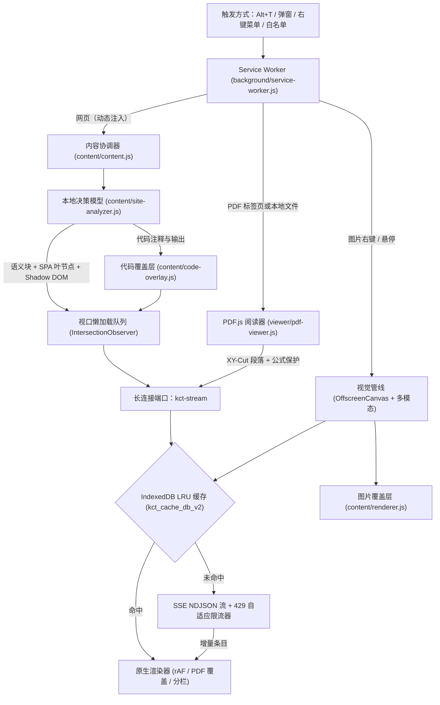

# NativeRead

[English](README.md) · [繁體中文](README.zh-TW.md) · **简体中文** · [日本語](README.ja.md) · [한국어](README.ko.md) · [Español](README.es.md) · [Français](README.fr.md) · [Deutsch](README.de.md)

**NativeRead (v2.2.0)** 是一款 Manifest V3 浏览器扩展程序及移动端 PWA，可在保留原页面排版与版式的前提下，翻译网页、PDF、代码注释及嵌入式信息图。它默认保持静默，仅在需要时通过您自己的 LLM API 密钥按需运行，并逐段流式输出译文，不打断阅读节奏。

---

## 1. 产品概览与快速开始

### 核心功能

| 功能 | 工作原理 | 阅读体验 |
| --- | --- | --- |
| **默认静默的网页翻译** | 零静态 `content_scripts`；仅在按需触发时（`Alt+T`、弹窗按钮、右键菜单或站点白名单 `autoTranslateHosts`）通过 `chrome.scripting` 动态注入。 | 在不翻译的站点上零性能开销、零浮动 UI、零 API 消耗。 |
| **内置 PDF.js 阅读器** | 在 `viewer/pdf-viewer.html` 中捆绑本地 Apache-2.0 协议的 `PDF.js`（`vendor/pdfjs/`）；支持远程 PDF、Google Drive 链接及本地 `.pdf` 拖拽打开。 | 可在**覆盖**、**分栏**和**原文**模式间切换（`1` / `2` / `3`）；图表、表格及独立公式保持完整。 |
| **Google Drive PDF 页内覆盖** | 原位检测 `.ndfHFb-c4YZDc-cYSp0e-DARUcf` 阅读器图层，合并同栏文本框，重建目录点线引导符，并从页面栅格图像中测量原生字形指标。 | 无需离开当前标签页，即可直接在 Google Drive 内翻译多页 PDF。 |
| **按需图片与信息图覆盖** | 严格按需触发：右键菜单（**NativeRead Translate Image Text**）或悬停在 `>= 200x140` px 图片上的胶囊按钮（**譯圖**）；绝不自动扫描页面图片。 | 使用采样的背景色与前景色原位替换文本块，同时保留 3D 图表与插画。 |
| **代码注释与 Notebook 输出** | 针对静态 `<pre>` 代码块（Pygments、Prism、Highlight.js、GitHub `.pl-c`）采用无损 CSS `attr()` 替换；针对 CodeMirror 6（`.cm-editor`）提供只读覆盖层；为 Jupyter 输出提供快速翻译按钮。 | 代码保持可编辑、可运行；聚焦编辑器或切换回原文模式时覆盖层自动隐藏。 |
| **移动端与跨平台** | 提供独立移动端 PWA（`docs/`）、通用用户脚本（`docs/nativeread.user.js`）、Android 扩展程序 ZIP 包（`docs/nativeread-android-extension.zip`）以及本地二维码 `#nr_sync` 同步。 | 在 iOS Safari 和 Android 浏览器上无需重复输入 API 密钥即可获得完整翻译体验。 |

### 快速开始（桌面端扩展程序）

需要 Chromium 119+（Chrome、Edge、Brave 或兼容浏览器）。

1. 克隆仓库：
   ```bash
   git clone https://github.com/Chih-Kai-Wang/native-read.git
   ```
2. 打开 `chrome://extensions/`（或 `edge://extensions/`）并开启**开发者模式**。
3. 点击**加载已解压的扩展程序**，选择克隆下来的 `native-read` 目录。
4. 点击工具栏中的 **NativeRead** 图标 → **Options**，选择模型提供商，输入您的 API 密钥，点击 **Test Connection** 并保存。
5. 在任意网页或 PDF 标签页中，使用 **`Alt+T`**、弹窗按钮或右键菜单触发翻译。点击弹窗或悬浮胶囊上的 `☆` / `★` 可将当前域名加入或移出自动翻译白名单。

### 支持的模型提供商

在 `shared/config.js`（`PROVIDER_PRESETS`）中配置。本地端点（`localhost`、`127.0.0.1`、`0.0.0.0`）无需 API 密钥。

| 提供商 ID | 协议 | 默认 Base URL | 默认模型 |
| --- | --- | --- | --- |
| `deepseek` | OpenAI | `https://api.deepseek.com/v1` | `deepseek-chat` |
| `openai` | OpenAI | `https://api.openai.com/v1` | `gpt-4o-mini` |
| `gemini` | Gemini Native | `https://generativelanguage.googleapis.com/v1beta` | `gemini-3.5-flash-lite` |
| `qwen` | OpenAI | `https://dashscope.aliyuncs.com/compatible-mode/v1` | `qwen-plus` |
| `siliconflow` | OpenAI | `https://api.siliconflow.cn/v1` | `deepseek-ai/DeepSeek-V3` |
| `moonshot` | OpenAI | `https://api.moonshot.cn/v1` | `moonshot-v1-8k` |
| `zhipu` | OpenAI | `https://open.bigmodel.cn/api/paas/v4` | `glm-4-flash` |
| `openrouter` | OpenAI | `https://openrouter.ai/api/v1` | `google/gemini-2.5-flash` |
| `custom` | OpenAI | `http://localhost:11434/v1` | `qwen2.5:7b` |

- **目标语言**：`zh-TW`（默认）、`zh-CN`、`ja`、`ko`、`es`、`fr`、`de`、`vi`、`pt`，以及自定义语言提示词。
- **思考深度（`thinkingEffort`）**：`fastest`（默认）、`balanced` 或 `deep`。自动将 Gemini 3.x/4.x 映射为 `thinkingLevel`（`MINIMAL` / `LOW` / `MEDIUM`），将 Gemini 2.5 Flash 映射为 `thinkingBudget`（`0` / `512` / `2048`），将 OpenAI `o1`/`o3`/`o4` 映射为 `reasoning_effort: "low"`，并在 `fastest` 模式下将 DashScope `qwen3` 设为 `enable_thinking: false`，同时从响应中剥离 `thought` 部分。

### 移动端与跨平台支持

- **移动端 PWA（`https://chih-kai-wang.github.io/native-read/`）**：可在 iOS Safari 和 Android Chrome 中安装到主屏幕。包含移动端 PDF.js 阅读器（覆盖 / 分栏 / 原文）、网页 URL 与直接粘贴文章翻译器、离线 App Shell（`docs/sw.js`）以及本地 IndexedDB 缓存。
- **通用用户脚本（`https://chih-kai-wang.github.io/native-read/nativeread.user.js`）**：可在 iOS Safari（通过 *Stay* 或 *Userscripts*）和 Android 浏览器（*Tampermonkey*、*Lemur*、*Kiwi*、*Firefox*）中运行。注入可拖动的 Shadow DOM `NR` 边缘标签，并在严格页面 CSP 阻止 `fetch` 时自动回退至 `GM_xmlhttpRequest`。
- **Android 扩展程序 ZIP（`https://chih-kai-wang.github.io/native-read/nativeread-android-extension.zip`）**：适用于基于 Chromium 的 Android 浏览器（*Lemur*、*Kiwi*、*Quetta*、*Edge Android*）的完整 MV3 包，支持触摸划词翻译（`touchend` / `selectionchange`）。
- **本地二维码 `#nr_sync` 同步**：在桌面端 Options 页面生成同步链接和二维码；在移动端扫码即可将提供商、API 密钥、模型及偏好设置导入 PWA、用户脚本或 Android 扩展程序，并立即清除 URL 片段。

---

## 2. 技术架构



### 2.1 本地零延迟决策模型

所有页面分段、过滤和排版决策均在 `content/site-analyzer.js` 和 `content/renderer.js` 中本地运行，零额外 LLM 调用：

- **正文区域检测（`findContentRoots`、`scoreReadabilityContainer`）**：优先识别嵌入式 Jupyter/notebook 单元格（`LESSON_CELL_SELECTOR`）、Google Drive PDF 阅读器页面（`.ndfHFb-c4YZDc-cYSp0e-DARUcf`）以及语义容器（`article`、`main`、`[role="main"]`、`.markdown-body`、`.prose`、`#mw-content-text`）。容器按 `textLen + pCount * 40` 评分，当 `linkRatio > 0.55` 时降权，文章/文档容器加权 `1.25x`，并在内部更紧凑容器保留 `>= 65%` 文本时进一步收窄。顶层 `#firstHeading` / `h1` 标题会被保留。
- **两遍 DOM 扫描（`collectUniversalCandidateElements`）**：
  - *第一遍*：收集语义块（`h1–h6, p, li, blockquote, td, th, figcaption, summary, dt, dd`），跳过嵌套容器，仅选取叶级文本块。
  - *第二遍*：针对现代 SPA 遍历 `DIV`、`SPAN`、`A`、`LABEL` 和 `BUTTON` 叶级候选节点，排除 Shadow DOM 宿主、包含块级子元素或交互控件的元素（`LEAF_FORBIDDEN_DESCENDANT_SELECTOR`）、纯元数据计数器（`PURE_METADATA_REGEX`），以及仅包裹 `<a href>` 链接的 `div`/`span` 容器。两遍结果按 DOM 文档顺序（`compareDocumentPosition`）合并。
- **Shadow DOM 遍历（`queryAllDeep`、`ensureShadowModeStyle`）**：最深遍历 5 层开放 `shadowRoot`，跳过代码编辑器和 UI 节点（`SHADOW_SKIP_SELECTOR`），并注入 `:host-context(html.kct-mode-*)` 规则，使替换 / 原文 / 双语模式切换在 Shadow DOM 内同样生效。
- **行内保护标记（`extractBlockContent`、`buildTranslatedFragment`）**：将行内代码（`code, kbd, var`）替换为 `[[C#]]`，将数学公式与引用（`.katex, .MathJax, mjx-container, math, .mwe-math-element, sup.reference`）替换为 `[[M#]]`，将较短或无需翻译的 `<a href>` 链接（`<= 28` 字符）替换为 `[[L#]]`。渲染器通过克隆原始 DOM 节点（`cloneNode(true)`）将其还原至 `DocumentFragment` 中。
- **语言过滤（`shouldTranslateText`）**：过滤 URL、邮箱、文件路径、Jupyter `In[]`/`Out[]` 提示符、单标记 ASCII 代码标识符，以及基于 Unicode 脚本比例判断已属于目标语言的文本（对于 `zh-TW`/`zh-CN`，当汉字比例 `>= 0.55` 且拉丁词 `< 6` 个时跳过，但仍会翻译假名比例 `>= 0.12` 的日文文本）。
- **字体基因配对（`probeTypography`、`sanitizeFontFamily`、`content/content.css`）**：根据计算后的 `fontFamily` 将每个文本块分类为 `serif`、`sans` 或 `mono`，剥离通用 CSS 兜底字体族（`serif`、`sans-serif`、`monospace`、`system-ui` 等），在 `--kct-orig-font` 中保留最多 5 个站点特定拉丁字体，并追加匹配的目标语言字体栈（`var(--kct-orig-font), var(--kct-font-serif|sans|mono)`）。对于 `lineHeight / fontSize < 1.62` 的紧凑未截断文本块，选择性应用 `line-height: 1.72` 提升（`data-kct-lh-lift="1"`）。

### 2.2 双 PDF 原生版式管线

NativeRead 针对浏览器中不同的 PDF 渲染方式维护了两条专用管线：

| 阶段 | 内置 PDF.js 阅读器（`viewer/pdf-viewer.js`） | Google Drive 页内覆盖（`site-analyzer.js` + `renderer.js`） |
| --- | --- | --- |
| **文本与几何来源** | 将 `pdfPage.getTextContent()` 转换为 CSS 视口坐标；跳过旋转文本（`\|angle\| > 0.25`）。 | `.ndfHFb-c4YZDc-cYSp0e-DARUcf-Df1ZY-bN97Pc-haAclf` 内按百分比定位的隐藏 `<p>` 节点。 |
| **分栏与段落分组** | 基线行聚类、几何上下标吸收、连续栏间距分栏、连字符合并，以及递归 XY-Cut 阅读顺序（Y-Cut → X-Cut → 跨栏文本内部 X 谷分割）。 | 跨组同栏合并（`leftDiff <= 3.6%`，`hRatio <= 0.36`）、连字符合并，以及 `nearestBelowTop` 安全高度限制；被吸收的 `<p>` 节点通过 `data-kct-pdf-merged="absorbed"` 隐藏。 |
| **公式与目录处理** | 跳过独立公式（`isDisplayedMathBlock`），使用 `[[M#]]` 保护行内公式，并将泄漏的 LaTeX 规范化为 Unicode（`cleanLatexMathInText`）。 | `detectPdfTocEntries` 识别 `>= 3` 个右对齐的目录行（误差 `1.2%` 以内），仅翻译标题，并使用 CSS 点线引导符（`.kct-pdf-toc-leader`）和等宽页码重建原生 flex 行。 |
| **字体与字重测量** | 从 `styles` 和 `commonObjs` 读取 PDF 字体元数据（`isSerif`、`isBold`、`isItalic`、`isMono`、`isMathFont`）。 | `ensurePdfLayerTypography` 直接从页面 `` 栅格图像测量 x-height 墨迹带（拉丁 `0.53` / 中日韩 `0.88`）和笔画比例（`>= 1.3x` 中位数 = 粗体），并将相近字号（`1.08x` 容差）聚类到同一中位数。 |
| **颜色与防遮挡保护** | 每页单次 `ctx.getImageData` 采样周边中位数 `bg` 与符合 WCAG 对比度的 `fg`；`refineMaxHeightWithCanvasInk` 向下扫描段落下方以避免遮挡图表/线条，并检测紧凑图表标签。 | `samplePdfImageColors` 从每页 ``（绑定至 `img.currentSrc \|\| img.src`）采样周边中位数 `bg` 和对比度调整后的 `fg`，附带 `2px` 阴影光晕及 `:hover` 展开效果。 |
| **显示模式** | **覆盖**、**分栏**（画布 + 译文卡片）、**原文**，以及点击对比弹窗。 | **替换**、**原文**和**双语**（紧凑的原位覆盖，悬停时展开为双语卡片）。 |

### 2.3 按需多模态图片覆盖管线

1. **显式用户触发**：仅当用户右键点击图片（**NativeRead 翻譯圖片文字**）或点击 `>= 200x140` px 正文图片（排除导航/页眉/页脚及 Google Drive PDF 页面栅格图）上的悬停胶囊按钮（**譯圖**）时激活。
2. **后台拉取与降采样（`background/service-worker.js`）**：`prepareImagePayloadForVision` 从 Service Worker 下载 `http(s):` 图片（避免页面 Canvas CORS 污染；16 MB 上限，20 秒超时，魔数 MIME 嗅探），或接受本地/blob 图片的 `data:` URL。使用 `createImageBitmap` + `OffscreenCanvas` 创建保留 Alpha 通道的 `~480px` 采样缓冲区，并对超过 `1600px` 或 `4 MB` 的图片重新编码。
3. **结构化视觉推理与颜色采样**：`callVisionImageLLM` 发送单次多模态请求（Gemini `inlineData` 或 OpenAI `image_url`，60 秒超时），返回 0–1000 坐标系下的 `{"blocks":[{"box_2d":[ymin,xmin,ymax,xmax],"text":"...","role":"title|badge|body"}]}`。`sampleImageBoxColors` 为每个文本框计算周边众数 `bg` 与符合 WCAG 标准的内部 `fg`，并按 SHA-256 摘要和规范化 URL 缓存在 IndexedDB 中。
4. **原位覆盖渲染（`content/renderer.js`）**：`renderImageVisionOverlay` 将 `` 包裹在 `.kct-img-overlay-host` 中，使 `.kct-img-overlay-layer` 精确对齐图片尺寸，通过自适应字号缩小（`fitVisionOverlayBlock`）放置每个文本块，并允许用户随时切换 **原圖 / 顯示譯圖**。

### 2.4 流式传输、视口懒加载、限流与 LRU 缓存

- **SSE / NDJSON 流式传输与弹性回退**：内容脚本与 PDF 阅读器通过长连接端口 `kct-stream` 通信。Service Worker 流式传输 Gemini（`:streamGenerateContent?alt=sse`）或 OpenAI（`stream: true`）的 NDJSON 行（`{"i":0,"t":"..."}`），并通过 `createIncrementalJsonScanner` 增量解析。缺失条目或流中断时自动回退至批量 JSON（`TRANSLATE_BATCH`）及递归二分（`translateItemsWithFallback`，最多 3 层）。
- **rAF 微批处理与视口懒加载**：流式网页译文通过 `renderJobsWithRAF` 以每帧最多 `15` 条的切片刷新（支持时在切片间调用 `scheduler.yield()`）。视口外文本块通过 `IntersectionObserver`（网页 `rootMargin: 600px 0px`；PDF.js `500px 0px`）延迟加载，按视口优先顺序入队，最多 `3` 个并发批量工作线程（`batchSize: 20`，`maxBatchChars: 5500`）。
- **跨帧 429 自适应限流器**：`background/service-worker.js` 跨标签页强制执行全局并发上限 `3`。遇到 HTTP `429` 时，解析 `Retry-After` / `retryDelay`，触发 90 秒自适应调速窗口（并发 `1`，请求间隔 `4.3s`）及全局冷却，并将每日/零配额耗尽（`QUOTA_EXCEEDED`）与临时 RPM 限制（`RATE_LIMITED`）区分开来。
- **IndexedDB LRU 缓存（`shared/cache-db.js`）**：在 `kct_cache_db_v2`（存储区 `entries`，按 `ts` 索引）中最多存储 `20,000` 条记录，键名为 `protocol:model:thinkingEffort:targetLang:customLang:glossaryHash`。缓存命中时会防抖更新 `ts`（`60s` 阈值，`250ms` 防抖），以便在超出容量时淘汰最久未使用的记录。

### 2.5 项目结构

```text
native-read/
├── manifest.json                 # MV3 清单、权限、Alt+T 快捷键（无静态 content_scripts）
├── shared/
│   ├── config.js                 # Schema v5 设置、提供商预设、思考深度配置、URL/PDF 辅助函数
│   └── cache-db.js               # IndexedDB kct_cache_db_v2 20,000 条目 LRU 缓存
├── background/
│   └── service-worker.js         # 动态注入器、SSE/NDJSON 流处理器、429 限流器、视觉引擎、#nr_sync 校验
├── content/
│   ├── site-analyzer.js          # 本地决策模型（Readability、两遍 SPA、Shadow DOM、Drive PDF 合并/目录）
│   ├── code-overlay.js           # 静态 <pre> 注释替换、CodeMirror 6 覆盖层、Jupyter 输出翻译器
│   ├── renderer.js               # 安全 DOM 渲染器、字体基因配对、Drive PDF 栅格测量、图片覆盖层
│   ├── content.js                # 视口懒加载队列、kct-stream 客户端、Shadow DOM 胶囊/划词/图片 UI
│   └── content.css               # 替换/原文/双语模式、字体栈、Drive PDF 与图片覆盖层样式
├── viewer/                       # 内置 PDF.js 阅读器（pdf-viewer.html / .css / .js）
├── popup/                        # 扩展程序弹窗控制、白名单切换、PDF 阅读器启动器
├── options/                      # 设置页面、提供商/模型配置、术语表、本地二维码同步、缓存控制
├── icons/                        # 扩展程序图标（16 / 48 / 128 px）
├── scripts/
│   └── build-mobile.js           # 生成 docs/nativeread.user.js、Android ZIP，并复制 PDF.js/图标
├── docs/                         # GitHub Pages 移动端 PWA（index.html、app.js、app.css、sw.js、生成产物）
├── LICENSE                       # MIT 许可证
└── README*.md                    # 多语言产品、架构与安全文档
```

---

## 3. 隐私与安全架构

| 领域 | 实现方式 |
| --- | --- |
| **本地存储** | 扩展程序设置与 API 密钥仅保存在 `chrome.storage.local`（`kct_settings_v1`）；PWA 设置保存在 `localStorage`；用户脚本设置保存在 `GM_getValue`/`GM_setValue`（回退至 `localStorage`）。翻译缓存本地保存在 IndexedDB（`kct_cache_db_v2`）中，可随时清除。 |
| **网络端点** | 扩展程序和用户脚本流量直接发送至您配置的 LLM 端点，API 密钥严格置于 HTTP 请求头（`x-goog-api-key` 或 `Authorization: Bearer`）中，并在错误消息中脱敏（`redactApiKey`）。远程 PDF 和按需图片由 Service Worker 直接从其源 URL 获取。 |
| **`#nr_sync` 片段处理** | 同步载荷仅存在于 URL `#` 片段中（绝不使用 `?query`），浏览器不会在 HTTP 请求中发送该片段。`background/service-worker.js` 仅接受来自扩展程序源或 `https://chih-kai-wang.github.io/native-read` 的 `#nr_sync`，除非包含显式 `apiKey` 否则拒绝修改端点（`baseUrl` / `protocol` / `providerId`），校验 `http:`/`https:` 协议，并立即使用 `history.replaceState` 清除片段。 |
| **零 `innerHTML` DOM 安全** | 所有译文字符串、弹窗和覆盖层均通过 `document.createTextNode` 和 `.textContent` 写入。行内占位符（`[[C#]]`、`[[M#]]`、`[[L#]]`）仅还原克隆自预先存在的 DOM 节点。 |
| **MV3 CSP 与 PDF.js 加固** | `viewer/pdf-viewer.js` 和 `docs/app.js` 中均本地捆绑 PDF.js 并设置 `isEvalSupported: false`。特权 Service Worker 操作（`ENSURE_AND_COMMAND`、`TEST_CONNECTION`、`OPEN_PDF_VIEWER`、`GET_SW_DEBUG`、`CLEAR_CACHE`）强制执行 `isExtensionSender(sender)` 校验。 |
| **UI 与二维码隔离** | 悬浮胶囊、划词弹窗、图片悬停触发器及用户脚本控件均隔离在 Shadow DOM（`all: initial`）内部。同步二维码在 Options 页面本地生成，不调用任何外部二维码服务。 |

> **关于移动端 PWA（`docs/app.js`）的说明**：针对 PDF URL，NativeRead 的策略是仅使用浏览器直接拉取——已移除旧版 `api.allorigins.win` CORS 代理回退，改为带超时的直接拉取与本地文件下载引导，以确保私有 PDF URL/字节绝不会发送至第三方中继。在 PWA 可选的 **Web URL** 标签页中，跨域公开文章提取（`fetchReadableArticleFromUrl`）目前使用 `r.jina.ai`（附带 `api.allorigins.win` 回退）；如果您在移动端要求零第三方中继，请直接在 Web 标签页粘贴文章文本，或改用用户脚本 / Android 扩展程序。

---

## 开发

构建移动端分发产物并对所有 JavaScript 文件运行语法检查：

```bash
node scripts/build-mobile.js
for f in shared/*.js background/*.js content/*.js popup/*.js options/*.js viewer/*.js scripts/*.js docs/app.js docs/sw.js docs/nativeread.user.js; do node --check "$f" || exit 1; done
```

`docs/nativeread.user.js`、`docs/nativeread-android-extension.zip`、`docs/vendor/pdfjs/`、`docs/icons/` 和 `docs/.nojekyll` 均由 `scripts/build-mobile.js` 生成——请编辑 `shared/`、`content/`、`viewer/` 和 `docs/app.js` 下的源码模块，然后重新运行构建脚本。

---

## 许可证

基于 [MIT License](LICENSE) 发布。捆绑的 PDF.js（`vendor/pdfjs/` 和 `docs/vendor/pdfjs/`）基于 Apache-2.0 许可证发布（参见 [docs/vendor/pdfjs/LICENSE](docs/vendor/pdfjs/LICENSE)）。