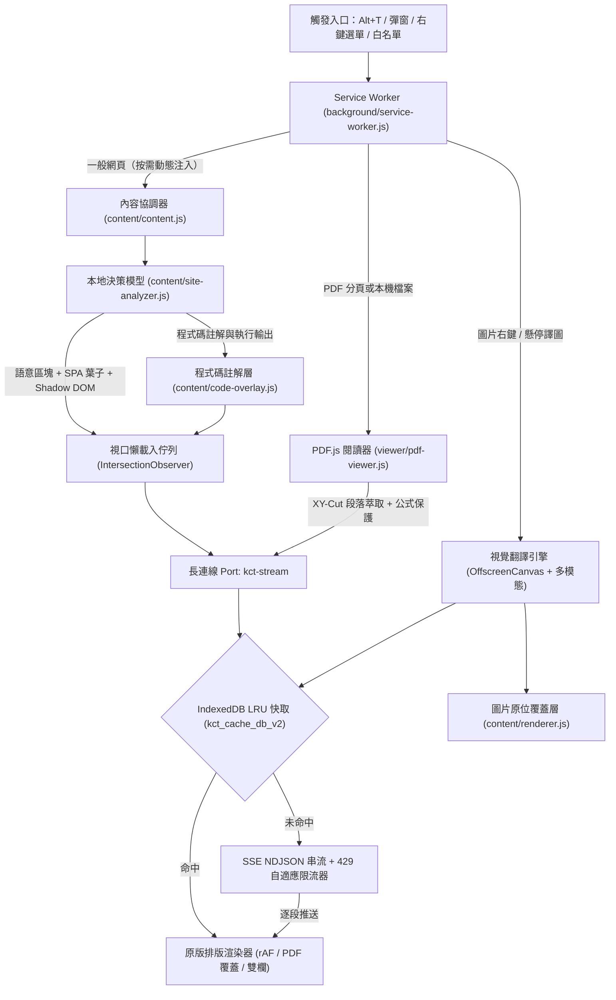

# NativeRead

[English](README.md) · **繁體中文** · [简体中文](README.zh-CN.md) · [日本語](README.ja.md) · [한국어](README.ko.md) · [Español](README.es.md) · [Français](README.fr.md) · [Deutsch](README.de.md)

**NativeRead（v2.2.0）** 是一款 Manifest V3 瀏覽器擴充功能與手機版 PWA，能在保留原網頁字體氣質與排版結構的前提下，翻譯網頁、PDF 文件、程式碼註解與內嵌資訊圖表。它預設靜默、按需啟動、直接使用你自己的大模型 API Key，並以串流方式逐段上屏，維持自然的母語閱讀節奏。

---

## 1. 產品總覽與快速上手

### 核心功能

| 核心能力 | 實作方式 | 閱讀體驗 |
| --- | --- | --- |
| **預設靜默・按需網頁翻譯** | 零靜態 `content_scripts`；僅於觸發時透過 `chrome.scripting` 動態注入（`Alt+T`、彈窗按鈕、右鍵選單或單站白名單 `autoTranslateHosts`）。 | 未翻譯的網站 0 腳本負擔、0 懸浮球干擾、0 意外 API 消耗。 |
| **內建 PDF.js 閱讀器** | 內建本機 Apache-2.0 `PDF.js`（`vendor/pdfjs/`）於 `viewer/pdf-viewer.html`；支援遠端 PDF、Google Drive 連結與本機 `.pdf` 拖曳開啟。 | 一鍵切換 **原位覆蓋**、**雙欄對照**、**原版** 三模式（`1` / `2` / `3`）；圖表、表格與獨立公式原封不動保留。 |
| **Google Drive PDF 頁內原位覆蓋** | 直接偵測 `.ndfHFb-c4YZDc-cYSp0e-DARUcf` 文字層，進行跨群組同欄合併、目錄（TOC）引導點線重建，並由頁面點陣圖量測原始字高與筆畫粗細。 | 免跳離 Google Drive 分頁即可逐頁原位翻譯多頁 PDF。 |
| **按需圖片與資訊圖表覆蓋** | 嚴格按需觸發，透過右鍵選單（**NativeRead 翻譯圖片文字**）或大圖（`>= 200x140` px）右上角懸停按鈕（**譯圖**）啟動；絕不自動掃描全頁圖片。 | 取樣原圖底色與高對比墨色原位替換文字，完整保留 3D 結構圖與插畫。 |
| **程式碼註解與 Notebook 輸出** | 靜態 `<pre>`（Pygments、Prism、Highlight.js、GitHub `.pl-c`）採非破壞性 CSS `attr()` 替換；CodeMirror 6（`.cm-editor`）採唯讀疊加層；Jupyter 執行輸出附快捷「譯」按鈕。 | 程式碼可正常編輯與執行；點擊編輯器或切回原文時疊加層自動隱藏。 |
| **手機與跨平台支援** | 提供獨立手機版 PWA（`docs/`）、全平台 Userscript（`docs/nativeread.user.js`）、Android 擴充包（`docs/nativeread-android-extension.zip`）與本機 QR Code `#nr_sync` 同步。 | iOS Safari 與 Android 瀏覽器皆可完整使用，免重打 API Key。 |

### 快速上手（桌面端擴充功能）

支援 Chromium 119+（Chrome、Edge、Brave 或相容瀏覽器）。

1. Clone 專案倉庫：
   ```bash
   git clone https://github.com/Chih-Kai-Wang/native-read.git
   ```
2. 開啟 `chrome://extensions/`（Edge 為 `edge://extensions/`），啟用右上角 **開發人員模式（Developer mode）**。
3. 點擊 **載入未封裝項目（Load unpacked）**，選擇 `native-read` 資料夾。
4. 點擊工具列上的 **NativeRead** 圖示 → **設定頁**，選擇 AI 服務商、填入 API Key、點擊 **測試連線** 並儲存。
5. 在任意網頁或 PDF 分頁按下 **`Alt+T`**、點擊彈窗按鈕或使用右鍵選單即可啟動翻譯；點擊彈窗或懸浮列上的 `☆` / `★` 可將目前網域加入或移除自動翻譯白名單。

### 支援的模型服務商

定義於 `shared/config.js`（`PROVIDER_PRESETS`）。本機端點（`localhost`、`127.0.0.1`、`0.0.0.0`）無須填寫 API Key。

| 服務商 ID | 協定 | 預設 Base URL | 預設模型 |
| --- | --- | --- | --- |
| `deepseek` | OpenAI | `https://api.deepseek.com/v1` | `deepseek-chat` |
| `openai` | OpenAI | `https://api.openai.com/v1` | `gpt-4o-mini` |
| `gemini` | Gemini 原生 | `https://generativelanguage.googleapis.com/v1beta` | `gemini-3.5-flash-lite` |
| `qwen` | OpenAI | `https://dashscope.aliyuncs.com/compatible-mode/v1` | `qwen-plus` |
| `siliconflow` | OpenAI | `https://api.siliconflow.cn/v1` | `deepseek-ai/DeepSeek-V3` |
| `moonshot` | OpenAI | `https://api.moonshot.cn/v1` | `moonshot-v1-8k` |
| `zhipu` | OpenAI | `https://open.bigmodel.cn/api/paas/v4` | `glm-4-flash` |
| `openrouter` | OpenAI | `https://openrouter.ai/api/v1` | `google/gemini-2.5-flash` |
| `custom` | OpenAI | `http://localhost:11434/v1` | `qwen2.5:7b` |

- **目標語言**：預設 `zh-TW`（繁體中文・台灣），並內建 `zh-CN`、`ja`、`ko`、`es`、`fr`、`de`、`vi`、`pt` 與自訂語言。
- **思考強度（`thinkingEffort`）**：支援 `fastest`（預設）、`balanced`、`deep`。`fastest` 模式下自動將 Gemini 3.x/4.x 對應至 `thinkingLevel`（`MINIMAL` / `LOW` / `MEDIUM`）、Gemini 2.5 Flash 對應至 `thinkingBudget`（`0` / `512` / `2048`）、OpenAI `o1`/`o3`/`o4` 設為 `reasoning_effort: "low"`、阿里雲 `qwen3` 設為 `enable_thinking: false`，並於回應解析時過濾 `thought` 片段。

### 手機與跨平台使用方式

- **手機版 PWA（`https://chih-kai-wang.github.io/native-read/`）**：支援 iOS Safari 與 Android Chrome「加入主畫面」，內建手機版 PDF.js 閱讀器（原位覆蓋／雙欄對照／原版）、網址與貼上文章翻譯器、離線 App Shell（`docs/sw.js`）與本機 IndexedDB 快取。
- **全平台 Userscript（`https://chih-kai-wang.github.io/native-read/nativeread.user.js`）**：適用於 iOS Safari（搭配 *Stay* 或 *Userscripts*）與 Android（*Tampermonkey*、*狐猴 Lemur*、*Kiwi*、*Firefox*）。頁緣提供可上下拖曳的 Shadow DOM `NR` 觸控膠囊，遇到嚴格頁面 CSP 阻擋 `fetch` 時自動降級為 `GM_xmlhttpRequest`。
- **Android 擴充功能包（`https://chih-kai-wang.github.io/native-read/nativeread-android-extension.zip`）**：完整 MV3 擴充包，支援 *狐猴 Lemur*、*Kiwi*、*Quetta*、*Edge Android*，並整合觸控選字（`touchend` / `selectionchange`）劃詞翻譯。
- **本機 QR Code `#nr_sync` 同步**：於桌面設定頁產生同步連結與本機 QR Code，手機掃描後自動匯入服務商、API Key、模型與偏好至 PWA、Userscript 或 Android 擴充功能，並立即清除網址列錨點。

---

## 2. 系統技術架構



### 2.1 本地零延遲決策模型

所有正文判斷、過濾與字體配對皆於 `content/site-analyzer.js` 與 `content/renderer.js` 本地即時完成，不消耗額外模型請求：

- **主內容偵測（`findContentRoots`、`scoreReadabilityContainer`）**：優先辨識 Jupyter / Notebook 渲染格（`LESSON_CELL_SELECTOR`）、Google Drive PDF 檢視器頁面（`.ndfHFb-c4YZDc-cYSp0e-DARUcf`）與語意容器（`article`、`main`、`[role="main"]`、`.markdown-body`、`.prose`、`#mw-content-text`）。以 `textLen + pCount * 40` 計分，連結率 `linkRatio > 0.55` 時施加懲罰，文章容器加權 `1.25x`，若內層容器涵蓋 `>= 65%` 文字則收斂至內層，並保留頁面主標題（`#firstHeading` / `h1`）。
- **雙階段 DOM 掃描（`collectUniversalCandidateElements`）**：
  - *Pass 1*：掃描語意區塊（`h1–h6, p, li, blockquote, td, th, figcaption, summary, dt, dd`），僅認領無子區塊的葉子段落。
  - *Pass 2*：針對現代 SPA 遍歷 `DIV`、`SPAN`、`A`、`LABEL`、`BUTTON` 葉子文字，排除 Shadow DOM 宿主、含區塊子元素或互動控制項（`LEAF_FORBIDDEN_DESCENDANT_SELECTOR`）、純數據中繼文字（`PURE_METADATA_REGEX`）以及僅包覆 `<a href>` 的外層容器。兩階段結果依 DOM 文件順序（`compareDocumentPosition`）合併排序。
- **Shadow DOM 穿透（`queryAllDeep`、`ensureShadowModeStyle`）**：深度最多 5 層遞迴掃描開放式 `shadowRoot`（略過程式碼編輯器與 UI 節點 `SHADOW_SKIP_SELECTOR`），並注入 `:host-context(html.kct-mode-*)` 規則確保譯文／原文／雙語模式在 Shadow DOM 內同步生效。
- **行內保護區符記（`extractBlockContent`、`buildTranslatedFragment`）**：將行內程式碼（`code, kbd, var`）轉為 `[[C#]]`，數學公式與引用（`.katex, .MathJax, mjx-container, math, .mwe-math-element, sup.reference`）轉為 `[[M#]]`，短／非翻譯 `<a href>` 連結（`<= 28` 字元）轉為 `[[L#]]`。渲染時以 `cloneNode(true)` 原生還原原始 DOM 節點至 `DocumentFragment`。
- **語系過濾（`shouldTranslateText`）**：略過網址、電子郵件、檔案路徑、Jupyter `In[]`/`Out[]` 提示、單一 ASCII 程式碼識別碼，並依 Unicode 字元比例跳過已是目標語言的段落（繁中／簡中目標下，漢字比例 `>= 0.55` 且拉丁單字 `< 6` 個時略過，但含假名比例 `>= 0.12` 的日文仍會翻譯）。
- **字體基因配對（`probeTypography`、`sanitizeFontFamily`、`content/content.css`）**：逐區塊由計算樣式判別 `serif` / `sans` / `mono`，剝離尾端通用字族（`serif`、`sans-serif`、`monospace`、`system-ui` 等）後保留最多 5 個原站西文字體至 `--kct-orig-font`，後方補配對應母語字體堆疊（`var(--kct-orig-font), var(--kct-font-serif|sans|mono)`）。未截斷且 `lineHeight / fontSize < 1.62` 的長文區塊會選擇性提升行高至 `1.72`（`data-kct-lh-lift="1"`）。

### 2.2 雙軌 PDF 原版排版管線

針對瀏覽器呈現 PDF 的兩種方式，NativeRead 維護兩條專用原版排版管線：

| 處理階段 | 內建 PDF.js 閱讀器（`viewer/pdf-viewer.js`） | Google Drive 頁內覆蓋（`site-analyzer.js` + `renderer.js`） |
| --- | --- | --- |
| **文字與座標來源** | `pdfPage.getTextContent()` 轉換至 CSS 視口座標；略過旋轉文字（`\|angle\| > 0.25`）。 | `.ndfHFb-c4YZDc-cYSp0e-DARUcf-Df1ZY-bN97Pc-haAclf` 內以百分比定位的隱藏 `<p>` 文字層。 |
| **切欄與段落合併** | 基線聚類、幾何上下標吸收、連續欄溝偵測切欄、跨行連字號還原，以及遞迴 XY-Cut 閱讀順序（Y-Cut → X-Cut → 內谷跨欄拆分）。 | 跨群組同欄合併（`leftDiff <= 3.6%`、`hRatio <= 0.36`）、連字號還原與 `nearestBelowTop` 安全高度夾制；被合併 `<p>` 標記 `data-kct-pdf-merged="absorbed"` 隱藏。 |
| **公式與目錄處理** | 跳過獨立公式區塊（`isDisplayedMathBlock`）、行內公式以 `[[M#]]` 保護，並將殘留 LaTeX 轉為 Unicode（`cleanLatexMathInText`）。 | `detectPdfTocEntries` 偵測 `>= 3` 列右對齊頁碼的目錄列（誤差 `1.2%` 內），僅翻譯標題並以彈性排版重建 CSS 引導點線（`.kct-pdf-toc-leader`）與等寬頁碼。 |
| **字級與字重判定** | 由 `styles` 與 `commonObjs` 讀取 PDF 字體中繼資料（`isSerif`、`isBold`、`isItalic`、`isMono`、`isMathFont`）。 | `ensurePdfLayerTypography` 直接量測頁面 `` 光柵的 x-height 墨水帶（拉丁 `0.53` / CJK `0.88`）與筆畫粗細比（`>= 1.3x` 中位數判為粗體），並將相近字級（`1.08x` 容差）聚類對齊。 |
| **色彩與防撞保護** | 單頁一次 `ctx.getImageData` 取樣邊框中位數底色與 WCAG 對比字色；`refineMaxHeightWithCanvasInk` 向下掃描畫布墨水避免蓋到圖表與線條，並辨識緊湊圖表標籤。 | `samplePdfImageColors` 依各頁 ``（綁定 `img.currentSrc \|\| img.src`）取樣底色與對比修正字色，搭配 `2px` 光暈與 `:hover` 展開檢視。 |
| **顯示模式** | **原位覆蓋**、**雙欄對照**（畫布＋譯文卡片）、**原版**，並支援點擊段落彈出原文對照與複製。 | **譯文**、**原文**、**雙語**（預設精簡原位顯示，滑鼠懸停展開雙語對照卡片）。 |

### 2.3 按需多模態圖片原位覆蓋管線

1. **使用者明確觸發**：僅在使用者對圖片點右鍵（**NativeRead 翻譯圖片文字**）或懸停大圖（`>= 200x140` px，排除導覽列與 Google Drive PDF 底圖）點擊 **譯圖** 時啟動。
2. **背景擷取與智慧縮放（`background/service-worker.js`）**：`prepareImagePayloadForVision` 於 Service Worker 背景下載 `http(s):` 圖片（繞過頁面 Canvas CORS 限制；上限 16 MB、20 秒逾時、魔術位元組 MIME 偵測），或接收本機／`blob:` 圖片的 `data:` URL。透過 `createImageBitmap` + `OffscreenCanvas` 建立 `~480px` 保留透明通道的取樣緩衝區，並對超過 `1600px` 或 `4 MB` 的圖片自動縮放重編碼。
3. **多模態推論與取色**：`callVisionImageLLM` 單次呼叫多模態端點（Gemini `inlineData` 或 OpenAI `image_url`，60 秒逾時），回傳 0–1000 座標的 `{"blocks":[{"box_2d":[ymin,xmin,ymax,xmax],"text":"...","role":"title|badge|body"}]}`。`sampleImageBoxColors` 計算每個區塊的邊框主色 `bg` 與符合 WCAG 對比的字色 `fg`，並以 SHA-256 摘要與正規化網址雙鍵寫入 IndexedDB 快取。
4. **原位覆蓋渲染（`content/renderer.js`）**：`renderImageVisionOverlay` 建立 `.kct-img-overlay-host` 與對齊圖片邊界的 `.kct-img-overlay-layer`，依角色繪製譯文區塊並自適應縮放字級（`fitVisionOverlayBlock`），支援隨時切換 **原圖 / 顯示譯圖**。

### 2.4 串流傳輸、視口懶載入、限流與 LRU 快取

- **SSE / NDJSON 串流與韌性降級**：內容腳本與 PDF 閱讀器透過 `kct-stream` 長連線 Port 與 Service Worker 通訊。背景端串流解析 Gemini（`:streamGenerateContent?alt=sse`）或 OpenAI（`stream: true`）的逐行 NDJSON（`{"i":0,"t":"..."}`，使用 `createIncrementalJsonScanner`）；若漏項或串流失敗則自動降級為批次 JSON（`TRANSLATE_BATCH`）並支援遞迴二分重試（`translateItemsWithFallback`，最多 3 層）。
- **rAF 微批次上屏與視口懶載入**：網頁串流結果透過 `renderJobsWithRAF` 以每幀最多 `15` 項寫入 DOM（支援時搭配 `scheduler.yield()` 讓出主執行緒）。視口外段落交由 `IntersectionObserver`（網頁 `rootMargin: 600px 0px`；PDF.js `500px 0px`）捲動按需排程，視口優先排序並以最多 `3` 個並行批次工作執行（預設 `batchSize: 20`、`maxBatchChars: 5500`）。
- **跨頁框 429 自適應限流器**：`background/service-worker.js` 全域控管跨頁框併發數上限為 `3`。遭遇 HTTP `429` 時解析 `Retry-After` / `retryDelay`，啟動 90 秒自適應節流（併發降至 `1`、請求間隔 `4.3s`）與全域冷卻，並區分每日／零配額上限（`QUOTA_EXCEEDED`）與短期頻率限制（`RATE_LIMITED`）。
- **IndexedDB LRU 快取（`shared/cache-db.js`）**：於 `kct_cache_db_v2`（`entries` 資料表、`ts` 索引）儲存最多 `20,000` 筆譯文，快取鍵包含 `protocol:model:thinkingEffort:targetLang:customLang:glossaryHash`。命中時節流更新 `ts`（`60s` 門檻、`250ms` 防抖），超量時依 `ts` 游標淘汰最久未使用項目。

### 2.5 專案目錄結構

```text
native-read/
├── manifest.json                 # MV3 清單、權限與 Alt+T 快捷鍵（無靜態 content_scripts）
├── shared/
│   ├── config.js                 # Schema v5 設定、服務商預設、思考強度解析、網址與 PDF 工具
│   └── cache-db.js               # IndexedDB kct_cache_db_v2 20,000 筆 LRU 快取層
├── background/
│   └── service-worker.js         # 按需注入器、SSE/NDJSON 串流、429 限流器、視覺引擎與 #nr_sync 驗證
├── content/
│   ├── site-analyzer.js          # 本地決策模型（Readability、雙階段 SPA、Shadow DOM、Drive PDF 合併/目錄）
│   ├── code-overlay.js           # 靜態 <pre> 註解替換、CodeMirror 6 疊加層、Jupyter 輸出翻譯
│   ├── renderer.js               # 安全 DOM 渲染、字體基因配對、Drive PDF 光柵量測、圖片覆蓋層
│   ├── content.js                # 視口懶載入佇列、kct-stream 客戶端、Shadow DOM 懸浮／劃詞／譯圖 UI
│   └── content.css               # 譯文／原文／雙語模式、多語字體堆疊、Drive PDF 與圖片覆蓋樣式
├── viewer/                       # 內建 PDF.js 閱讀器（pdf-viewer.html / .css / .js）
├── popup/                        # 擴充功能彈窗控制、白名單切換與 PDF 閱讀器入口
├── options/                      # 設定頁、模型與術語表配置、本機 QR 同步與快取管理
├── icons/                        # 擴充功能圖示（16 / 48 / 128 px）
├── scripts/
│   └── build-mobile.js           # 自動產出 docs/nativeread.user.js、Android ZIP 並同步 PDF.js 與圖示
├── docs/                         # GitHub Pages 手機版 PWA（index.html、app.js、app.css、sw.js 與建置產物）
├── LICENSE                       # MIT License
└── README*.md                    # 多語系產品介紹、技術規格與安全文件
```

---

## 3. 隱私與安全架構

| 安全面向 | 實作細節 |
| --- | --- |
| **完全本機儲存** | 擴充功能設定與 API Key 僅存於 `chrome.storage.local`（`kct_settings_v1`）；PWA 存於 `localStorage`；Userscript 存於 `GM_getValue`/`GM_setValue`（降級 `localStorage`）。譯文快取存於本機 IndexedDB（`kct_cache_db_v2`），可隨時一鍵清除。 |
| **直連模型端點** | 擴充功能與 Userscript 僅直連你設定的模型端點，API Key 嚴格置於 HTTP Header（`x-goog-api-key` 或 `Authorization: Bearer`），錯誤訊息皆經 `redactApiKey` 遮罩；遠端 PDF 與按需圖片由 Service Worker 直接向來源網址下載。 |
| **`#nr_sync` 錨點安全機制** | 同步負載僅編碼於 URL `#` Fragment（絕不使用 `?query`），依 HTTP 規範不會傳送至伺服器。`background/service-worker.js` 嚴格限制僅接受擴充自身來源或官方 PWA（`https://chih-kai-wang.github.io/native-read`），未附帶明確 `apiKey` 時拒絕變更 `baseUrl` / `protocol` / `providerId`，驗證 `http:`/`https:` 協定，並於匯入後立即以 `history.replaceState` 抹除錨點。 |
| **零 `innerHTML` 防 XSS** | 所有譯文、彈窗與覆蓋層文字皆透過 `document.createTextNode` 與 `.textContent` 寫入；行內佔位符（`[[C#]]`、`[[M#]]`、`[[L#]]`）僅複製頁面既有原始 DOM 節點。 |
| **MV3 CSP 與 PDF.js 加固** | PDF.js 完全本機化打包，且於 `viewer/pdf-viewer.js` 與 `docs/app.js` 皆停用 `eval` 探測（`isEvalSupported: false`）。Service Worker 關鍵控制訊息（`ENSURE_AND_COMMAND`、`TEST_CONNECTION`、`OPEN_PDF_VIEWER`、`GET_SW_DEBUG`、`CLEAR_CACHE`）強制驗證 `isExtensionSender(sender)`。 |
| **介面與 QR 碼隔離** | 懸浮控制列、劃詞彈窗、圖片懸停按鈕與 Userscript 介面均封裝於 Shadow DOM（`all: initial`）。手機同步 QR Code 於設定頁純本機端繪製，不將金鑰傳送至任何外部 QR 服務。 |

> **關於手機版 PWA（`docs/app.js`）的跨網域說明**：針對 PDF 網址，NativeRead 採取僅直連政策——移除舊版 `api.allorigins.win` CORS 代理降級，改為直連搭配逾時提示並引導下載後開啟本機檔案，避免私密 PDF 網址或內容經過第三方伺服器。PWA 的選用 **網頁翻譯** 分頁目前在擷取跨網域公開網頁時（`fetchReadableArticleFromUrl`）會透過 `r.jina.ai`（降級 `api.allorigins.win`）解析正文；若你在手機端需要 100% 零第三方中繼，請改用該分頁的「直接貼上外文段落」，或安裝 Userscript／Android 擴充功能。

---

## 開發與建置

執行手機端建置腳本並對全部 JavaScript 檔案進行語法檢查：

```bash
node scripts/build-mobile.js
for f in shared/*.js background/*.js content/*.js popup/*.js options/*.js viewer/*.js scripts/*.js docs/app.js docs/sw.js docs/nativeread.user.js; do node --check "$f" || exit 1; done
```

`docs/nativeread.user.js`、`docs/nativeread-android-extension.zip`、`docs/vendor/pdfjs/`、`docs/icons/` 與 `docs/.nojekyll` 皆為 `scripts/build-mobile.js` 自動產生之檔案——請直接修改 `shared/`、`content/`、`viewer/` 與 `docs/app.js` 原始碼後重新執行建置腳本。

---

## 授權條款

本專案採用 [MIT License](LICENSE) 開源釋出；隨附之 PDF.js（`vendor/pdfjs/` 與 `docs/vendor/pdfjs/`）遵循 Apache-2.0 License（見 [docs/vendor/pdfjs/LICENSE](docs/vendor/pdfjs/LICENSE)）。
